```graphviz
digraph G {
"/nix/store/7afg0p2kyc8qb5a0nv7mlvpf1mbpqkdx-shell-no-cc" [label = "shell-no-cc", shape = box, style = filled, fillcolor = "#ff0000"];
"/nix/store/6namahvnlcb0lzf70jc1shljyrhg3z6r-stdenv-linux" -> "/nix/store/7afg0p2kyc8qb5a0nv7mlvpf1mbpqkdx-shell-no-cc" [color = "black"];
"/nix/store/9krlzvny65gdc8s7kpb6lkx8cd02c25b-default-builder.sh" -> "/nix/store/7afg0p2kyc8qb5a0nv7mlvpf1mbpqkdx-shell-no-cc" [color = "red"];
"/nix/store/b45zavallnsvqwjs9wg9xw167jcs0935-bash-4.4-p23" -> "/nix/store/7afg0p2kyc8qb5a0nv7mlvpf1mbpqkdx-shell-no-cc" [color = "green"];
"/nix/store/6namahvnlcb0lzf70jc1shljyrhg3z6r-stdenv-linux" [label = "stdenv-linux", shape = box, style = filled, fillcolor = "#ff0000"];
"/nix/store/04skc521p42djf1j2cd8jywfillmnfkb-gzip-1.10" -> "/nix/store/6namahvnlcb0lzf70jc1shljyrhg3z6r-stdenv-linux" [color = "blue"];
"/nix/store/1i5y55x4b4m9qkx5dqbmr1r6bvrqbanw-multiple-outputs.sh" -> "/nix/store/6namahvnlcb0lzf70jc1shljyrhg3z6r-stdenv-linux" [color = "magenta"];
"/nix/store/5cgdzkwpan1kk19pi3mnnls24x6lfr6r-gnumake-4.3" -> "/nix/store/6namahvnlcb0lzf70jc1shljyrhg3z6r-stdenv-linux" [color = "burlywood"];
"/nix/store/7lkzid5yncibabddzaw4sj13n342jz1s-gnugrep-3.6" -> "/nix/store/6namahvnlcb0lzf70jc1shljyrhg3z6r-stdenv-linux" [color = "black"];
"/nix/store/8zxndz5ag0p6s526c2xyllhk1nrn4c3i-audit-tmpdir.sh" -> "/nix/store/6namahvnlcb0lzf70jc1shljyrhg3z6r-stdenv-linux" [color = "red"];
"/nix/store/b27wld0aqcdspznhxwgmr6cs67kg9lk3-gawk-5.1.0" -> "/nix/store/6namahvnlcb0lzf70jc1shljyrhg3z6r-stdenv-linux" [color = "green"];
"/nix/store/b3l5zq2nkhfpqrr0lil06dhqyjf5jz38-gnused-4.8" -> "/nix/store/6namahvnlcb0lzf70jc1shljyrhg3z6r-stdenv-linux" [color = "blue"];
"/nix/store/b45zavallnsvqwjs9wg9xw167jcs0935-bash-4.4-p23" -> "/nix/store/6namahvnlcb0lzf70jc1shljyrhg3z6r-stdenv-linux" [color = "magenta"];
"/nix/store/bnj8d7mvbkg3vdb07yz74yhl3g107qq5-patch-shebangs.sh" -> "/nix/store/6namahvnlcb0lzf70jc1shljyrhg3z6r-stdenv-linux" [color = "burlywood"];
"/nix/store/c8n9kcdddp9np665xz6ri61b383nxvz8-move-systemd-user-units.sh" -> "/nix/store/6namahvnlcb0lzf70jc1shljyrhg3z6r-stdenv-linux" [color = "black"];
"/nix/store/cickvswrvann041nqxb0rxilc46svw1n-prune-libtool-files.sh" -> "/nix/store/6namahvnlcb0lzf70jc1shljyrhg3z6r-stdenv-linux" [color = "red"];
"/nix/store/cl3qd985p1yxyfkj96v0hqxiy3w69xq5-compress-man-pages.sh" -> "/nix/store/6namahvnlcb0lzf70jc1shljyrhg3z6r-stdenv-linux" [color = "green"];
"/nix/store/f67dl43kggvml0mnrdcasqh0fw2lx5xr-findutils-4.7.0" -> "/nix/store/6namahvnlcb0lzf70jc1shljyrhg3z6r-stdenv-linux" [color = "blue"];
"/nix/store/fyaryjvghbkpfnsyw97hb3lyb37s1pd6-move-lib64.sh" -> "/nix/store/6namahvnlcb0lzf70jc1shljyrhg3z6r-stdenv-linux" [color = "magenta"];
"/nix/store/h54dzwd7rdh2jlcv91424csl6d0ccgjy-strip.sh" -> "/nix/store/6namahvnlcb0lzf70jc1shljyrhg3z6r-stdenv-linux" [color = "burlywood"];
"/nix/store/hicfsj7pp72fc96vp1mqjb0qjzf8fiik-patchelf-0.12" -> "/nix/store/6namahvnlcb0lzf70jc1shljyrhg3z6r-stdenv-linux" [color = "black"];
"/nix/store/i92f6n6mb65fzpppl3h4vbm3a2rfyb5n-gnutar-1.34" -> "/nix/store/6namahvnlcb0lzf70jc1shljyrhg3z6r-stdenv-linux" [color = "red"];
"/nix/store/ibnw01kxpkh11pfydrd9dkvkxdzs4m9l-patch-2.7.6" -> "/nix/store/6namahvnlcb0lzf70jc1shljyrhg3z6r-stdenv-linux" [color = "green"];
"/nix/store/kd4xwxjpjxi71jkm6ka0np72if9rm3y0-move-sbin.sh" -> "/nix/store/6namahvnlcb0lzf70jc1shljyrhg3z6r-stdenv-linux" [color = "blue"];
"/nix/store/kxw6q8v6isaqjm702d71n2421cxamq68-make-symlinks-relative.sh" -> "/nix/store/6namahvnlcb0lzf70jc1shljyrhg3z6r-stdenv-linux" [color = "magenta"];
"/nix/store/l6vlzv376qfq62pqwv5fna3lw7gyi5sd-bzip2-1.0.6.0.2-bin" -> "/nix/store/6namahvnlcb0lzf70jc1shljyrhg3z6r-stdenv-linux" [color = "burlywood"];
"/nix/store/mbahsiqqj61wjyh2yyzflxpf35hdpjbz-diffutils-3.7" -> "/nix/store/6namahvnlcb0lzf70jc1shljyrhg3z6r-stdenv-linux" [color = "black"];
"/nix/store/mjjy30kxz775bhhi6j9phw81qh6dsbrf-move-docs.sh" -> "/nix/store/6namahvnlcb0lzf70jc1shljyrhg3z6r-stdenv-linux" [color = "red"];
"/nix/store/ngg1cv31c8c7bcm2n8ww4g06nq7s4zhm-set-source-date-epoch-to-latest.sh" -> "/nix/store/6namahvnlcb0lzf70jc1shljyrhg3z6r-stdenv-linux" [color = "green"];
"/nix/store/nvlnl2swxmk50x25mzn71rhc0gzpylfr-coreutils-8.32" -> "/nix/store/6namahvnlcb0lzf70jc1shljyrhg3z6r-stdenv-linux" [color = "blue"];
"/nix/store/pr6nzbscdpg94yvr151lrif2kg0csx7b-reproducible-builds.sh" -> "/nix/store/6namahvnlcb0lzf70jc1shljyrhg3z6r-stdenv-linux" [color = "magenta"];
"/nix/store/zi2s4z7vbmmldb07m7m958v5a61rmdyh-xz-5.2.5-bin" -> "/nix/store/6namahvnlcb0lzf70jc1shljyrhg3z6r-stdenv-linux" [color = "burlywood"];
"/nix/store/04skc521p42djf1j2cd8jywfillmnfkb-gzip-1.10" [label = "gzip-1.10", shape = box, style = filled, fillcolor = "#ff0000"];
"/nix/store/j5p0j1w27aqdzncpw73k95byvhh5prw2-glibc-2.33-47" -> "/nix/store/04skc521p42djf1j2cd8jywfillmnfkb-gzip-1.10" [color = "black"];
"/nix/store/1i5y55x4b4m9qkx5dqbmr1r6bvrqbanw-multiple-outputs.sh" [label = "multiple-outputs.sh", shape = box, style = filled, fillcolor = "#ff0000"];
"/nix/store/5cgdzkwpan1kk19pi3mnnls24x6lfr6r-gnumake-4.3" [label = "gnumake-4.3", shape = box, style = filled, fillcolor = "#ff0000"];
"/nix/store/j5p0j1w27aqdzncpw73k95byvhh5prw2-glibc-2.33-47" -> "/nix/store/5cgdzkwpan1kk19pi3mnnls24x6lfr6r-gnumake-4.3" [color = "red"];
"/nix/store/7lkzid5yncibabddzaw4sj13n342jz1s-gnugrep-3.6" [label = "gnugrep-3.6", shape = box, style = filled, fillcolor = "#ff0000"];
"/nix/store/i3kchbfby0bjxfv0lpi4ymcp387ssnj3-pcre-8.44" -> "/nix/store/7lkzid5yncibabddzaw4sj13n342jz1s-gnugrep-3.6" [color = "green"];
"/nix/store/j5p0j1w27aqdzncpw73k95byvhh5prw2-glibc-2.33-47" -> "/nix/store/7lkzid5yncibabddzaw4sj13n342jz1s-gnugrep-3.6" [color = "blue"];
"/nix/store/8zxndz5ag0p6s526c2xyllhk1nrn4c3i-audit-tmpdir.sh" [label = "audit-tmpdir.sh", shape = box, style = filled, fillcolor = "#ff0000"];
"/nix/store/9krlzvny65gdc8s7kpb6lkx8cd02c25b-default-builder.sh" [label = "default-builder.sh", shape = box, style = filled, fillcolor = "#ff0000"];
"/nix/store/b27wld0aqcdspznhxwgmr6cs67kg9lk3-gawk-5.1.0" [label = "gawk-5.1.0", shape = box, style = filled, fillcolor = "#ff0000"];
"/nix/store/j5p0j1w27aqdzncpw73k95byvhh5prw2-glibc-2.33-47" -> "/nix/store/b27wld0aqcdspznhxwgmr6cs67kg9lk3-gawk-5.1.0" [color = "magenta"];
"/nix/store/b3l5zq2nkhfpqrr0lil06dhqyjf5jz38-gnused-4.8" [label = "gnused-4.8", shape = box, style = filled, fillcolor = "#ff0000"];
"/nix/store/j5p0j1w27aqdzncpw73k95byvhh5prw2-glibc-2.33-47" -> "/nix/store/b3l5zq2nkhfpqrr0lil06dhqyjf5jz38-gnused-4.8" [color = "burlywood"];
"/nix/store/b45zavallnsvqwjs9wg9xw167jcs0935-bash-4.4-p23" [label = "bash-4.4-p23", shape = box, style = filled, fillcolor = "#ff0000"];
"/nix/store/j5p0j1w27aqdzncpw73k95byvhh5prw2-glibc-2.33-47" -> "/nix/store/b45zavallnsvqwjs9wg9xw167jcs0935-bash-4.4-p23" [color = "black"];
"/nix/store/bnj8d7mvbkg3vdb07yz74yhl3g107qq5-patch-shebangs.sh" [label = "patch-shebangs.sh", shape = box, style = filled, fillcolor = "#ff0000"];
"/nix/store/c8n9kcdddp9np665xz6ri61b383nxvz8-move-systemd-user-units.sh" [label = "move-systemd-user-units.sh", shape = box, style = filled, fillcolor = "#ff0000"];
"/nix/store/cickvswrvann041nqxb0rxilc46svw1n-prune-libtool-files.sh" [label = "prune-libtool-files.sh", shape = box, style = filled, fillcolor = "#ff0000"];
"/nix/store/cl3qd985p1yxyfkj96v0hqxiy3w69xq5-compress-man-pages.sh" [label = "compress-man-pages.sh", shape = box, style = filled, fillcolor = "#ff0000"];
"/nix/store/f67dl43kggvml0mnrdcasqh0fw2lx5xr-findutils-4.7.0" [label = "findutils-4.7.0", shape = box, style = filled, fillcolor = "#ff0000"];
"/nix/store/j5p0j1w27aqdzncpw73k95byvhh5prw2-glibc-2.33-47" -> "/nix/store/f67dl43kggvml0mnrdcasqh0fw2lx5xr-findutils-4.7.0" [color = "red"];
"/nix/store/nvlnl2swxmk50x25mzn71rhc0gzpylfr-coreutils-8.32" -> "/nix/store/f67dl43kggvml0mnrdcasqh0fw2lx5xr-findutils-4.7.0" [color = "green"];
"/nix/store/fyaryjvghbkpfnsyw97hb3lyb37s1pd6-move-lib64.sh" [label = "move-lib64.sh", shape = box, style = filled, fillcolor = "#ff0000"];
"/nix/store/h54dzwd7rdh2jlcv91424csl6d0ccgjy-strip.sh" [label = "strip.sh", shape = box, style = filled, fillcolor = "#ff0000"];
"/nix/store/hicfsj7pp72fc96vp1mqjb0qjzf8fiik-patchelf-0.12" [label = "patchelf-0.12", shape = box, style = filled, fillcolor = "#ff0000"];
"/nix/store/j5p0j1w27aqdzncpw73k95byvhh5prw2-glibc-2.33-47" -> "/nix/store/hicfsj7pp72fc96vp1mqjb0qjzf8fiik-patchelf-0.12" [color = "blue"];
"/nix/store/l2516vxb7kznb9q7a0xmxcnqbq6818vh-gcc-10.3.0-lib" -> "/nix/store/hicfsj7pp72fc96vp1mqjb0qjzf8fiik-patchelf-0.12" [color = "magenta"];
"/nix/store/i3kchbfby0bjxfv0lpi4ymcp387ssnj3-pcre-8.44" [label = "pcre-8.44", shape = box, style = filled, fillcolor = "#ff0000"];
"/nix/store/j5p0j1w27aqdzncpw73k95byvhh5prw2-glibc-2.33-47" -> "/nix/store/i3kchbfby0bjxfv0lpi4ymcp387ssnj3-pcre-8.44" [color = "burlywood"];
"/nix/store/i92f6n6mb65fzpppl3h4vbm3a2rfyb5n-gnutar-1.34" [label = "gnutar-1.34", shape = box, style = filled, fillcolor = "#ff0000"];
"/nix/store/ahlxjqi7zr8kq8ksyb3i09v0mjij3wyv-acl-2.3.1" -> "/nix/store/i92f6n6mb65fzpppl3h4vbm3a2rfyb5n-gnutar-1.34" [color = "black"];
"/nix/store/j5p0j1w27aqdzncpw73k95byvhh5prw2-glibc-2.33-47" -> "/nix/store/i92f6n6mb65fzpppl3h4vbm3a2rfyb5n-gnutar-1.34" [color = "red"];
"/nix/store/ahlxjqi7zr8kq8ksyb3i09v0mjij3wyv-acl-2.3.1" [label = "acl-2.3.1", shape = box, style = filled, fillcolor = "#ff0000"];
"/nix/store/j5p0j1w27aqdzncpw73k95byvhh5prw2-glibc-2.33-47" -> "/nix/store/ahlxjqi7zr8kq8ksyb3i09v0mjij3wyv-acl-2.3.1" [color = "green"];
"/nix/store/yzck63na53w82lxzdagc2nhd3iyiq6rj-attr-2.4.48" -> "/nix/store/ahlxjqi7zr8kq8ksyb3i09v0mjij3wyv-acl-2.3.1" [color = "blue"];
"/nix/store/ibnw01kxpkh11pfydrd9dkvkxdzs4m9l-patch-2.7.6" [label = "patch-2.7.6", shape = box, style = filled, fillcolor = "#ff0000"];
"/nix/store/cm62la3ys8443di6qahvz4l6i9cwr6q8-ed-1.17" -> "/nix/store/ibnw01kxpkh11pfydrd9dkvkxdzs4m9l-patch-2.7.6" [color = "magenta"];
"/nix/store/j5p0j1w27aqdzncpw73k95byvhh5prw2-glibc-2.33-47" -> "/nix/store/ibnw01kxpkh11pfydrd9dkvkxdzs4m9l-patch-2.7.6" [color = "burlywood"];
"/nix/store/cm62la3ys8443di6qahvz4l6i9cwr6q8-ed-1.17" [label = "ed-1.17", shape = box, style = filled, fillcolor = "#ff0000"];
"/nix/store/j5p0j1w27aqdzncpw73k95byvhh5prw2-glibc-2.33-47" -> "/nix/store/cm62la3ys8443di6qahvz4l6i9cwr6q8-ed-1.17" [color = "black"];
"/nix/store/j5p0j1w27aqdzncpw73k95byvhh5prw2-glibc-2.33-47" [label = "glibc-2.33-47", shape = box, style = filled, fillcolor = "#ff0000"];
"/nix/store/6qpkxif64n27vkxszdq8n2wm8b82nb9x-libidn2-2.3.1" -> "/nix/store/j5p0j1w27aqdzncpw73k95byvhh5prw2-glibc-2.33-47" [color = "red"];
"/nix/store/6qpkxif64n27vkxszdq8n2wm8b82nb9x-libidn2-2.3.1" [label = "libidn2-2.3.1", shape = box, style = filled, fillcolor = "#ff0000"];
"/nix/store/9yp4pnhwi8mp5xq2zs49rkg9s4pr4vbz-libunistring-0.9.10" -> "/nix/store/6qpkxif64n27vkxszdq8n2wm8b82nb9x-libidn2-2.3.1" [color = "green"];
"/nix/store/9yp4pnhwi8mp5xq2zs49rkg9s4pr4vbz-libunistring-0.9.10" [label = "libunistring-0.9.10", shape = box, style = filled, fillcolor = "#ff0000"];
"/nix/store/kd4xwxjpjxi71jkm6ka0np72if9rm3y0-move-sbin.sh" [label = "move-sbin.sh", shape = box, style = filled, fillcolor = "#ff0000"];
"/nix/store/kxw6q8v6isaqjm702d71n2421cxamq68-make-symlinks-relative.sh" [label = "make-symlinks-relative.sh", shape = box, style = filled, fillcolor = "#ff0000"];
"/nix/store/l2516vxb7kznb9q7a0xmxcnqbq6818vh-gcc-10.3.0-lib" [label = "gcc-10.3.0-lib", shape = box, style = filled, fillcolor = "#ff0000"];
"/nix/store/j5p0j1w27aqdzncpw73k95byvhh5prw2-glibc-2.33-47" -> "/nix/store/l2516vxb7kznb9q7a0xmxcnqbq6818vh-gcc-10.3.0-lib" [color = "blue"];
"/nix/store/l6vlzv376qfq62pqwv5fna3lw7gyi5sd-bzip2-1.0.6.0.2-bin" [label = "bzip2-1.0.6.0.2-bin", shape = box, style = filled, fillcolor = "#ff0000"];
"/nix/store/5gzmw6z822gdhv8izfdhhdwz1wgd79hm-bzip2-1.0.6.0.2" -> "/nix/store/l6vlzv376qfq62pqwv5fna3lw7gyi5sd-bzip2-1.0.6.0.2-bin" [color = "magenta"];
"/nix/store/j5p0j1w27aqdzncpw73k95byvhh5prw2-glibc-2.33-47" -> "/nix/store/l6vlzv376qfq62pqwv5fna3lw7gyi5sd-bzip2-1.0.6.0.2-bin" [color = "burlywood"];
"/nix/store/5gzmw6z822gdhv8izfdhhdwz1wgd79hm-bzip2-1.0.6.0.2" [label = "bzip2-1.0.6.0.2", shape = box, style = filled, fillcolor = "#ff0000"];
"/nix/store/j5p0j1w27aqdzncpw73k95byvhh5prw2-glibc-2.33-47" -> "/nix/store/5gzmw6z822gdhv8izfdhhdwz1wgd79hm-bzip2-1.0.6.0.2" [color = "black"];
"/nix/store/mbahsiqqj61wjyh2yyzflxpf35hdpjbz-diffutils-3.7" [label = "diffutils-3.7", shape = box, style = filled, fillcolor = "#ff0000"];
"/nix/store/j5p0j1w27aqdzncpw73k95byvhh5prw2-glibc-2.33-47" -> "/nix/store/mbahsiqqj61wjyh2yyzflxpf35hdpjbz-diffutils-3.7" [color = "red"];
"/nix/store/nvlnl2swxmk50x25mzn71rhc0gzpylfr-coreutils-8.32" -> "/nix/store/mbahsiqqj61wjyh2yyzflxpf35hdpjbz-diffutils-3.7" [color = "green"];
"/nix/store/mjjy30kxz775bhhi6j9phw81qh6dsbrf-move-docs.sh" [label = "move-docs.sh", shape = box, style = filled, fillcolor = "#ff0000"];
"/nix/store/ngg1cv31c8c7bcm2n8ww4g06nq7s4zhm-set-source-date-epoch-to-latest.sh" [label = "set-source-date-epoch-to-latest.sh", shape = box, style = filled, fillcolor = "#ff0000"];
"/nix/store/nvlnl2swxmk50x25mzn71rhc0gzpylfr-coreutils-8.32" [label = "coreutils-8.32", shape = box, style = filled, fillcolor = "#ff0000"];
"/nix/store/ahlxjqi7zr8kq8ksyb3i09v0mjij3wyv-acl-2.3.1" -> "/nix/store/nvlnl2swxmk50x25mzn71rhc0gzpylfr-coreutils-8.32" [color = "blue"];
"/nix/store/j5p0j1w27aqdzncpw73k95byvhh5prw2-glibc-2.33-47" -> "/nix/store/nvlnl2swxmk50x25mzn71rhc0gzpylfr-coreutils-8.32" [color = "magenta"];
"/nix/store/yzck63na53w82lxzdagc2nhd3iyiq6rj-attr-2.4.48" -> "/nix/store/nvlnl2swxmk50x25mzn71rhc0gzpylfr-coreutils-8.32" [color = "burlywood"];
"/nix/store/pr6nzbscdpg94yvr151lrif2kg0csx7b-reproducible-builds.sh" [label = "reproducible-builds.sh", shape = box, style = filled, fillcolor = "#ff0000"];
"/nix/store/yzck63na53w82lxzdagc2nhd3iyiq6rj-attr-2.4.48" [label = "attr-2.4.48", shape = box, style = filled, fillcolor = "#ff0000"];
"/nix/store/j5p0j1w27aqdzncpw73k95byvhh5prw2-glibc-2.33-47" -> "/nix/store/yzck63na53w82lxzdagc2nhd3iyiq6rj-attr-2.4.48" [color = "black"];
"/nix/store/zi2s4z7vbmmldb07m7m958v5a61rmdyh-xz-5.2.5-bin" [label = "xz-5.2.5-bin", shape = box, style = filled, fillcolor = "#ff0000"];
"/nix/store/j5p0j1w27aqdzncpw73k95byvhh5prw2-glibc-2.33-47" -> "/nix/store/zi2s4z7vbmmldb07m7m958v5a61rmdyh-xz-5.2.5-bin" [color = "red"];
"/nix/store/v5hkm1468x7sgi6kbvz8v45d9h0z0fav-xz-5.2.5" -> "/nix/store/zi2s4z7vbmmldb07m7m958v5a61rmdyh-xz-5.2.5-bin" [color = "green"];
"/nix/store/v5hkm1468x7sgi6kbvz8v45d9h0z0fav-xz-5.2.5" [label = "xz-5.2.5", shape = box, style = filled, fillcolor = "#ff0000"];
"/nix/store/j5p0j1w27aqdzncpw73k95byvhh5prw2-glibc-2.33-47" -> "/nix/store/v5hkm1468x7sgi6kbvz8v45d9h0z0fav-xz-5.2.5" [color = "blue"];
}
```

```graphviz
digraph G {
"/nix/store/2msg7r8gd7ydwmr33a9nrrjnar7wywxh-minimal-shell" [label = "minimal-shell", shape = box, style = filled, fillcolor = "#ff0000"];
"/nix/store/9krlzvny65gdc8s7kpb6lkx8cd02c25b-default-builder.sh" -> "/nix/store/2msg7r8gd7ydwmr33a9nrrjnar7wywxh-minimal-shell" [color = "black"];
"/nix/store/b45zavallnsvqwjs9wg9xw167jcs0935-bash-4.4-p23" -> "/nix/store/2msg7r8gd7ydwmr33a9nrrjnar7wywxh-minimal-shell" [color = "red"];
"/nix/store/g7z2p2g53kkajj54s5x9v72c2llrbf8q-stdenv-linux" -> "/nix/store/2msg7r8gd7ydwmr33a9nrrjnar7wywxh-minimal-shell" [color = "green"];
"/nix/store/9krlzvny65gdc8s7kpb6lkx8cd02c25b-default-builder.sh" [label = "default-builder.sh", shape = box, style = filled, fillcolor = "#ff0000"];
"/nix/store/b45zavallnsvqwjs9wg9xw167jcs0935-bash-4.4-p23" [label = "bash-4.4-p23", shape = box, style = filled, fillcolor = "#ff0000"];
"/nix/store/j5p0j1w27aqdzncpw73k95byvhh5prw2-glibc-2.33-47" -> "/nix/store/b45zavallnsvqwjs9wg9xw167jcs0935-bash-4.4-p23" [color = "blue"];
"/nix/store/g7z2p2g53kkajj54s5x9v72c2llrbf8q-stdenv-linux" [label = "stdenv-linux", shape = box, style = filled, fillcolor = "#ff0000"];
"/nix/store/1i5y55x4b4m9qkx5dqbmr1r6bvrqbanw-multiple-outputs.sh" -> "/nix/store/g7z2p2g53kkajj54s5x9v72c2llrbf8q-stdenv-linux" [color = "magenta"];
"/nix/store/8zxndz5ag0p6s526c2xyllhk1nrn4c3i-audit-tmpdir.sh" -> "/nix/store/g7z2p2g53kkajj54s5x9v72c2llrbf8q-stdenv-linux" [color = "burlywood"];
"/nix/store/b45zavallnsvqwjs9wg9xw167jcs0935-bash-4.4-p23" -> "/nix/store/g7z2p2g53kkajj54s5x9v72c2llrbf8q-stdenv-linux" [color = "black"];
"/nix/store/bnj8d7mvbkg3vdb07yz74yhl3g107qq5-patch-shebangs.sh" -> "/nix/store/g7z2p2g53kkajj54s5x9v72c2llrbf8q-stdenv-linux" [color = "red"];
"/nix/store/c8n9kcdddp9np665xz6ri61b383nxvz8-move-systemd-user-units.sh" -> "/nix/store/g7z2p2g53kkajj54s5x9v72c2llrbf8q-stdenv-linux" [color = "green"];
"/nix/store/cickvswrvann041nqxb0rxilc46svw1n-prune-libtool-files.sh" -> "/nix/store/g7z2p2g53kkajj54s5x9v72c2llrbf8q-stdenv-linux" [color = "blue"];
"/nix/store/cl3qd985p1yxyfkj96v0hqxiy3w69xq5-compress-man-pages.sh" -> "/nix/store/g7z2p2g53kkajj54s5x9v72c2llrbf8q-stdenv-linux" [color = "magenta"];
"/nix/store/fyaryjvghbkpfnsyw97hb3lyb37s1pd6-move-lib64.sh" -> "/nix/store/g7z2p2g53kkajj54s5x9v72c2llrbf8q-stdenv-linux" [color = "burlywood"];
"/nix/store/h54dzwd7rdh2jlcv91424csl6d0ccgjy-strip.sh" -> "/nix/store/g7z2p2g53kkajj54s5x9v72c2llrbf8q-stdenv-linux" [color = "black"];
"/nix/store/kd4xwxjpjxi71jkm6ka0np72if9rm3y0-move-sbin.sh" -> "/nix/store/g7z2p2g53kkajj54s5x9v72c2llrbf8q-stdenv-linux" [color = "red"];
"/nix/store/kxw6q8v6isaqjm702d71n2421cxamq68-make-symlinks-relative.sh" -> "/nix/store/g7z2p2g53kkajj54s5x9v72c2llrbf8q-stdenv-linux" [color = "green"];
"/nix/store/mjjy30kxz775bhhi6j9phw81qh6dsbrf-move-docs.sh" -> "/nix/store/g7z2p2g53kkajj54s5x9v72c2llrbf8q-stdenv-linux" [color = "blue"];
"/nix/store/ngg1cv31c8c7bcm2n8ww4g06nq7s4zhm-set-source-date-epoch-to-latest.sh" -> "/nix/store/g7z2p2g53kkajj54s5x9v72c2llrbf8q-stdenv-linux" [color = "magenta"];
"/nix/store/nvlnl2swxmk50x25mzn71rhc0gzpylfr-coreutils-8.32" -> "/nix/store/g7z2p2g53kkajj54s5x9v72c2llrbf8q-stdenv-linux" [color = "burlywood"];
"/nix/store/pr6nzbscdpg94yvr151lrif2kg0csx7b-reproducible-builds.sh" -> "/nix/store/g7z2p2g53kkajj54s5x9v72c2llrbf8q-stdenv-linux" [color = "black"];
"/nix/store/1i5y55x4b4m9qkx5dqbmr1r6bvrqbanw-multiple-outputs.sh" [label = "multiple-outputs.sh", shape = box, style = filled, fillcolor = "#ff0000"];
"/nix/store/8zxndz5ag0p6s526c2xyllhk1nrn4c3i-audit-tmpdir.sh" [label = "audit-tmpdir.sh", shape = box, style = filled, fillcolor = "#ff0000"];
"/nix/store/bnj8d7mvbkg3vdb07yz74yhl3g107qq5-patch-shebangs.sh" [label = "patch-shebangs.sh", shape = box, style = filled, fillcolor = "#ff0000"];
"/nix/store/c8n9kcdddp9np665xz6ri61b383nxvz8-move-systemd-user-units.sh" [label = "move-systemd-user-units.sh", shape = box, style = filled, fillcolor = "#ff0000"];
"/nix/store/cickvswrvann041nqxb0rxilc46svw1n-prune-libtool-files.sh" [label = "prune-libtool-files.sh", shape = box, style = filled, fillcolor = "#ff0000"];
"/nix/store/cl3qd985p1yxyfkj96v0hqxiy3w69xq5-compress-man-pages.sh" [label = "compress-man-pages.sh", shape = box, style = filled, fillcolor = "#ff0000"];
"/nix/store/fyaryjvghbkpfnsyw97hb3lyb37s1pd6-move-lib64.sh" [label = "move-lib64.sh", shape = box, style = filled, fillcolor = "#ff0000"];
"/nix/store/h54dzwd7rdh2jlcv91424csl6d0ccgjy-strip.sh" [label = "strip.sh", shape = box, style = filled, fillcolor = "#ff0000"];
"/nix/store/j5p0j1w27aqdzncpw73k95byvhh5prw2-glibc-2.33-47" [label = "glibc-2.33-47", shape = box, style = filled, fillcolor = "#ff0000"];
"/nix/store/6qpkxif64n27vkxszdq8n2wm8b82nb9x-libidn2-2.3.1" -> "/nix/store/j5p0j1w27aqdzncpw73k95byvhh5prw2-glibc-2.33-47" [color = "red"];
"/nix/store/6qpkxif64n27vkxszdq8n2wm8b82nb9x-libidn2-2.3.1" [label = "libidn2-2.3.1", shape = box, style = filled, fillcolor = "#ff0000"];
"/nix/store/9yp4pnhwi8mp5xq2zs49rkg9s4pr4vbz-libunistring-0.9.10" -> "/nix/store/6qpkxif64n27vkxszdq8n2wm8b82nb9x-libidn2-2.3.1" [color = "green"];
"/nix/store/9yp4pnhwi8mp5xq2zs49rkg9s4pr4vbz-libunistring-0.9.10" [label = "libunistring-0.9.10", shape = box, style = filled, fillcolor = "#ff0000"];
"/nix/store/kd4xwxjpjxi71jkm6ka0np72if9rm3y0-move-sbin.sh" [label = "move-sbin.sh", shape = box, style = filled, fillcolor = "#ff0000"];
"/nix/store/kxw6q8v6isaqjm702d71n2421cxamq68-make-symlinks-relative.sh" [label = "make-symlinks-relative.sh", shape = box, style = filled, fillcolor = "#ff0000"];
"/nix/store/mjjy30kxz775bhhi6j9phw81qh6dsbrf-move-docs.sh" [label = "move-docs.sh", shape = box, style = filled, fillcolor = "#ff0000"];
"/nix/store/ngg1cv31c8c7bcm2n8ww4g06nq7s4zhm-set-source-date-epoch-to-latest.sh" [label = "set-source-date-epoch-to-latest.sh", shape = box, style = filled, fillcolor = "#ff0000"];
"/nix/store/nvlnl2swxmk50x25mzn71rhc0gzpylfr-coreutils-8.32" [label = "coreutils-8.32", shape = box, style = filled, fillcolor = "#ff0000"];
"/nix/store/ahlxjqi7zr8kq8ksyb3i09v0mjij3wyv-acl-2.3.1" -> "/nix/store/nvlnl2swxmk50x25mzn71rhc0gzpylfr-coreutils-8.32" [color = "blue"];
"/nix/store/j5p0j1w27aqdzncpw73k95byvhh5prw2-glibc-2.33-47" -> "/nix/store/nvlnl2swxmk50x25mzn71rhc0gzpylfr-coreutils-8.32" [color = "magenta"];
"/nix/store/yzck63na53w82lxzdagc2nhd3iyiq6rj-attr-2.4.48" -> "/nix/store/nvlnl2swxmk50x25mzn71rhc0gzpylfr-coreutils-8.32" [color = "burlywood"];
"/nix/store/ahlxjqi7zr8kq8ksyb3i09v0mjij3wyv-acl-2.3.1" [label = "acl-2.3.1", shape = box, style = filled, fillcolor = "#ff0000"];
"/nix/store/j5p0j1w27aqdzncpw73k95byvhh5prw2-glibc-2.33-47" -> "/nix/store/ahlxjqi7zr8kq8ksyb3i09v0mjij3wyv-acl-2.3.1" [color = "black"];
"/nix/store/yzck63na53w82lxzdagc2nhd3iyiq6rj-attr-2.4.48" -> "/nix/store/ahlxjqi7zr8kq8ksyb3i09v0mjij3wyv-acl-2.3.1" [color = "red"];
"/nix/store/pr6nzbscdpg94yvr151lrif2kg0csx7b-reproducible-builds.sh" [label = "reproducible-builds.sh", shape = box, style = filled, fillcolor = "#ff0000"];
"/nix/store/yzck63na53w82lxzdagc2nhd3iyiq6rj-attr-2.4.48" [label = "attr-2.4.48", shape = box, style = filled, fillcolor = "#ff0000"];
"/nix/store/j5p0j1w27aqdzncpw73k95byvhh5prw2-glibc-2.33-47" -> "/nix/store/yzck63na53w82lxzdagc2nhd3iyiq6rj-attr-2.4.48" [color = "green"];
}
```

We are currently using _nix-shell_ to create a reproducible environment for our developers and CI infrastructure. Can we minimize the dependency closure to make our CI jobs faster?

<!--more-->

If you are familiar with _Nix_, undoubtedly you have come across [nix-shell](https://nixos.org/manual/nix/unstable/command-ref/nix-shell.html). Originally designed to help debug a failing deriviation by entering the user into a shell, it has quickly become a beloved way to create reproducible developer environments via [mkShell](https://nixos.org/manual/nixpkgs/stable/#sec-pkgs-mkShell).

> mkShell is a special kind of derivation that is only useful when using it combined with nix-shell. It will in fact fail to instantiate when invoked with nix-build.

_mkShell_ however comes with a predefined set of dependencies via the [standard build environment (stdenv)](https://nixos.org/manual/nixpkgs/stable/#chap-stdenv).

Let's look at an _empty mkShell_ and explore the transitive closure.
```nix
let
  nixpkgs = import (builtins.fetchTarball {
    name = "nixos-unstable-2020-09-24";
    url =
      "https://github.com/nixos/nixpkgs/archive/8ecc61c91a596df7d3293603a9c2384190c1b89a.tar.gz";
    sha256 = "0vhajylsmipjkm5v44n2h0pglcmpvk4mkyvxp7qfvkjdxw21dyml";
  }) { };
in nixpkgs.mkShell {
  name = "basic-shell";
  buildInputs = [ ];
  shellHook = ''
  '';
}
``` 

We can even visualize the dependency closure using [graphviz](https://graphviz.org/).
```bash
nix-store --query --graph $(nix-build --no-out-link -A inputDerivation basic-shell.nix) 
```

```graphviz
digraph G {
"/nix/store/zg33vr1apaq341c9bdfbhlwbp8l22qm6-basic-shell" [label = "basic-shell", shape = box, style = filled, fillcolor = "#ff0000"];
"/nix/store/9krlzvny65gdc8s7kpb6lkx8cd02c25b-default-builder.sh" -> "/nix/store/zg33vr1apaq341c9bdfbhlwbp8l22qm6-basic-shell" [color = "black"];
"/nix/store/b45zavallnsvqwjs9wg9xw167jcs0935-bash-4.4-p23" -> "/nix/store/zg33vr1apaq341c9bdfbhlwbp8l22qm6-basic-shell" [color = "red"];
"/nix/store/bmxafbqrlvcwpcwd21irmirid4rkpank-stdenv-linux" -> "/nix/store/zg33vr1apaq341c9bdfbhlwbp8l22qm6-basic-shell" [color = "green"];
"/nix/store/9krlzvny65gdc8s7kpb6lkx8cd02c25b-default-builder.sh" [label = "default-builder.sh", shape = box, style = filled, fillcolor = "#ff0000"];
"/nix/store/b45zavallnsvqwjs9wg9xw167jcs0935-bash-4.4-p23" [label = "bash-4.4-p23", shape = box, style = filled, fillcolor = "#ff0000"];
"/nix/store/j5p0j1w27aqdzncpw73k95byvhh5prw2-glibc-2.33-47" -> "/nix/store/b45zavallnsvqwjs9wg9xw167jcs0935-bash-4.4-p23" [color = "blue"];
"/nix/store/bmxafbqrlvcwpcwd21irmirid4rkpank-stdenv-linux" [label = "stdenv-linux", shape = box, style = filled, fillcolor = "#ff0000"];
"/nix/store/04skc521p42djf1j2cd8jywfillmnfkb-gzip-1.10" -> "/nix/store/bmxafbqrlvcwpcwd21irmirid4rkpank-stdenv-linux" [color = "magenta"];
"/nix/store/1i5y55x4b4m9qkx5dqbmr1r6bvrqbanw-multiple-outputs.sh" -> "/nix/store/bmxafbqrlvcwpcwd21irmirid4rkpank-stdenv-linux" [color = "burlywood"];
"/nix/store/5cgdzkwpan1kk19pi3mnnls24x6lfr6r-gnumake-4.3" -> "/nix/store/bmxafbqrlvcwpcwd21irmirid4rkpank-stdenv-linux" [color = "black"];
"/nix/store/7lkzid5yncibabddzaw4sj13n342jz1s-gnugrep-3.6" -> "/nix/store/bmxafbqrlvcwpcwd21irmirid4rkpank-stdenv-linux" [color = "red"];
"/nix/store/8zxndz5ag0p6s526c2xyllhk1nrn4c3i-audit-tmpdir.sh" -> "/nix/store/bmxafbqrlvcwpcwd21irmirid4rkpank-stdenv-linux" [color = "green"];
"/nix/store/b27wld0aqcdspznhxwgmr6cs67kg9lk3-gawk-5.1.0" -> "/nix/store/bmxafbqrlvcwpcwd21irmirid4rkpank-stdenv-linux" [color = "blue"];
"/nix/store/b3l5zq2nkhfpqrr0lil06dhqyjf5jz38-gnused-4.8" -> "/nix/store/bmxafbqrlvcwpcwd21irmirid4rkpank-stdenv-linux" [color = "magenta"];
"/nix/store/b45zavallnsvqwjs9wg9xw167jcs0935-bash-4.4-p23" -> "/nix/store/bmxafbqrlvcwpcwd21irmirid4rkpank-stdenv-linux" [color = "burlywood"];
"/nix/store/bnj8d7mvbkg3vdb07yz74yhl3g107qq5-patch-shebangs.sh" -> "/nix/store/bmxafbqrlvcwpcwd21irmirid4rkpank-stdenv-linux" [color = "black"];
"/nix/store/c8n9kcdddp9np665xz6ri61b383nxvz8-move-systemd-user-units.sh" -> "/nix/store/bmxafbqrlvcwpcwd21irmirid4rkpank-stdenv-linux" [color = "red"];
"/nix/store/cickvswrvann041nqxb0rxilc46svw1n-prune-libtool-files.sh" -> "/nix/store/bmxafbqrlvcwpcwd21irmirid4rkpank-stdenv-linux" [color = "green"];
"/nix/store/cl3qd985p1yxyfkj96v0hqxiy3w69xq5-compress-man-pages.sh" -> "/nix/store/bmxafbqrlvcwpcwd21irmirid4rkpank-stdenv-linux" [color = "blue"];
"/nix/store/f67dl43kggvml0mnrdcasqh0fw2lx5xr-findutils-4.7.0" -> "/nix/store/bmxafbqrlvcwpcwd21irmirid4rkpank-stdenv-linux" [color = "magenta"];
"/nix/store/fyaryjvghbkpfnsyw97hb3lyb37s1pd6-move-lib64.sh" -> "/nix/store/bmxafbqrlvcwpcwd21irmirid4rkpank-stdenv-linux" [color = "burlywood"];
"/nix/store/h54dzwd7rdh2jlcv91424csl6d0ccgjy-strip.sh" -> "/nix/store/bmxafbqrlvcwpcwd21irmirid4rkpank-stdenv-linux" [color = "black"];
"/nix/store/hicfsj7pp72fc96vp1mqjb0qjzf8fiik-patchelf-0.12" -> "/nix/store/bmxafbqrlvcwpcwd21irmirid4rkpank-stdenv-linux" [color = "red"];
"/nix/store/i92f6n6mb65fzpppl3h4vbm3a2rfyb5n-gnutar-1.34" -> "/nix/store/bmxafbqrlvcwpcwd21irmirid4rkpank-stdenv-linux" [color = "green"];
"/nix/store/ibnw01kxpkh11pfydrd9dkvkxdzs4m9l-patch-2.7.6" -> "/nix/store/bmxafbqrlvcwpcwd21irmirid4rkpank-stdenv-linux" [color = "blue"];
"/nix/store/kd4xwxjpjxi71jkm6ka0np72if9rm3y0-move-sbin.sh" -> "/nix/store/bmxafbqrlvcwpcwd21irmirid4rkpank-stdenv-linux" [color = "magenta"];
"/nix/store/kxw6q8v6isaqjm702d71n2421cxamq68-make-symlinks-relative.sh" -> "/nix/store/bmxafbqrlvcwpcwd21irmirid4rkpank-stdenv-linux" [color = "burlywood"];
"/nix/store/l6vlzv376qfq62pqwv5fna3lw7gyi5sd-bzip2-1.0.6.0.2-bin" -> "/nix/store/bmxafbqrlvcwpcwd21irmirid4rkpank-stdenv-linux" [color = "black"];
"/nix/store/mbahsiqqj61wjyh2yyzflxpf35hdpjbz-diffutils-3.7" -> "/nix/store/bmxafbqrlvcwpcwd21irmirid4rkpank-stdenv-linux" [color = "red"];
"/nix/store/mjjy30kxz775bhhi6j9phw81qh6dsbrf-move-docs.sh" -> "/nix/store/bmxafbqrlvcwpcwd21irmirid4rkpank-stdenv-linux" [color = "green"];
"/nix/store/ngg1cv31c8c7bcm2n8ww4g06nq7s4zhm-set-source-date-epoch-to-latest.sh" -> "/nix/store/bmxafbqrlvcwpcwd21irmirid4rkpank-stdenv-linux" [color = "blue"];
"/nix/store/nvlnl2swxmk50x25mzn71rhc0gzpylfr-coreutils-8.32" -> "/nix/store/bmxafbqrlvcwpcwd21irmirid4rkpank-stdenv-linux" [color = "magenta"];
"/nix/store/pr6nzbscdpg94yvr151lrif2kg0csx7b-reproducible-builds.sh" -> "/nix/store/bmxafbqrlvcwpcwd21irmirid4rkpank-stdenv-linux" [color = "burlywood"];
"/nix/store/q65l6lvzgbrv64p5iib8jvpj5zc2mans-gcc-wrapper-10.3.0" -> "/nix/store/bmxafbqrlvcwpcwd21irmirid4rkpank-stdenv-linux" [color = "black"];
"/nix/store/zi2s4z7vbmmldb07m7m958v5a61rmdyh-xz-5.2.5-bin" -> "/nix/store/bmxafbqrlvcwpcwd21irmirid4rkpank-stdenv-linux" [color = "red"];
"/nix/store/04skc521p42djf1j2cd8jywfillmnfkb-gzip-1.10" [label = "gzip-1.10", shape = box, style = filled, fillcolor = "#ff0000"];
"/nix/store/j5p0j1w27aqdzncpw73k95byvhh5prw2-glibc-2.33-47" -> "/nix/store/04skc521p42djf1j2cd8jywfillmnfkb-gzip-1.10" [color = "green"];
"/nix/store/1i5y55x4b4m9qkx5dqbmr1r6bvrqbanw-multiple-outputs.sh" [label = "multiple-outputs.sh", shape = box, style = filled, fillcolor = "#ff0000"];
"/nix/store/5cgdzkwpan1kk19pi3mnnls24x6lfr6r-gnumake-4.3" [label = "gnumake-4.3", shape = box, style = filled, fillcolor = "#ff0000"];
"/nix/store/j5p0j1w27aqdzncpw73k95byvhh5prw2-glibc-2.33-47" -> "/nix/store/5cgdzkwpan1kk19pi3mnnls24x6lfr6r-gnumake-4.3" [color = "blue"];
"/nix/store/7lkzid5yncibabddzaw4sj13n342jz1s-gnugrep-3.6" [label = "gnugrep-3.6", shape = box, style = filled, fillcolor = "#ff0000"];
"/nix/store/i3kchbfby0bjxfv0lpi4ymcp387ssnj3-pcre-8.44" -> "/nix/store/7lkzid5yncibabddzaw4sj13n342jz1s-gnugrep-3.6" [color = "magenta"];
"/nix/store/j5p0j1w27aqdzncpw73k95byvhh5prw2-glibc-2.33-47" -> "/nix/store/7lkzid5yncibabddzaw4sj13n342jz1s-gnugrep-3.6" [color = "burlywood"];
"/nix/store/8zxndz5ag0p6s526c2xyllhk1nrn4c3i-audit-tmpdir.sh" [label = "audit-tmpdir.sh", shape = box, style = filled, fillcolor = "#ff0000"];
"/nix/store/b27wld0aqcdspznhxwgmr6cs67kg9lk3-gawk-5.1.0" [label = "gawk-5.1.0", shape = box, style = filled, fillcolor = "#ff0000"];
"/nix/store/j5p0j1w27aqdzncpw73k95byvhh5prw2-glibc-2.33-47" -> "/nix/store/b27wld0aqcdspznhxwgmr6cs67kg9lk3-gawk-5.1.0" [color = "black"];
"/nix/store/b3l5zq2nkhfpqrr0lil06dhqyjf5jz38-gnused-4.8" [label = "gnused-4.8", shape = box, style = filled, fillcolor = "#ff0000"];
"/nix/store/j5p0j1w27aqdzncpw73k95byvhh5prw2-glibc-2.33-47" -> "/nix/store/b3l5zq2nkhfpqrr0lil06dhqyjf5jz38-gnused-4.8" [color = "red"];
"/nix/store/bnj8d7mvbkg3vdb07yz74yhl3g107qq5-patch-shebangs.sh" [label = "patch-shebangs.sh", shape = box, style = filled, fillcolor = "#ff0000"];
"/nix/store/c8n9kcdddp9np665xz6ri61b383nxvz8-move-systemd-user-units.sh" [label = "move-systemd-user-units.sh", shape = box, style = filled, fillcolor = "#ff0000"];
"/nix/store/cickvswrvann041nqxb0rxilc46svw1n-prune-libtool-files.sh" [label = "prune-libtool-files.sh", shape = box, style = filled, fillcolor = "#ff0000"];
"/nix/store/cl3qd985p1yxyfkj96v0hqxiy3w69xq5-compress-man-pages.sh" [label = "compress-man-pages.sh", shape = box, style = filled, fillcolor = "#ff0000"];
"/nix/store/f67dl43kggvml0mnrdcasqh0fw2lx5xr-findutils-4.7.0" [label = "findutils-4.7.0", shape = box, style = filled, fillcolor = "#ff0000"];
"/nix/store/j5p0j1w27aqdzncpw73k95byvhh5prw2-glibc-2.33-47" -> "/nix/store/f67dl43kggvml0mnrdcasqh0fw2lx5xr-findutils-4.7.0" [color = "green"];
"/nix/store/nvlnl2swxmk50x25mzn71rhc0gzpylfr-coreutils-8.32" -> "/nix/store/f67dl43kggvml0mnrdcasqh0fw2lx5xr-findutils-4.7.0" [color = "blue"];
"/nix/store/fyaryjvghbkpfnsyw97hb3lyb37s1pd6-move-lib64.sh" [label = "move-lib64.sh", shape = box, style = filled, fillcolor = "#ff0000"];
"/nix/store/h54dzwd7rdh2jlcv91424csl6d0ccgjy-strip.sh" [label = "strip.sh", shape = box, style = filled, fillcolor = "#ff0000"];
"/nix/store/hicfsj7pp72fc96vp1mqjb0qjzf8fiik-patchelf-0.12" [label = "patchelf-0.12", shape = box, style = filled, fillcolor = "#ff0000"];
"/nix/store/j5p0j1w27aqdzncpw73k95byvhh5prw2-glibc-2.33-47" -> "/nix/store/hicfsj7pp72fc96vp1mqjb0qjzf8fiik-patchelf-0.12" [color = "magenta"];
"/nix/store/l2516vxb7kznb9q7a0xmxcnqbq6818vh-gcc-10.3.0-lib" -> "/nix/store/hicfsj7pp72fc96vp1mqjb0qjzf8fiik-patchelf-0.12" [color = "burlywood"];
"/nix/store/i3kchbfby0bjxfv0lpi4ymcp387ssnj3-pcre-8.44" [label = "pcre-8.44", shape = box, style = filled, fillcolor = "#ff0000"];
"/nix/store/j5p0j1w27aqdzncpw73k95byvhh5prw2-glibc-2.33-47" -> "/nix/store/i3kchbfby0bjxfv0lpi4ymcp387ssnj3-pcre-8.44" [color = "black"];
"/nix/store/i92f6n6mb65fzpppl3h4vbm3a2rfyb5n-gnutar-1.34" [label = "gnutar-1.34", shape = box, style = filled, fillcolor = "#ff0000"];
"/nix/store/ahlxjqi7zr8kq8ksyb3i09v0mjij3wyv-acl-2.3.1" -> "/nix/store/i92f6n6mb65fzpppl3h4vbm3a2rfyb5n-gnutar-1.34" [color = "red"];
"/nix/store/j5p0j1w27aqdzncpw73k95byvhh5prw2-glibc-2.33-47" -> "/nix/store/i92f6n6mb65fzpppl3h4vbm3a2rfyb5n-gnutar-1.34" [color = "green"];
"/nix/store/ahlxjqi7zr8kq8ksyb3i09v0mjij3wyv-acl-2.3.1" [label = "acl-2.3.1", shape = box, style = filled, fillcolor = "#ff0000"];
"/nix/store/j5p0j1w27aqdzncpw73k95byvhh5prw2-glibc-2.33-47" -> "/nix/store/ahlxjqi7zr8kq8ksyb3i09v0mjij3wyv-acl-2.3.1" [color = "blue"];
"/nix/store/yzck63na53w82lxzdagc2nhd3iyiq6rj-attr-2.4.48" -> "/nix/store/ahlxjqi7zr8kq8ksyb3i09v0mjij3wyv-acl-2.3.1" [color = "magenta"];
"/nix/store/ibnw01kxpkh11pfydrd9dkvkxdzs4m9l-patch-2.7.6" [label = "patch-2.7.6", shape = box, style = filled, fillcolor = "#ff0000"];
"/nix/store/cm62la3ys8443di6qahvz4l6i9cwr6q8-ed-1.17" -> "/nix/store/ibnw01kxpkh11pfydrd9dkvkxdzs4m9l-patch-2.7.6" [color = "burlywood"];
"/nix/store/j5p0j1w27aqdzncpw73k95byvhh5prw2-glibc-2.33-47" -> "/nix/store/ibnw01kxpkh11pfydrd9dkvkxdzs4m9l-patch-2.7.6" [color = "black"];
"/nix/store/cm62la3ys8443di6qahvz4l6i9cwr6q8-ed-1.17" [label = "ed-1.17", shape = box, style = filled, fillcolor = "#ff0000"];
"/nix/store/j5p0j1w27aqdzncpw73k95byvhh5prw2-glibc-2.33-47" -> "/nix/store/cm62la3ys8443di6qahvz4l6i9cwr6q8-ed-1.17" [color = "red"];
"/nix/store/j5p0j1w27aqdzncpw73k95byvhh5prw2-glibc-2.33-47" [label = "glibc-2.33-47", shape = box, style = filled, fillcolor = "#ff0000"];
"/nix/store/6qpkxif64n27vkxszdq8n2wm8b82nb9x-libidn2-2.3.1" -> "/nix/store/j5p0j1w27aqdzncpw73k95byvhh5prw2-glibc-2.33-47" [color = "green"];
"/nix/store/6qpkxif64n27vkxszdq8n2wm8b82nb9x-libidn2-2.3.1" [label = "libidn2-2.3.1", shape = box, style = filled, fillcolor = "#ff0000"];
"/nix/store/9yp4pnhwi8mp5xq2zs49rkg9s4pr4vbz-libunistring-0.9.10" -> "/nix/store/6qpkxif64n27vkxszdq8n2wm8b82nb9x-libidn2-2.3.1" [color = "blue"];
"/nix/store/9yp4pnhwi8mp5xq2zs49rkg9s4pr4vbz-libunistring-0.9.10" [label = "libunistring-0.9.10", shape = box, style = filled, fillcolor = "#ff0000"];
"/nix/store/kd4xwxjpjxi71jkm6ka0np72if9rm3y0-move-sbin.sh" [label = "move-sbin.sh", shape = box, style = filled, fillcolor = "#ff0000"];
"/nix/store/kxw6q8v6isaqjm702d71n2421cxamq68-make-symlinks-relative.sh" [label = "make-symlinks-relative.sh", shape = box, style = filled, fillcolor = "#ff0000"];
"/nix/store/l2516vxb7kznb9q7a0xmxcnqbq6818vh-gcc-10.3.0-lib" [label = "gcc-10.3.0-lib", shape = box, style = filled, fillcolor = "#ff0000"];
"/nix/store/j5p0j1w27aqdzncpw73k95byvhh5prw2-glibc-2.33-47" -> "/nix/store/l2516vxb7kznb9q7a0xmxcnqbq6818vh-gcc-10.3.0-lib" [color = "magenta"];
"/nix/store/l6vlzv376qfq62pqwv5fna3lw7gyi5sd-bzip2-1.0.6.0.2-bin" [label = "bzip2-1.0.6.0.2-bin", shape = box, style = filled, fillcolor = "#ff0000"];
"/nix/store/5gzmw6z822gdhv8izfdhhdwz1wgd79hm-bzip2-1.0.6.0.2" -> "/nix/store/l6vlzv376qfq62pqwv5fna3lw7gyi5sd-bzip2-1.0.6.0.2-bin" [color = "burlywood"];
"/nix/store/j5p0j1w27aqdzncpw73k95byvhh5prw2-glibc-2.33-47" -> "/nix/store/l6vlzv376qfq62pqwv5fna3lw7gyi5sd-bzip2-1.0.6.0.2-bin" [color = "black"];
"/nix/store/5gzmw6z822gdhv8izfdhhdwz1wgd79hm-bzip2-1.0.6.0.2" [label = "bzip2-1.0.6.0.2", shape = box, style = filled, fillcolor = "#ff0000"];
"/nix/store/j5p0j1w27aqdzncpw73k95byvhh5prw2-glibc-2.33-47" -> "/nix/store/5gzmw6z822gdhv8izfdhhdwz1wgd79hm-bzip2-1.0.6.0.2" [color = "red"];
"/nix/store/mbahsiqqj61wjyh2yyzflxpf35hdpjbz-diffutils-3.7" [label = "diffutils-3.7", shape = box, style = filled, fillcolor = "#ff0000"];
"/nix/store/j5p0j1w27aqdzncpw73k95byvhh5prw2-glibc-2.33-47" -> "/nix/store/mbahsiqqj61wjyh2yyzflxpf35hdpjbz-diffutils-3.7" [color = "green"];
"/nix/store/nvlnl2swxmk50x25mzn71rhc0gzpylfr-coreutils-8.32" -> "/nix/store/mbahsiqqj61wjyh2yyzflxpf35hdpjbz-diffutils-3.7" [color = "blue"];
"/nix/store/mjjy30kxz775bhhi6j9phw81qh6dsbrf-move-docs.sh" [label = "move-docs.sh", shape = box, style = filled, fillcolor = "#ff0000"];
"/nix/store/ngg1cv31c8c7bcm2n8ww4g06nq7s4zhm-set-source-date-epoch-to-latest.sh" [label = "set-source-date-epoch-to-latest.sh", shape = box, style = filled, fillcolor = "#ff0000"];
"/nix/store/nvlnl2swxmk50x25mzn71rhc0gzpylfr-coreutils-8.32" [label = "coreutils-8.32", shape = box, style = filled, fillcolor = "#ff0000"];
"/nix/store/ahlxjqi7zr8kq8ksyb3i09v0mjij3wyv-acl-2.3.1" -> "/nix/store/nvlnl2swxmk50x25mzn71rhc0gzpylfr-coreutils-8.32" [color = "magenta"];
"/nix/store/j5p0j1w27aqdzncpw73k95byvhh5prw2-glibc-2.33-47" -> "/nix/store/nvlnl2swxmk50x25mzn71rhc0gzpylfr-coreutils-8.32" [color = "burlywood"];
"/nix/store/yzck63na53w82lxzdagc2nhd3iyiq6rj-attr-2.4.48" -> "/nix/store/nvlnl2swxmk50x25mzn71rhc0gzpylfr-coreutils-8.32" [color = "black"];
"/nix/store/pr6nzbscdpg94yvr151lrif2kg0csx7b-reproducible-builds.sh" [label = "reproducible-builds.sh", shape = box, style = filled, fillcolor = "#ff0000"];
"/nix/store/q65l6lvzgbrv64p5iib8jvpj5zc2mans-gcc-wrapper-10.3.0" [label = "gcc-wrapper-10.3.0", shape = box, style = filled, fillcolor = "#ff0000"];
"/nix/store/7lkzid5yncibabddzaw4sj13n342jz1s-gnugrep-3.6" -> "/nix/store/q65l6lvzgbrv64p5iib8jvpj5zc2mans-gcc-wrapper-10.3.0" [color = "red"];
"/nix/store/7sjz9m88abiqqg9h6cvk7cg0va9p0ylv-binutils-wrapper-2.35.1" -> "/nix/store/q65l6lvzgbrv64p5iib8jvpj5zc2mans-gcc-wrapper-10.3.0" [color = "green"];
"/nix/store/b45zavallnsvqwjs9wg9xw167jcs0935-bash-4.4-p23" -> "/nix/store/q65l6lvzgbrv64p5iib8jvpj5zc2mans-gcc-wrapper-10.3.0" [color = "blue"];
"/nix/store/bq095znl868pg40844laf50fv701s9k2-glibc-2.33-47-dev" -> "/nix/store/q65l6lvzgbrv64p5iib8jvpj5zc2mans-gcc-wrapper-10.3.0" [color = "magenta"];
"/nix/store/j5p0j1w27aqdzncpw73k95byvhh5prw2-glibc-2.33-47" -> "/nix/store/q65l6lvzgbrv64p5iib8jvpj5zc2mans-gcc-wrapper-10.3.0" [color = "burlywood"];
"/nix/store/l2516vxb7kznb9q7a0xmxcnqbq6818vh-gcc-10.3.0-lib" -> "/nix/store/q65l6lvzgbrv64p5iib8jvpj5zc2mans-gcc-wrapper-10.3.0" [color = "black"];
"/nix/store/lmwjr2fq2w875qn1in6wmzfirxkwjbnx-gcc-10.3.0" -> "/nix/store/q65l6lvzgbrv64p5iib8jvpj5zc2mans-gcc-wrapper-10.3.0" [color = "red"];
"/nix/store/n86swrzs7fpv2cdl5f2916cym5502v1m-expand-response-params" -> "/nix/store/q65l6lvzgbrv64p5iib8jvpj5zc2mans-gcc-wrapper-10.3.0" [color = "green"];
"/nix/store/nvlnl2swxmk50x25mzn71rhc0gzpylfr-coreutils-8.32" -> "/nix/store/q65l6lvzgbrv64p5iib8jvpj5zc2mans-gcc-wrapper-10.3.0" [color = "blue"];
"/nix/store/yj1ynwa7dr25fljf5z18rvks7xjxvpbh-glibc-2.33-47-bin" -> "/nix/store/q65l6lvzgbrv64p5iib8jvpj5zc2mans-gcc-wrapper-10.3.0" [color = "magenta"];
"/nix/store/7sjz9m88abiqqg9h6cvk7cg0va9p0ylv-binutils-wrapper-2.35.1" [label = "binutils-wrapper-2.35.1", shape = box, style = filled, fillcolor = "#ff0000"];
"/nix/store/b45zavallnsvqwjs9wg9xw167jcs0935-bash-4.4-p23" -> "/nix/store/7sjz9m88abiqqg9h6cvk7cg0va9p0ylv-binutils-wrapper-2.35.1" [color = "burlywood"];
"/nix/store/bq095znl868pg40844laf50fv701s9k2-glibc-2.33-47-dev" -> "/nix/store/7sjz9m88abiqqg9h6cvk7cg0va9p0ylv-binutils-wrapper-2.35.1" [color = "black"];
"/nix/store/fh9f7pr9kxfwvs8lm4479lvhrkzmmkdw-binutils-2.35.1" -> "/nix/store/7sjz9m88abiqqg9h6cvk7cg0va9p0ylv-binutils-wrapper-2.35.1" [color = "red"];
"/nix/store/j5p0j1w27aqdzncpw73k95byvhh5prw2-glibc-2.33-47" -> "/nix/store/7sjz9m88abiqqg9h6cvk7cg0va9p0ylv-binutils-wrapper-2.35.1" [color = "green"];
"/nix/store/n86swrzs7fpv2cdl5f2916cym5502v1m-expand-response-params" -> "/nix/store/7sjz9m88abiqqg9h6cvk7cg0va9p0ylv-binutils-wrapper-2.35.1" [color = "blue"];
"/nix/store/nvlnl2swxmk50x25mzn71rhc0gzpylfr-coreutils-8.32" -> "/nix/store/7sjz9m88abiqqg9h6cvk7cg0va9p0ylv-binutils-wrapper-2.35.1" [color = "magenta"];
"/nix/store/yj1ynwa7dr25fljf5z18rvks7xjxvpbh-glibc-2.33-47-bin" -> "/nix/store/7sjz9m88abiqqg9h6cvk7cg0va9p0ylv-binutils-wrapper-2.35.1" [color = "burlywood"];
"/nix/store/bq095znl868pg40844laf50fv701s9k2-glibc-2.33-47-dev" [label = "glibc-2.33-47-dev", shape = box, style = filled, fillcolor = "#ff0000"];
"/nix/store/3y54pb0q84jwlhrc05wavqfi3k8b9n48-linux-headers-5.12" -> "/nix/store/bq095znl868pg40844laf50fv701s9k2-glibc-2.33-47-dev" [color = "black"];
"/nix/store/j5p0j1w27aqdzncpw73k95byvhh5prw2-glibc-2.33-47" -> "/nix/store/bq095znl868pg40844laf50fv701s9k2-glibc-2.33-47-dev" [color = "red"];
"/nix/store/yj1ynwa7dr25fljf5z18rvks7xjxvpbh-glibc-2.33-47-bin" -> "/nix/store/bq095znl868pg40844laf50fv701s9k2-glibc-2.33-47-dev" [color = "green"];
"/nix/store/3y54pb0q84jwlhrc05wavqfi3k8b9n48-linux-headers-5.12" [label = "linux-headers-5.12", shape = box, style = filled, fillcolor = "#ff0000"];
"/nix/store/fh9f7pr9kxfwvs8lm4479lvhrkzmmkdw-binutils-2.35.1" [label = "binutils-2.35.1", shape = box, style = filled, fillcolor = "#ff0000"];
"/nix/store/j5p0j1w27aqdzncpw73k95byvhh5prw2-glibc-2.33-47" -> "/nix/store/fh9f7pr9kxfwvs8lm4479lvhrkzmmkdw-binutils-2.35.1" [color = "blue"];
"/nix/store/l2516vxb7kznb9q7a0xmxcnqbq6818vh-gcc-10.3.0-lib" -> "/nix/store/fh9f7pr9kxfwvs8lm4479lvhrkzmmkdw-binutils-2.35.1" [color = "magenta"];
"/nix/store/zg4jsb0s6l9wnzlz8a20hwni9g67ynlc-zlib-1.2.11" -> "/nix/store/fh9f7pr9kxfwvs8lm4479lvhrkzmmkdw-binutils-2.35.1" [color = "burlywood"];
"/nix/store/lmwjr2fq2w875qn1in6wmzfirxkwjbnx-gcc-10.3.0" [label = "gcc-10.3.0", shape = box, style = filled, fillcolor = "#ff0000"];
"/nix/store/bq095znl868pg40844laf50fv701s9k2-glibc-2.33-47-dev" -> "/nix/store/lmwjr2fq2w875qn1in6wmzfirxkwjbnx-gcc-10.3.0" [color = "black"];
"/nix/store/j5p0j1w27aqdzncpw73k95byvhh5prw2-glibc-2.33-47" -> "/nix/store/lmwjr2fq2w875qn1in6wmzfirxkwjbnx-gcc-10.3.0" [color = "red"];
"/nix/store/l2516vxb7kznb9q7a0xmxcnqbq6818vh-gcc-10.3.0-lib" -> "/nix/store/lmwjr2fq2w875qn1in6wmzfirxkwjbnx-gcc-10.3.0" [color = "green"];
"/nix/store/zg4jsb0s6l9wnzlz8a20hwni9g67ynlc-zlib-1.2.11" -> "/nix/store/lmwjr2fq2w875qn1in6wmzfirxkwjbnx-gcc-10.3.0" [color = "blue"];
"/nix/store/n86swrzs7fpv2cdl5f2916cym5502v1m-expand-response-params" [label = "expand-response-params", shape = box, style = filled, fillcolor = "#ff0000"];
"/nix/store/j5p0j1w27aqdzncpw73k95byvhh5prw2-glibc-2.33-47" -> "/nix/store/n86swrzs7fpv2cdl5f2916cym5502v1m-expand-response-params" [color = "magenta"];
"/nix/store/yj1ynwa7dr25fljf5z18rvks7xjxvpbh-glibc-2.33-47-bin" [label = "glibc-2.33-47-bin", shape = box, style = filled, fillcolor = "#ff0000"];
"/nix/store/j5p0j1w27aqdzncpw73k95byvhh5prw2-glibc-2.33-47" -> "/nix/store/yj1ynwa7dr25fljf5z18rvks7xjxvpbh-glibc-2.33-47-bin" [color = "burlywood"];
"/nix/store/yzck63na53w82lxzdagc2nhd3iyiq6rj-attr-2.4.48" [label = "attr-2.4.48", shape = box, style = filled, fillcolor = "#ff0000"];
"/nix/store/j5p0j1w27aqdzncpw73k95byvhh5prw2-glibc-2.33-47" -> "/nix/store/yzck63na53w82lxzdagc2nhd3iyiq6rj-attr-2.4.48" [color = "black"];
"/nix/store/zg4jsb0s6l9wnzlz8a20hwni9g67ynlc-zlib-1.2.11" [label = "zlib-1.2.11", shape = box, style = filled, fillcolor = "#ff0000"];
"/nix/store/j5p0j1w27aqdzncpw73k95byvhh5prw2-glibc-2.33-47" -> "/nix/store/zg4jsb0s6l9wnzlz8a20hwni9g67ynlc-zlib-1.2.11" [color = "red"];
"/nix/store/zi2s4z7vbmmldb07m7m958v5a61rmdyh-xz-5.2.5-bin" [label = "xz-5.2.5-bin", shape = box, style = filled, fillcolor = "#ff0000"];
"/nix/store/j5p0j1w27aqdzncpw73k95byvhh5prw2-glibc-2.33-47" -> "/nix/store/zi2s4z7vbmmldb07m7m958v5a61rmdyh-xz-5.2.5-bin" [color = "green"];
"/nix/store/v5hkm1468x7sgi6kbvz8v45d9h0z0fav-xz-5.2.5" -> "/nix/store/zi2s4z7vbmmldb07m7m958v5a61rmdyh-xz-5.2.5-bin" [color = "blue"];
"/nix/store/v5hkm1468x7sgi6kbvz8v45d9h0z0fav-xz-5.2.5" [label = "xz-5.2.5", shape = box, style = filled, fillcolor = "#ff0000"];
"/nix/store/j5p0j1w27aqdzncpw73k95byvhh5prw2-glibc-2.33-47" -> "/nix/store/v5hkm1468x7sgi6kbvz8v45d9h0z0fav-xz-5.2.5" [color = "magenta"];
}
```
{: title="basic nix-shell"}

There is quite a lot there including GCC and we see the total closure size is **~270MiB**.

```console
$ nix path-info --closure-size --human-readable $(nix-build --no-out-link -A inputDerivation basic-shell.nix)

/nix/store/zg33vr1apaq341c9bdfbhlwbp8l22qm6-basic-shell	 268.3M
```

Let's see how much better we can do with [mkShellNoCC](https://github.com/NixOS/nixpkgs/commit/9b3091a94cad63ebd0bd7aafbcfed7c133ef899d).
```nix
let
  nixpkgs = import (builtins.fetchTarball {
    name = "nixos-unstable-2020-09-24";
    url =
      "https://github.com/nixos/nixpkgs/archive/8ecc61c91a596df7d3293603a9c2384190c1b89a.tar.gz";
    sha256 = "0vhajylsmipjkm5v44n2h0pglcmpvk4mkyvxp7qfvkjdxw21dyml";
  }) { };
in nixpkgs.mkShellNoCC {
  name = "shell-no-cc";
  buildInputs = [ ];
  shellHook = ''
  '';
}
```


{: title="nix-shell without compiler"}

Looks like we are down to **~53MiB**
```console
$ nix path-info --closure-size --human-readable $(nix-build --no-out-link -A inputDerivation shell-no-cc.nix).
/nix/store/7afg0p2kyc8qb5a0nv7mlvpf1mbpqkdx-shell-no-cc	  53.5M
```

🕵️ Can we do better?

> Thank you to [siraben](https://github.com/siraben) via Matrix to help share some of the following derivation.

Let's strip everything in **nix-shell** aside from _coreutils_.

```nix
let
  nixpkgs = import (builtins.fetchTarball {
    name = "nixos-unstable-2020-09-24";
    url =
      "https://github.com/nixos/nixpkgs/archive/8ecc61c91a596df7d3293603a9c2384190c1b89a.tar.gz";
    sha256 = "0vhajylsmipjkm5v44n2h0pglcmpvk4mkyvxp7qfvkjdxw21dyml";
  }) { };
  stdenvMinimal = nixpkgs.stdenvNoCC.override {
    cc = null;
    preHook = "";
    allowedRequisites = null;
    initialPath = nixpkgs.lib.filter
      (a: nixpkgs.lib.hasPrefix "coreutils" a.name)
      nixpkgs.stdenvNoCC.initialPath;
    extraNativeBuildInputs = [ ];
  };
  minimalMkShell = nixpkgs.mkShell.override {
    stdenv = stdenvMinimal;
  };
in minimalMkShell {
  name = "minimal-shell";
  buildInputs = [ ];
  shellHook = ''
  '';
}
```


{: title="nix-shell without compiler"}

💥 Looks like it's down to **34MiB**  💥
```console
$ nix path-info --closure-size --human-readable $(nix-build --no-out-link -A inputDerivation minimal-shell.nix)
/nix/store/2msg7r8gd7ydwmr33a9nrrjnar7wywxh-minimal-shell	  34.9M
```

Awesome, we've just reduced the closure-size by **~7.7x** !

🧐 Most of that space is due to **glibc** i8n & locales.
```console
$ du -h /nix/store/j5p0j1w27aqdzncpw73k95byvhh5prw2-glibc-2.33-47 | sort -rh | head -n 10
33M	/nix/store/j5p0j1w27aqdzncpw73k95byvhh5prw2-glibc-2.33-47
17M	/nix/store/j5p0j1w27aqdzncpw73k95byvhh5prw2-glibc-2.33-47/share/i18n
17M	/nix/store/j5p0j1w27aqdzncpw73k95byvhh5prw2-glibc-2.33-47/share
16M	/nix/store/j5p0j1w27aqdzncpw73k95byvhh5prw2-glibc-2.33-47/lib
13M	/nix/store/j5p0j1w27aqdzncpw73k95byvhh5prw2-glibc-2.33-47/share/i18n/locales
8.7M	/nix/store/j5p0j1w27aqdzncpw73k95byvhh5prw2-glibc-2.33-47/lib/gconv
3.4M	/nix/store/j5p0j1w27aqdzncpw73k95byvhh5prw2-glibc-2.33-47/share/i18n/charmaps
1.8M	/nix/store/j5p0j1w27aqdzncpw73k95byvhh5prw2-glibc-2.33-47/lib/locale
304K	/nix/store/j5p0j1w27aqdzncpw73k95byvhh5prw2-glibc-2.33-47/share/locale
128K	/nix/store/j5p0j1w27aqdzncpw73k95byvhh5prw2-glibc-2.33-47/libexec
```

Can we do *even* better?

Unfortunately **not at this time**. Removing _coreutils_ from the closure, causes the [basic builder](https://github.com/NixOS/nixpkgs/blob/c464dc811babfe316ed4ab7bbc12351122e69dd7/pkgs/stdenv/generic/builder.sh#L7) to fail since it no longer can find _mkdir_.

```console
$ nix-shell minimal-shell.nix --pure
these derivations will be built:
  /nix/store/4gw7ly8hicaw5895370ylmrdhz9l4y9d-stdenv-linux.drv
building '/nix/store/4gw7ly8hicaw5895370ylmrdhz9l4y9d-stdenv-linux.drv'...
/nix/store/dsyj1sp3h8q2wwi8m6z548rvn3bmm3vc-builder.sh: line 7: mkdir: command not found
builder for '/nix/store/4gw7ly8hicaw5895370ylmrdhz9l4y9d-stdenv-linux.drv' failed with exit code 127
```