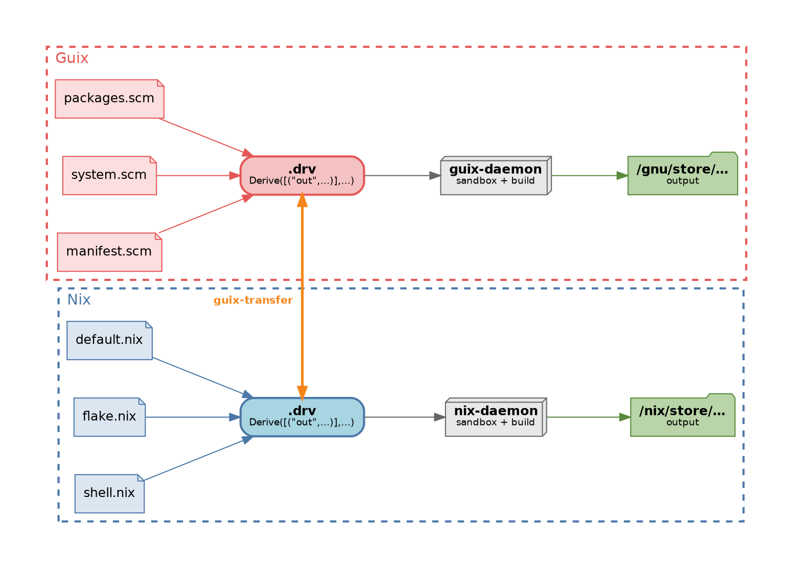

Nix and Guix look like rival ecosystems, but under the hood they're the same "Input  Output Machine".

Need proof? 🕵 How about we build a Guix derivation with Nix.

First let's create a super basic derivation in Guix: _Hello world_.

```console?comments=true
$ guix repl -- /dev/stdin <<'EOF'
  (use-modules (guix derivations) (guix store))
  (with-store %store
    (let ((drv (derivation %store "simple" "/bin/sh"
                           '("-c" "echo Hello World > $out")
                           #:env-vars '(("PATH" . "/bin"))
                           #:system "x86_64-linux")))
      (format #t "~a\n" (derivation-file-name drv))))
EOF
/gnu/store/zr0q11srv4yir8a6wrz582js7zsi17ij-simple.drv
```

We then ask Nix to build it. 🪄

We ask to use `/gnu/store` as the Nix store and have it write its state, database and log files in alternate directories, so it does not collide or mess with Guix.

> **Note**
> It's slightly more complicated. Nix happens to check its SQLite database for the derivation, so we need to register it first. The version of Guix (v1.5.0) I'm using leverages a `guix-daemon` user that runs inside a private mount namespace where `/gnu/store` is writable, but everyone else (including me) sees it as read-only. The `unshare --mount` creates a new private mount namespace so I can mount it as read-write and run the Nix command against it.
{: .alert .alert-note }

```
$ cat > /tmp/register.txt <<'EOF'
/gnu/store/zr0q11srv4yir8a6wrz582js7zsi17ij-simple.drv
822a79886102e5ca392cd14358aef0866c36ca526ff1b156f1ded2808a2095df
336

0
EOF

$ NIX_STORE=/nix/store/fla7gi1dvkw4hvwxar8m7z25p2yv7r40-nix-2.34.7/bin/nix-store

$ NIX_STORE_DIR=/gnu/store NIX_STATE_DIR=/tmp/nix-gnu/var/nix \
   $NIX_STORE --load-db < /tmp/register.txt

$ sudo unshare --mount bash -c '
mount -o remount,rw /gnu/store
su -s /bin/bash guix-daemon -c \
    "NIX_STORE_DIR=/gnu/store NIX_STATE_DIR=/tmp/nix-gnu/var/nix \
    NIX_LOG_DIR=/tmp/nix-gnu/var/log/nix \
    /nix/store/fla7gi1dvkw4hvwxar8m7z25p2yv7r40-nix-2.34.7/bin/nix-store \
    --realise /gnu/store/zr0q11srv4yir8a6wrz582js7zsi17ij-simple.drv"
'
warning: creating directory "/var/empty/.cache/nix": Permission denied
this derivation will be built:
  /gnu/store/zr0q11srv4yir8a6wrz582js7zsi17ij-simple.drv
building '/gnu/store/zr0q11srv4yir8a6wrz582js7zsi17ij-simple.drv'...
warning: you did not specify '--add-root'; the result might be removed by the garbage collector
/gnu/store/kd5szqbl9asz5hravhnxgd9plm4a9gzh-simple

$ cat /gnu/store/kd5szqbl9asz5hravhnxgd9plm4a9gzh-simple
Hello World
```

We just built a Guix derivation using Nix. 🔥

How is that possible?

Both take a language frontend, Nix or Guile (Scheme), that
compiles to a **derivation** (recipe) and pass that onto a **builder** (daemon) that executes it to produce an output.

What makes them both special is they both promise the same thing: **hermetic builds**. Everything needed to build the output is declared in the recipe: sources, environment variables, dependencies, etc.

> "Under Nix, a build process will only find resources that have been declared explicitly as dependencies. There’s no way it can build until everything it needs has been correctly declared. If it builds, you will know you’ve provided a complete declaration." -- [Nix OS Website](https://nixos.org/guides/how-nix-works/)


{: title="Guix Nix Overview"}


Guix, specifically the daemon, was forked from Nix early on, and as a result the two are very similar; they both share the same derivation format, [ATerm](https://nix.dev/manual/nix/2.25/protocols/derivation-aterm), for instance.

> Guix is based on the Nix package manager -- [Guix Website](https://guix.gnu.org/manual/devel/en/guix.html#Acknowledgments)

That's why our earlier example of building the Guix derivation with Nix was possible without much translation.

What if we could leverage an existing recipe from Guix in Nix in its traditional `/nix/store`?

If we could convert from one recipe file to the other, we could use the existing recipes from Guix in Nix and vice versa.

Turns out this is far more feasible than you would think, because _Guix is
Nix_ or at least a superset of it.

I, with the help of Claude, built a tool to do just that: [guix-transfer](https://github.com/fzakaria/guix-transfer) 🤯.

> **guix-transfer** is a CLI tool for performing bottom-up translation of GNU Guix derivations into Nix.

Confused? Let us see it in action:

```console?comments=true
# generate a Guix derivation
$ guix build hello --derivations
/gnu/store/2nfg943asrl9dv64zrr1a4kpb25mfafd-hello-2.12.2.drv

# translate it
$ /guix-transfer /gnu/store/2nfg943asrl9dv64zrr1a4kpb25mfafd-hello-2.12.2.drv
Loading Guix derivation graph from /gnu/store/2nfg943asrl9dv64zrr1a4kpb25mfafd-hello-2.12.2.drv ...
Loaded 228 derivations.
Translating bottom-up ...
[228/228] done
Done. Final Nix derivation:
/nix/store/brdd8zw3j9hhq8zf27ixqyi3l61nwppn-hello-2.12.2.drv
Realise it with: nix-store --realise --option filter-syscalls false /nix/store/brdd8zw3j9hhq8zf27ixqyi3l61nwppn-hello-2.12.2.drv

# build it with Nix
# this is a LONG multi-hour build since we build everything from source
$ nix-store --option filter-syscalls false --realise \
/nix/store/brdd8zw3j9hhq8zf27ixqyi3l61nwppn-hello-2.12.2.drv

$ /nix/store/j3940mdzr6qmw4ydhyla663s501vb8ns-hello-2.12.2/bin/hello
Hello, world!
```

> **Note**
> When you unpack a tarball, tar restores each file's original permissions, including setuid/setgid bits. Nix's sandbox installs a seccomp filter that blocks any `chmod` call that sets these bits, returning "Operation not permitted". Guix's early bootstrap uses a Scheme-based `tar` (gash-utils) that treats this error as fatal, unlike GNU tar which silently skips it. The fix is `--option filter-syscalls false`, which disables the filter.
{: .alert .alert-note }

If it's not clear what we just did: we took a Guix derivation and all of its dependencies (down to the bootstrap seeds), translated it to a Nix derivation, and built it with Nix. 😲

What is this <u>abomination</u> and how was this possible!?

It's important to revisit what a derivation is, and how it's used in Nix and Guix to better understand how this is possible. Let's look at the same basic derivation from earlier, _Hello World_.

> You might want to check out my other post on [Nix derivations by hand]() if this interests you 🤓.

```nix
derivation {
  name = "simple";
  builder = "/bin/sh";
  system = builtins.currentSystem;
  args = ["-c" ''
    echo "Hello World" > $out
  ''];
}
```

When we evaluate (nix-instantiate) this derivation, we get a path to a file that contains the derivation in the [ATerm](https://nix.dev/manual/nix/2.25/protocols/derivation-aterm) format:

```
$ nix-instantiate - << 'EOF'
derivation {
  name = "simple";
  builder = "/bin/sh";
  system = builtins.currentSystem;
  args = ["-c" ''
    echo "Hello World" > $out
  ''];
}
EOF
/nix/store/w4mcfbibhjgri1nm627gb9whxxd65gmi-simple.drv
```

If we look at the contents of the file, we can see the ATerm representation of the derivation:

```
Derive(
  [("out", "/nix/store/r4c710xzfqrqw2wd6cinxwgmh44l4cy2-simple", "", "")],
  [],
  [],
  "x86_64-linux",
  "/bin/sh",
  ["-c", "echo \"Hello World\" > $out\n"],
  [
    ("builder", "/bin/sh"),
    ("name", "simple"),
    ("out", "/nix/store/r4c710xzfqrqw2wd6cinxwgmh44l4cy2-simple"),
    ("system", "x86_64-linux")
  ]
)
```

This **has all the information** we need to build the output by the builder. At this point, it's really not Nix specific anymore. The same applies for the Guix derivations.

The derivations do not "know" whether they came from Scheme or Nix. It's a recipe. The insight then is if we rewrite the store paths from `/gnu/store` to `/nix/store`, and swap some builtins (i.e. `builtin:download` for `builtin:fetchurl`), we can get `nix-daemon` to build it *identically*. 💡

The only difference in more complex derivations is that they have dependencies, which are also derivations, and the builder references them so it forms a graph of derivations, each built by the builder in topological order.

The leaves of this tree for any non-trivial derivation are the bootstrap seeds: `gcc`, `awk`, `bash`, `tar` etc. Guix is famous for bootstrapping itself from **a 357-byte binary as source** [[ref](https://guix.gnu.org/manual/1.5.0/en/html_node/Full_002dSource-Bootstrap.html)]. Since at no point do the bootstrap seeds depend on `/gnu/store` being the prefix, the translated chain builds identically under Nix.

`guix-transfer` walks a Guix `.drv` graph in post-order and for each
derivation:

1. Guix's `builtin:download` is replaced with
   Nix's `builtin:fetchurl`. Same idea, different name.

2. Source files are added to the Nix store, with embedded
   `/gnu/store` paths rewritten to their `/nix/store` equivalents.

3. Every `/gnu/store` reference: input drvs, builder path, args,
   env vars are rewritten to the mapped `/nix/store` path.

4. Output paths are blanked as Nix recomputes them via
   [`hashDerivationModulo`](https://fzakaria.com/2025/10/29/nix-derivation-madness).

5. The result is serialised as JSON and registered with
   `nix derivation add`.

That's it. No Nix expressions are generated. No `stdenv`. No mapping
of Guix packages to nixpkgs equivalents. The Guix derivation graph is
translated *faithfully*, and `nix-daemon` builds it.

> **Note**
> Interestingly, `builtin:fetchurl` takes exactly one URL and cannot
fall back. Guix derivations carry lists of mirrors, many of which are
flaky or dead. Similar to Nix, Guix operates a content-addressed mirror
at `bordeaux.guix.gnu.org` that serves *any* source its CI has ever seen.
We leverage this for the `fetchurl` instead of the original source URL.
{: .alert .alert-note }

Now that we have a way to _slurp_ Guix packages into Nix, we can start to do some diabolical combinations by combining _native_ Nix and Guix packages together!

We can take our `hello` package we built in Nix and leverage it in a Nix derivation.

```nix
let
guixHello = /nix/store/...-hello-2.12.2;
in
derivation {
  name = "nix-hello-world";
  system = "x86_64-linux";
  builder = "/bin/sh";
  args = [ "-c" "echo \"$(${guixHello}/bin/hello) from Nix\" > $out" ];
}
```

Nix automatically scans your derivations for anything prefixed with `/nix/store` and tracks it as an input dependency. This is similar to how store paths are interpolated when you do something like `${pkgs.hello}/bin/hello`.

```console
$ nix-build --no-out-link hello-from-nix.nix

$ cat /nix/store/...-run-guix-hello
Hello, world! from Nix
```

If writing the `/nix/store` paths raw in the Nix expression is a little _too raw_ for you, we can build something more ergonic pretty easily as well.
`guix-transfer` has an `--emit-nix` mode that instead will emit the Nix expression for the translated `.drv`.

Let's look at a slightly more complex example that uses Guix's `guile` to build a derivation with dependencies:

```console?comments=true
$ guix repl -- /dev/stdin <<'EOF'
  (use-modules (guix derivations) (guix store) (guix packages)
               (gnu packages bootstrap))
  (with-store store
    (let* ((guile-drv (package-derivation store %bootstrap-guile))
           (guile-out (derivation->output-path guile-drv))
           (drv (derivation store "demo" (string-append guile-out "/bin/guile")
                            `("--no-auto-compile" "-c"
                              ,(string-append
                                 "(call-with-output-file (getenv \"out\") "
                                 "  (lambda (p) (display \"Hello from Guix!\\n\" p)))"))
                            #:inputs (list (derivation-input guile-drv))
                            #:system "x86_64-linux")))
      (format #t "~a\n" (derivation-file-name drv))))
EOF

$ guix build /gnu/store/fln2d17fyqka3gafcdqyhfyl1nzml5jn-demo.drv
successfully built /gnu/store/fln2d17fyqka3gafcdqyhfyl1nzml5jn-demo.drv
/gnu/store/l66zvywi60ljhk3kwwaay156cgsc2ahg-demo

$ cat /gnu/store/l66zvywi60ljhk3kwwaay156cgsc2ahg-demo
Hello from Guix!
```

We can now convert this to a Nix expression with `guix-transfer`.

```console
$ guix-transfer /gnu/store/fln2d17fyqka3gafcdqyhfyl1nzml5jn-demo.drv --emit-nix /tmp/demo.nix
...
Realise it with: nix-store --realise --option filter-syscalls false /nix/store/fkj4vz6vs85s2x3dwhg5ysfwyr8rv4a5-demo.drv
Emitted Nix expression: /tmp/demo.nix
```

We realise the derivation with `nix-store --realise` or we can `nix-build` the Nix expression. Please notice that both **produce the exact same hash**: `/nix/store/rq5bc9crsg1hrr7afllzjgi7z8bl21zy-demo`.

```console
$ nix-build /tmp/demo.nix
/nix/store/rq5bc9crsg1hrr7afllzjgi7z8bl21zy-demo

$ nix-store --realise --option filter-syscalls false /nix/store/zgwdbfpigl8cwy5d85p0rdcl21x3bszm-demo.drv
/nix/store/rq5bc9crsg1hrr7afllzjgi7z8bl21zy-demo

$ cat /nix/store/rq5bc9crsg1hrr7afllzjgi7z8bl21zy-demo
Hello from Guix!
```

We can now use this Guix derivation like any normal Nix expression, such as the ones you might encounter in Nixpkgs.

```nix
let
  guixDemo = import /tmp/demo.nix;
in
derivation {
  name = "use-guix-demo";
  system = "x86_64-linux";
  builder = "/bin/sh";
  args = [ "-c" "echo \"Nix says: $(cat ${guixDemo})\" > $out" ];
}
```

That means we could even build a `flake` that is all of Guix packages available for use.

```nix
{
  outputs = { self }: {
    packages.x86_64-linux.demo = import ./demo.nix;
  };
}
```

My mind is blown. 🤯

[Nixpkgs](https://github.com/nixos/nixpkgs) is known as the world's largest package repository, and now we have made a way for it suddenly to become even larger by borrowing **any** derivation from Guix!

The real _power_ behind Nix are the derivations and that they are hermetic, declaring any dependency needed. We've seen that we can transfer these recipes to any _store-based_ system that has similar qualities and preserve the reproducibility.
