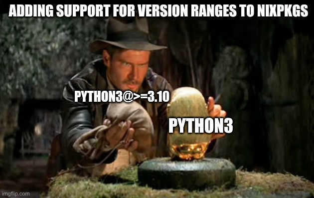
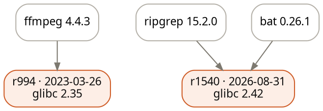
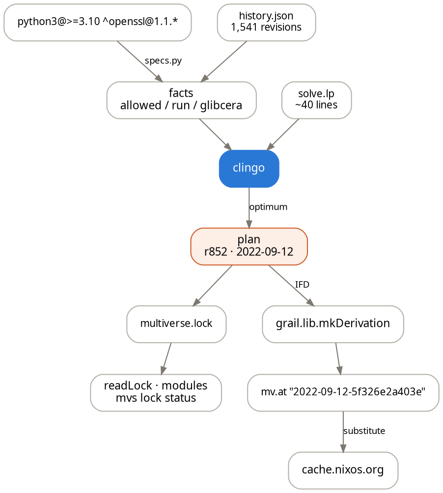

> **Update**
> You can try this live at [fzakaria.github.io/grail](https://fzakaria.github.io/grail/) and query nixpkgs version ranges in your browser, the same solver, compiled to WebAssembly.
{: .alert .alert-note }

Ever since I launched [nixmultiverse.com](https://nixmultiverse.com/), I knew there were so many possibilities to explore. One of the most exciting is the ability to ask questions about the history of nixpkgs that were previously impossible to answer.

I added some basic support for this type of introspection in the `mvs` tool that I demonstrated in [a previous post](): figuring out the minimum number of nixpkgs to satisfy a set of package exact version constraints. The real magic happens when you can ask questions about _version ranges_. 🧙

Nixpkgs is a _versionless_ package manager. Every attribute has one version, and that version is whatever the revision you happen to be on says it is. This is a great design for simplicity, sometimes it 
comes at a cost though of compatibility.

What would it take to add version range support to Nixpkgs?



_nixpkgs has never had version ranges until now!_  😈

```console?comments=true
# one revision where BOTH constraints were simultaneously true
$ grail solve 'python3@>=3.10 ^openssl@1.1.*'
1 revision
  2022-09-12-5f326e2a403e  (2022-09-12, r852)
    python3 3.10.6
    openssl 1.1.1q
  glibc: 2.35
```


```nix
grail.lib.${system}.mkDerivation {
  pname = "demo";
  specs = "python3@>=3.10 ^openssl@1.1.*";
  dontUnpack = true;
  installPhase = ''
    { python3 --version; openssl version; } | tee $out
  '';
}
```

This example was thought to be _inexpressible_ in nixpkgs. Nixpkgs has effectively one version per attribute, so there is nothing to range over. This is why Nix does not need a dependency solver: a solver picks among versions, and there are simply no versions to select.

If we want to reliably build software as the original author intended though, it helps to provide the author with the ability to express a range of versions that are known to work. This is the "holy grail" of nixpkgs: version ranges.

Nearly all other packaging ecosystem include support for version ranges (i.e. npm, cargo, pip). Surprisingly, even _store-based_ package managers similar to Nix have version ranges. [Spack](https://spack.io/) is the most well-known example of this, and it is a _store-based_ package manager for HPC. Spack has a rich spec language, which I will copy, that allows you to express constraints for its package recipes.[^spack-paper] 

[^spack-paper]: They wrote a great paper about it ["Using Answer Set Programming for HPC Dependency Solving"](https://arxiv.org/abs/2210.08404), which was presented at SuperComputing 2022 the same year I presented ["Mapping Out the HPC Dependency Chaos"](https://arxiv.org/abs/2211.05118). The BDFL of Spack, Todd Gamblin, was also on my dissertation committee.

> **Spoiler**
> For those geeks 🤓 who are already thinking "What about libc compatability!?" and thinking this will end in despair, fear not!
> Spack has a `libc_compatibility.lp` that helps their solver reason about the compatibility of different glibc versions. Keep reading to find out more.
{: .alert .alert-tip }


The inclusion of [nixpkgs-multiverse]() un-deleted every version from Nixpkgs. 309,000+ package-versions across 1,541 revisions of nixos-unstable, nearly every one of them a cache hit. The moment versions became a _choice_, solving became a real possibility. I get to hand Nix the solver it thought it never needed. 😈


## grail

The multiverse already solves exact pins, and [provably well](#pins-are-intervals) in O(n log n).
However it had some caveats to the solution. In order to solve version ranges, the problem
becomes a boolean satisfiability problem and therefore NP-hard. Time for a real solver!

[grail](https://github.com/fzakaria/grail) is a small query language tied to a solver. The grammar is shamelessly Spack-flavored: `@` takes a range, and `^` chains constraints into a _coexistence group_, meaning they must resolve at one shared revision.

A quick primer on the query language:

| sigil | example | meaning |
| --- | --- | --- |
| `@` | `python3@>=3.10` | attach a version range to an attribute; a bare attr means any version |
| `>=` `>` `<=` `<` `=` | `ripgrep@>=14` | compare in `builtins.compareVersions` order |
| bare version, `.x`, `.*` | `openssl@1.1.*` | component-wise prefix: `3.8` accepts 3.8.9, refuses 3.81 |
| `..` | `python3@3.10..3.12` | inclusive interval; the upper end is prefix-inclusive, so 3.12.4 stays |
| `,` | `@>=3.9,<3.12` | logical and: every term must hold |
| <code>&#124;&#124;</code> | <code>@4.*&#124;&#124;5.*</code> | logical or: either side may hold |
| `^` | `a@1 ^b@2` | coexistence: chain onto the previous spec, one shared revision serves the whole group |
| whitespace | `a@1 b@2` | independent specs; the solver still merges them onto one revision when it can |

The grammar's BNF can be found at [docs/grammar.md](https://github.com/fzakaria/grail/blob/main/docs/grammar.md). There is also support for _date ranges_ and _glibc eras_ via `--one-glibc`.

```console?comments=true
# independent constraints: minimized across revisions
$ grail solve 'ffmpeg@4.* ripgrep@>=14'

# a coexistence group: one revision serves all of it
$ grail solve 'python3@>=3.10 ^nodejs@>=20 ^go@>=1.21 ^ruby@>=3.2'
1 revision
  2026-08-31-34ab99075ac4  (2026-08-31, r1540)
    python3 3.14.7
    nodejs 24.19.0
    go 1.26.7
    ruby 3.4.9
  glibc: 2.42
```

You can visualize the SAT solver's plan with `--viz`.
Here is `ffmpeg@4.* ripgrep@>=14 ^bat`: the solver merges ripgrep and bat
onto the tip and gives ffmpeg 4 its own 2023 world:

```console
$ grail solve 'ffmpeg@4.* ripgrep@>=14 ^bat' --viz plan.svg
```


{: title="the solved plan drawn by clingraph: ripgrep and bat share the tip revision, ffmpeg 4 gets its own 2023 revision" style="--graphviz-height: 7.5rem"}

The SAT solver I used also dutifully tells me when a set of constraints is unsatisfiable, and why with a surprising amount of detail:

```console
$ grail solve 'python3@3.8.* ^postgresql@13.*'
unsatisfiable: python3@3.8.* and postgresql@13.* never overlapped:
python3@3.8.* was last alive 2021-07-18 (r621),
postgresql@13.* first alive 2021-08-01 (r625)
```

So for python 3.8 and postgresql 13 no single Nixpkgs revision can satisfy both constraints as known to the [nixmultiverse.com](https://nixmultiverse.com/) index.

The earlier opening query, `python3@>=3.10 ^openssl@1.1.*`, was satisified though. Drawing its lifetimes against the full index shows how. The shaded band is the overlap of 88 days.

<figure>
<svg class="grail-lifetimes" viewBox="0 0 760 387" width="760" height="387" role="img"
     style="display:block;margin-inline:auto"
     aria-label="version lifetimes of python3 and openssl in nixos-unstable with the coexistence window shaded">
<style>
  .grail-lifetimes { font-family: var(--mono, "JetBrains Mono", ui-monospace, Menlo, Consolas, monospace); }
  .grail-lifetimes text { font-size: 10px; fill: var(--ink-muted, #565046); }
  .grail-lifetimes .head { font-size: 11px; font-weight: 600; fill: var(--ink, #1a1815); }
  .grail-lifetimes .grid { stroke: var(--rule, #dcd5c5); stroke-width: 1; }
  .grail-lifetimes .ctx { fill: var(--ink-faint, #6f685b); opacity: .55; }
  .grail-lifetimes .hit { fill: #2a78d6; }
  .grail-lifetimes .win { fill: #cf5d28; opacity: .16; }
  .grail-lifetimes .wtext { fill: #cf5d28; font-size: 10px; }
</style>
<line class="grid" x1="88.2" y1="38" x2="88.2" y2="365"/>
<text x="88.2" y="381" text-anchor="middle">2013</text>
<line class="grid" x1="184.1" y1="38" x2="184.1" y2="365"/>
<text x="184.1" y="381" text-anchor="middle">2015</text>
<line class="grid" x1="280.2" y1="38" x2="280.2" y2="365"/>
<text x="280.2" y="381" text-anchor="middle">2017</text>
<line class="grid" x1="376.1" y1="38" x2="376.1" y2="365"/>
<text x="376.1" y="381" text-anchor="middle">2019</text>
<line class="grid" x1="472.2" y1="38" x2="472.2" y2="365"/>
<text x="472.2" y="381" text-anchor="middle">2021</text>
<line class="grid" x1="568.1" y1="38" x2="568.1" y2="365"/>
<text x="568.1" y="381" text-anchor="middle">2023</text>
<line class="grid" x1="664.2" y1="38" x2="664.2" y2="365"/>
<text x="664.2" y="381" text-anchor="middle">2025</text>
<rect class="win" x="542.3" y="38" width="11.2" height="327"/>
<text class="wtext" x="534.3" y="50" text-anchor="end">both hold: 2022-06-19 → 2022-09-12</text>
<rect class="hit" x="64" y="16" width="18" height="7" rx="3.5"/>
<text x="88" y="24">matches the constraint</text>
<rect class="ctx" x="274" y="16" width="18" height="7" rx="3.5"/>
<text x="298" y="24">other versions</text>
<text class="head" x="4" y="48">python3</text>
<text x="56" y="66" text-anchor="end">3.14</text>
<rect class="hit" x="736.8" y="60" width="7.1" height="7" rx="3.5"/>
<text x="56" y="83" text-anchor="end">3.13</text>
<rect class="hit" x="686.4" y="77" width="50.1" height="7" rx="3.5"/>
<text x="56" y="100" text-anchor="end">3.12</text>
<rect class="hit" x="640.9" y="94" width="45.2" height="7" rx="3.5"/>
<text x="56" y="117" text-anchor="end">3.11</text>
<rect class="hit" x="607.0" y="111" width="33.2" height="7" rx="3.5"/>
<text x="56" y="134" text-anchor="end">3.10</text>
<rect class="hit" x="542.3" y="128" width="64.0" height="7" rx="3.5"/>
<text x="56" y="151" text-anchor="end">3.9</text>
<rect class="ctx" x="498.6" y="145" width="43.6" height="7" rx="3.5"/>
<text x="56" y="168" text-anchor="end">3.8</text>
<rect class="ctx" x="445.9" y="162" width="52.3" height="7" rx="3.5"/>
<text x="56" y="185" text-anchor="end">3.7</text>
<rect class="ctx" x="372.3" y="179" width="73.5" height="7" rx="3.5"/>
<text x="56" y="202" text-anchor="end">3.6</text>
<rect class="ctx" x="299.6" y="196" width="70.6" height="7" rx="3.5"/>
<text x="56" y="219" text-anchor="end">3.5</text>
<rect class="ctx" x="267.2" y="213" width="31.8" height="7" rx="3.5"/>
<text x="56" y="236" text-anchor="end">3.3</text>
<rect class="ctx" x="100.0" y="230" width="28.0" height="7" rx="3.5"/>
<text x="56" y="253" text-anchor="end">3.2</text>
<rect class="ctx" x="64.5" y="247" width="31.4" height="7" rx="3.5"/>
<text class="head" x="4" y="296">openssl</text>
<text x="56" y="314" text-anchor="end">3.x</text>
<rect class="ctx" x="553.6" y="308" width="190.3" height="7" rx="3.5"/>
<text x="56" y="331" text-anchor="end">1.1.x</text>
<rect class="hit" x="406.9" y="325" width="7.0" height="7" rx="3.5"/>
<rect class="hit" x="407.1" y="325" width="146.4" height="7" rx="3.5"/>
<text x="56" y="348" text-anchor="end">1.0.x</text>
<rect class="ctx" x="64.5" y="342" width="342.2" height="7" rx="3.5"/>
<rect class="ctx" x="406.9" y="342" width="7.0" height="7" rx="3.5"/>
</svg>
</figure>

## A five-minute tour of ASP

The SAT solver used is [Answer Set Programming](https://en.wikipedia.org/wiki/Answer_set_programming) (ASP), specifically [clingo](https://potassco.org/clingo/).

Answer Set Programming looks like Prolog but thinks like SAT. You write facts, rules, and constraints; clingo grounds them and searches for _stable models_: assignments where everything holds. 

The facts are just rows, emitted from the multiverse's `history.json` for only the attrs the query names:

```prolog
% s0 is the first spec of the query: python3@>=3.10
attrname(s0, "python3").
% passed the range; 47 = compareVersions rank
allowed(s0, "3.10.6", 47).
% one lifetime run, in revision offsets
run(s0, "3.10.6", 835, 864).
% glibc 2.35 reigned over r824..r1005
glibcera(9, 824, 1005).
```

After we've encoded our facts, we write rules to express the constraints and the policy.


```prolog
% choice rule: pick exactly one allowed version per spec
1 { pick(S, V) : allowed(S, V, _) } 1 :- spec(S).

% choice rule: park each coexistence group at one candidate revision
1 { at(G, R) : possible(G, R) } 1 :- group(G, _).

% integrity constraint: kill every model where a member's picked
% version was not alive at the group's chosen revision
:- at(G, R), group(G, S), pick(S, V), not alive(S, V, R).

% the policy, highest priority (@4) first
% fewest revisions
#minimize { 1@4, R : used(R) }.
% then newest versions
#maximize { K@3, S : pick(S, V), allowed(S, V, K) }.
% then fewest glibc eras
#minimize { 1@2, K : usedglibc(K) }.
% then freshest builds
#maximize { R@1, G : at(G, R) }.
```

> **Note**
> LLMs are great at writing ASP, and which point we can leverage the
> tool itself to verifiably prove the correctness of the solver.
{: .alert .alert-note }

We only need to put facts for the attrs the query requested so it keeps the solver's length and runtime reasonable (sub second).[^inspired]

[^inspired]: The ASP encoding is inspired by [Spack](https://spack.io), which uses the same clingo solver to reason about version ranges but to solve the complete dependency graph.

## It's just a lock file

`grail lock` writes a `multiverse.lock` file for the solved constraints that can be used by [nixpkgs-multiverse](https://github.com/fzakaria/nixpkgs-multiverse).

Everything downstream through `mvs` works because the lock file format is the same: `readLock`, the NixOS/darwin/home-manager modules, `mvs lock status`.

```console?comments=true
$ grail lock 'python3@>=3.10 ^openssl@1.1.*'
wrote multiverse.lock (1 group(s), 1 revision(s))

# the real mvs, reading a lock a different tool wrote
$ mvs lock status
ATTR     PINNED  LATEST  BEHIND
openssl  1.1.1q  3.6.3   17 versions, 1449 days
python3  3.10.6  3.14.7  29 versions, 1449 days
```

## mkDerivation with version ranges

What about just specifing the version ranges **directly in the derivation**?

The resolver is itself a derivation: clingo runs inside the build sandbox, the plan comes back into eval by [import-from-derivation](https://nix.dev/manual/nix/2.31/language/import-from-derivation), and multiverse's [`mv.at`](https://nixmultiverse.com/docs/nix-api#nested-attributes-are-one-key) materialises the chosen nixpkgs.

```nix
grail.lib.${system}.mkDerivation {
  pname = "demo";
  specs = "python3@>=3.10 ^openssl@1.1.*";
  dontUnpack = true;
  installPhase = ''
    { python3 --version; openssl version; } | tee $out
  '';
}
```

```console?comments=true
$ nix build github:fzakaria/grail#demo
$ cat result
Python 3.10.6
OpenSSL 1.1.1q  5 Jul 2022
glibc ldd (GNU libc) 2.35
```

Every input can be substituted from [cache.nixos.org](https://cache.nixos.org) because [nixmultiverse.com](https://nixmultiverse.com/) indexes Hydra built channel bumps only.

The derivation didn't pin any Nixpkgs; it stated constraints, and a solver chose one specifically.


{: title="the grail pipeline from query to facts to clingo to plan to lock and mkDerivation" style="--graphviz-height: 24.7rem"}

## What about glibc?

A "coexistence group", the `^` sigil, takes its `stdenv` from the single revision, so compiler, glibc and inputs are a single coherent world. This is the traditional Nixpkgs model and it is the safe default.

Mixing revisions in one _build_ is where dragons live. If done carelessly, you can end up with two different glibc versions in one process.


Thankfully, for the non-Nix users who don't have such puritanical desires, `glibc` is backward compatible through symbol versioning: an object demanding at most `GLIBC_2.27` links happily against 2.38.
Every binary includes a friendly note in its `.gnu.version_r` section that says exactly what minimium version it supports.

`grail` ships an extractor that turns them into facts:

```console?comments=true
$ elf_facts.py $(readlink -f $(command -v python3)) python3
needs("python3", "libc.so.6").
verneed("python3", "libc.so.6", "GLIBC_2.2.5").
verneed("python3", "libc.so.6", "GLIBC_2.34").
interp("python3", "/nix/store/...-glibc-2.40-224/lib/ld-linux-x86-64.so.2").
% max glibc demand: GLIBC_2.34
```

This encodes the fact that `python3` was linked against glibc 2.40, but _demands_ at most 2.34. The solver can reason about this fact and mix it into any world back to 2021, six eras earlier than its `RUNPATH` admits.[^spack-libc]

[^spack-libc]: Spack's `libc_compatibility.lp` encodes the forward version of this rule for reusing binaries against a host libc; `grail` points the same idea backward through the multiverse's fourteen years of history.

Discovering this glibc minimum is surprisingly tractable. Computing these facts is cheaper than it sounds. A store path is immutable, so any fact about it is computed once and cached forever. The coarse fact is already free: a narinfo's `References` names the glibc a path was linked against  which the multiverse has already crawled.
The `.gnu.version_r` fact is a few MiB of streamed NAR that can be fetched on demand only when the solver needs it.

## Where this goes

I have been exploring the space through the separate utility [grail](https://github.com/fzakaria/grail) but the next step once I have settled on the user experience is to integrate it into [nixmultiverse.com](https://nixmultiverse.com/).

I can even integrate the solver into the website, [nixmultiverse.com](https://nixmultiverse.com/), directly since [clingo](https://github.com/potassco/clingo) can compile to WebAssembly. A solver page where "when did these five things last coexist?" can be a URL query 🤯.

[Spack](https://spack.io/) has shown that we need not fear version ranges. Yes, there _may be dragons_, but that has always been the case for Nixpkgs. Expert tools are sharp and can cut you but they can also bestow great power.

I have just re-introduced my own personal hell onto Nixpkgs: [the diamond dependency problem](), but at least I have the tools to reason about it.

The code is at [github.com/fzakaria/grail](https://github.com/fzakaria/grail), go forth and explore the multiverse of Nixpkgs!