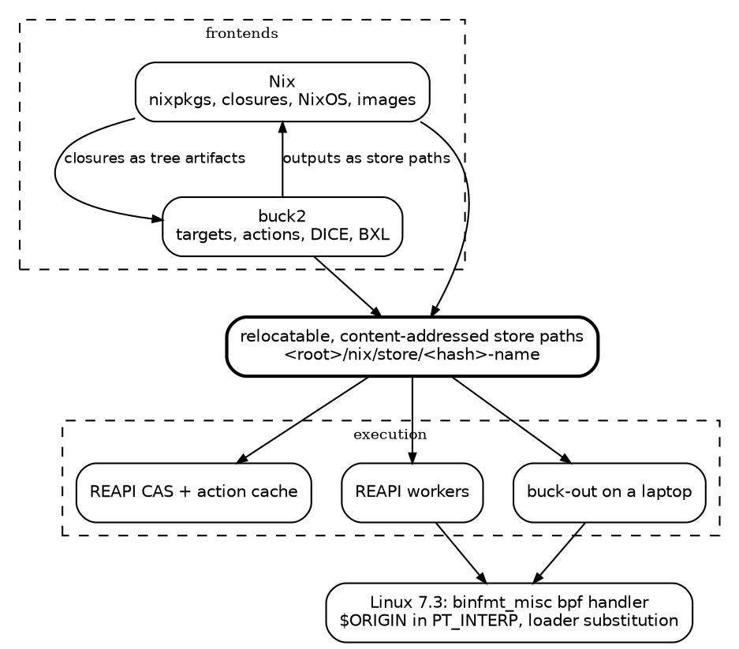

One of the big ideas I think the Nix community should pursue is [relocatable binaries](). I put my money where my mouth is and collaborated with the VFS Linux maintainer [Christian Brauner](https://brauner.io/) to get `$ORIGIN` support in `PT_INTERP` and the shebang via EBPF 🐝. That work is in Linux 7.3 which is about to be released.

Despite the amazing potential this unlocks, I found few to be as enthusiastic as I was. Instead of excitement, I was met with skepticism: _"What's the point beyond it being a cool technical trick?"_

First off, _"The pursuit of excellence does not need justification."_ by [Mitchell Hashimoto](https://x.com/mitchellh/status/2074225453217505494?lang=en) should be enough.

There is however a very practical reason to pursue relocatable binaries: it allows Nix to be a package set for other build systems, specifically Bazel and buck2. The two frontends can share the same store, and the machine doing the compiling does not need to have Nix installed.

# The wall

The integration of Nix and buck2 or Bazel is not novel or new. Many have tried and most have failed, or have seen mixed success.


[rules_nixpkgs](https://www.tweag.io/blog/2024-02-29-remote-execution-rules-nixpkgs/)
: Brings nixpkgs toolchains to Bazel and has been incompatible with remote execution since 2022.

[buck2.nix](https://tweag.io/blog/2025-07-31-buck2-nix/)
: Brings nixpkgs toolchains to buck2 as symlinks into the local store, which works on exactly one machine.

[Snowydeer](https://github.com/MercuryTechnologies/snowydeer)
: Imports buck2 outputs into Lix as content-addressed store paths, scanning the NAR for hash parts to recover the references.

The wall they all face is that a nixpkgs output is pinned to `/nix/store` by three absolute strings: the `RUNPATH` the loader reads, the `PT_INTERP` the kernel reads, and the symlinks that point at siblings.

A remote executor has none of those paths. you either ship the whole closure inside the executor image, mount the store over the network, or `chroot` every action into a fake root.

[](/assets/images/galaxy_brain_relocatable_meme.png)
{: style="--image-width: 20rem"}


They all work but have unfortunate side effects. A new compiler version means a new executor image. An NFS mount means a shared filesystem under a system whose entire design is that it does not need one. Requiring `chroot` for a worker means that Nix is now a leaky abstraction.

Relocatable binaries gets rid of the wall by circumventing the problem entirely. 🤯

# A closure is a layout, not a location

Absolute paths are not necessary and we can make them relative. It requires work to find all the places a path is baked in, but this is the plight of a Nix enthusiast: we patch and fix the world.

`RUNPATH`
: Already supports relative paths; the loader expands `$ORIGIN` to the directory of the executable.

`PT_INTERP`
: Linux 7.3 supports a `binfmt_misc` handler written in BPF that replaces `$ORIGIN` in the interpreter to the directory of the executable.

[](/assets/images/panik_kalm_panik_pt_interp_meme.png)
{: style="--image-width: 18rem"}


When we make all absolute paths relative, a beautiful thing happens:
the directory `nix/store/<hash>-name` stops being an address and becomes a _shape_. 

We can put the shape under `/`, you have a Nix store. If we put it under `buck-out/v2/gen/toolchains/…/closure/`, you have a toolchain artifact. If we put it under a remote worker's input root, you have an action that runs.

It is the same beauty of what made Nix hermetic but taken to the next maximum: the shape is now relocatable. The same bytes can be in many places at once, and the loader and kernel do not care which one they are in.

<figure>
<a href="/assets/images/one_store_tree.svg" class="graphviz-full" draggable="false" title="Open this diagram on its own">
<svg viewBox="0 0 760 400" role="img" xml:space="preserve"
     style="display:block;margin-inline:auto;width:100%;height:auto;font-family:var(--mono)"
     aria-label="A file tree. Under an unnamed root: nix/store, containing gcc, glibc and gmp. gcc's bin/gcc has PT_INTERP $ORIGIN/../../glibc/lib/ld-linux-x86-64.so.2 and RUNPATH $ORIGIN/../../glibc/lib; both arrows land inside the sibling glibc directory. cc1, five levels deeper in libexec, has RUNPATH $ORIGIN/../../../../../gmp/lib, and its arrow lands inside the sibling gmp directory. The root is labelled: slash, or buck-out/…/closure/, or an action's input root: the same shape.">
  <style>
    .tr-t { font-size: 12.5px; fill: var(--ink, #1a1815); white-space: pre; }
    .tr-m { font-size: 11px; fill: var(--ink-muted, #565046); }
    .tr-o { fill: var(--accent, #9e3413); font-weight: bold; }
    .tr-a { stroke: var(--accent, #9e3413); stroke-width: 1.25; fill: none; }
    .tr-hit { fill: var(--accent-wash, #9e34131f); }
  </style>
  <defs>
    <marker id="tr-arrow" viewBox="0 0 10 10" refX="9" refY="5" markerWidth="6" markerHeight="6" orient="auto-start-reverse">
      <path d="M0,0 L10,5 L0,10 z" fill="var(--accent, #9e3413)"/>
    </marker>
  </defs>

  <text class="tr-t" x="20" y="30">&lt;root&gt;/</text>
  <text class="tr-m" x="100" y="30">= /  or  buck-out/…/closure/  or  an input root</text>
  <text class="tr-t" x="20" y="52">└── nix/store/</text>
  <text class="tr-t" x="20" y="74">    ├── 5q6bdx…-gcc-16.2.0/</text>
  <text class="tr-t" x="20" y="96">    │   ├── bin/gcc</text>
  <text class="tr-t" x="20" y="118">    │   │     PT_INTERP  <tspan class="tr-o">$ORIGIN</tspan>/../../h4wfwi…-glibc-2.44-25/lib/ld-linux-x86-64.so.2</text>
  <text class="tr-t" x="20" y="140">    │   │     RUNPATH    <tspan class="tr-o">$ORIGIN</tspan>/../../h4wfwi…-glibc-2.44-25/lib</text>
  <text class="tr-t" x="20" y="162">    │   └── libexec/gcc/x86_64-unknown-linux-gnu/16.2.0/cc1</text>
  <text class="tr-t" x="20" y="184">    │         RUNPATH    <tspan class="tr-o">$ORIGIN</tspan>/../../../../../85lj8x…-gmp-6.3.0/lib:…</text>

  <rect class="tr-hit" x="44" y="192" width="230" height="86" rx="3"/>
  <text class="tr-t" x="20" y="206">    ├── h4wfwi…-glibc-2.44-25/</text>
  <text class="tr-t" x="20" y="228">    │   └── lib/</text>
  <text class="tr-t" x="20" y="250">    │       ├── ld-linux-x86-64.so.2</text>
  <text class="tr-t" x="20" y="272">    │       └── libc.so.6</text>

  <rect class="tr-hit" x="44" y="280" width="230" height="46" rx="3"/>
  <text class="tr-t" x="20" y="294">    └── 85lj8x…-gmp-6.3.0/</text>
  <text class="tr-t" x="20" y="316">        └── lib/libgmp.so.10</text>

  <!-- $ORIGIN of gcc is bin/; two steps up is nix/store/; then into the sibling -->
  <path class="tr-a" marker-end="url(#tr-arrow)" d="M 672 114 C 748 114, 748 250, 312 250"/>
  <path class="tr-a" marker-end="url(#tr-arrow)" d="M 514 136 C 700 136, 700 228, 196 228"/>
  <!-- cc1 is five deep, so five steps up -->
  <path class="tr-a" marker-end="url(#tr-arrow)" d="M 574 180 C 724 180, 724 316, 312 316"/>
</svg>
</a>
</figure>

# Two frontends

Once a closure is a shape, the two build systems stop competing for the same job. 👏

Everyone loves Nix for its replicability but are furstrated by the needless rebuilds due to the input-address (extensional) model.

On the other hand, tools like buck2 and Bazel only allow content-addressed (intensional) inputs,. Coupled with a fine-grained action graph, this allows for incremental builds and remote execution, but they don't truly model the world of packages and their dependencies, which is where Nix excels.

Each has spent years badly imitating the other. Buck2 users hand-roll toolchain downloads; Nix users wait for a whole derivation to rebuild because one file changed.

What if Nix and buck2 could _natively_ share the same store?



Nix could provide buck2 a closure, and buck2 would treat it like any other input. On the way out, buck2 hands Nix the name of an output, and Nix fetches it like any other store path.

The "store" in the middle is not a daemon or a filesystem. It is an agreement about layout. One build, seen through that agreement:

<figure>
<a href="/assets/images/one_store_flow.svg" class="graphviz-full" draggable="false" title="Open this diagram on its own">
<svg viewBox="0 0 820 400" role="img"
     style="display:block;margin-inline:auto;width:100%;height:auto;font-family:var(--mono)"
     aria-label="An animated data-flow diagram. On the host, the gcc closure in /nix/store is declared to buck2 by its digest and uploaded to a content-addressed store if it is not there already. A remote worker fetches it into an action's input root, the kernel resolves gcc's $ORIGIN interpreter, gcc runs and links hello. hello is uploaded to the content-addressed store. buck2 reports its digest to the host, and Nix substitutes /nix/store/&lt;D&gt;-hello straight out of that store, with glibc recorded as a reference.">
  <style>
    .fl-box { fill: var(--paper-raised, #ebe6da); stroke: var(--rule-strong, #c2b9a6); stroke-width: 1; }
    .fl-cas { fill: var(--accent-wash, #9e34131f); stroke: var(--accent, #9e3413); stroke-width: 1; }
    .fl-t { font-size: 12.5px; fill: var(--ink, #1a1815); }
    .fl-m { font-size: 10.5px; fill: var(--ink-muted, #565046); }
    .fl-h { font-size: 10px; fill: var(--ink-faint, #6f685b); letter-spacing: .08em; }
    .fl-edge { stroke: var(--ink-faint, #6f685b); stroke-width: 1; fill: none; }
    .fl-dot-tc { fill: var(--accent, #9e3413); }
    .fl-dot-out { fill: var(--ink, #1a1815); }
    .fl-kernel { fill: none; stroke: var(--accent, #9e3413); stroke-width: 2; }
    @keyframes fl-flash { 0%, 100% { opacity: 0 } 50% { opacity: 1 } }
    @media (prefers-reduced-motion: reduce) { .fl-dot { display: none } .fl-kernel { opacity: .6 } }
  </style>
  <defs>
    <marker id="fl-arrow" viewBox="0 0 10 10" refX="9" refY="5" markerWidth="6" markerHeight="6" orient="auto-start-reverse">
      <path d="M0,0 L10,5 L0,10 z" fill="var(--ink-faint, #6f685b)"/>
    </marker>
    <path id="fl-p1" d="M140 90 L140 130"/>
    <path id="fl-p2" d="M260 155 L360 155"/>
    <path id="fl-p3" d="M460 85 L560 85"/>
    <path id="fl-p4" d="M680 110 L680 150"/>
    <path id="fl-p5" d="M680 200 L680 240"/>
    <path id="fl-p6" d="M560 265 L460 265"/>
    <path id="fl-p7" d="M360 265 L260 265"/>
    <path id="fl-p8" d="M360 355 L260 355"/>
  </defs>

  <text class="fl-h" x="140" y="22" text-anchor="middle">HOST</text>
  <text class="fl-h" x="410" y="22" text-anchor="middle">CAS</text>
  <text class="fl-h" x="680" y="22" text-anchor="middle">WORKER</text>

  <!-- host -->
  <rect class="fl-box" x="20" y="40" width="240" height="50" rx="4"/>
  <text class="fl-t" x="140" y="60" text-anchor="middle">/nix/store/&lt;h&gt;-gcc-16.2.0</text>
  <text class="fl-m" x="140" y="76" text-anchor="middle">nixpkgs, relocatable</text>

  <rect class="fl-box" x="20" y="130" width="240" height="50" rx="4"/>
  <text class="fl-t" x="140" y="150" text-anchor="middle">toolchain closure</text>
  <text class="fl-m" x="140" y="166" text-anchor="middle">&lt;h&gt;-gcc, declared by digest</text>

  <rect class="fl-box" x="20" y="240" width="240" height="50" rx="4"/>
  <text class="fl-t" x="140" y="260" text-anchor="middle">buck2 build //:hello</text>
  <text class="fl-m" x="140" y="276" text-anchor="middle">learns digest D; downloads nothing</text>

  <rect class="fl-box" x="20" y="330" width="240" height="50" rx="4"/>
  <text class="fl-t" x="140" y="350" text-anchor="middle">/nix/store/&lt;D&gt;-hello</text>
  <text class="fl-m" x="140" y="366" text-anchor="middle">references: &lt;h&gt;-glibc-2.44-25</text>

  <!-- cas -->
  <rect class="fl-cas" x="360" y="40" width="100" height="340" rx="4"/>
  <text class="fl-t" x="410" y="200" text-anchor="middle">content-</text>
  <text class="fl-t" x="410" y="214" text-anchor="middle">addressed</text>
  <text class="fl-m" x="410" y="230" text-anchor="middle">by digest</text>

  <!-- worker -->
  <rect class="fl-box" x="560" y="60" width="240" height="50" rx="4"/>
  <text class="fl-t" x="680" y="80" text-anchor="middle">input root/buck-out/…/closure/</text>
  <text class="fl-m" x="680" y="96" text-anchor="middle">nix/store/&lt;h&gt;-gcc  (same bytes)</text>

  <rect class="fl-box" x="560" y="150" width="240" height="50" rx="4"/>
  <rect class="fl-kernel fl-dot" x="558" y="148" width="244" height="54" rx="5" style="animation: fl-flash 8s linear infinite; animation-delay: 3.6s"/>
  <text class="fl-t" x="680" y="170" text-anchor="middle">exec gcc, cc1, as, ld</text>
  <text class="fl-m" x="680" y="186" text-anchor="middle">kernel resolves $ORIGIN → ld.so</text>

  <rect class="fl-box" x="560" y="240" width="240" height="50" rx="4"/>
  <text class="fl-t" x="680" y="260" text-anchor="middle">hello, linked</text>
  <text class="fl-m" x="680" y="276" text-anchor="middle">this store: no gcc, no binutils</text>

  <!-- edges -->
  <use href="#fl-p1" class="fl-edge" marker-end="url(#fl-arrow)"/>
  <use href="#fl-p2" class="fl-edge" marker-end="url(#fl-arrow)"/>
  <use href="#fl-p3" class="fl-edge" marker-end="url(#fl-arrow)"/>
  <use href="#fl-p4" class="fl-edge" marker-end="url(#fl-arrow)"/>
  <use href="#fl-p5" class="fl-edge" marker-end="url(#fl-arrow)"/>
  <use href="#fl-p6" class="fl-edge" marker-end="url(#fl-arrow)"/>
  <use href="#fl-p7" class="fl-edge" marker-end="url(#fl-arrow)"/>
  <use href="#fl-p8" class="fl-edge" marker-end="url(#fl-arrow)"/>

  <text class="fl-m" x="150" y="114">digest</text>
  <text class="fl-m" x="310" y="148" text-anchor="middle">upload</text>
  <text class="fl-m" x="510" y="78" text-anchor="middle">fetch</text>
  <text class="fl-m" x="510" y="282" text-anchor="middle">upload</text>
  <text class="fl-m" x="310" y="282" text-anchor="middle">digest</text>
  <text class="fl-m" x="310" y="372" text-anchor="middle">substitute</text>

  <!-- the toolchain's journey: 8 second loop, one edge per second -->
  <circle class="fl-dot fl-dot-tc" r="5">
    <animateMotion dur="8s" repeatCount="indefinite" calcMode="linear" keyPoints="0;0;1;1" keyTimes="0;0;0.125;1"><mpath href="#fl-p1"/></animateMotion>
    <animate attributeName="opacity" dur="8s" repeatCount="indefinite" values="1;1;0;0" keyTimes="0;0.12;0.125;1"/>
  </circle>
  <circle class="fl-dot fl-dot-tc" r="5">
    <animateMotion dur="8s" repeatCount="indefinite" calcMode="linear" keyPoints="0;0;1;1" keyTimes="0;0.125;0.25;1"><mpath href="#fl-p2"/></animateMotion>
    <animate attributeName="opacity" dur="8s" repeatCount="indefinite" values="0;0;1;1;0;0" keyTimes="0;0.125;0.13;0.245;0.25;1"/>
  </circle>
  <circle class="fl-dot fl-dot-tc" r="5">
    <animateMotion dur="8s" repeatCount="indefinite" calcMode="linear" keyPoints="0;0;1;1" keyTimes="0;0.25;0.375;1"><mpath href="#fl-p3"/></animateMotion>
    <animate attributeName="opacity" dur="8s" repeatCount="indefinite" values="0;0;1;1;0;0" keyTimes="0;0.25;0.255;0.37;0.375;1"/>
  </circle>
  <circle class="fl-dot fl-dot-tc" r="5">
    <animateMotion dur="8s" repeatCount="indefinite" calcMode="linear" keyPoints="0;0;1;1" keyTimes="0;0.375;0.5;1"><mpath href="#fl-p4"/></animateMotion>
    <animate attributeName="opacity" dur="8s" repeatCount="indefinite" values="0;0;1;1;0;0" keyTimes="0;0.375;0.38;0.495;0.5;1"/>
  </circle>
  <!-- the output's journey -->
  <circle class="fl-dot fl-dot-out" r="5">
    <animateMotion dur="8s" repeatCount="indefinite" calcMode="linear" keyPoints="0;0;1;1" keyTimes="0;0.5;0.625;1"><mpath href="#fl-p5"/></animateMotion>
    <animate attributeName="opacity" dur="8s" repeatCount="indefinite" values="0;0;1;1;0;0" keyTimes="0;0.5;0.505;0.62;0.625;1"/>
  </circle>
  <circle class="fl-dot fl-dot-out" r="5">
    <animateMotion dur="8s" repeatCount="indefinite" calcMode="linear" keyPoints="0;0;1;1" keyTimes="0;0.625;0.75;1"><mpath href="#fl-p6"/></animateMotion>
    <animate attributeName="opacity" dur="8s" repeatCount="indefinite" values="0;0;1;1;0;0" keyTimes="0;0.625;0.63;0.745;0.75;1"/>
  </circle>
  <circle class="fl-dot fl-dot-out" r="5">
    <animateMotion dur="8s" repeatCount="indefinite" calcMode="linear" keyPoints="0;0;1;1" keyTimes="0;0.75;0.875;1"><mpath href="#fl-p7"/></animateMotion>
    <animate attributeName="opacity" dur="8s" repeatCount="indefinite" values="0;0;1;1;0;0" keyTimes="0;0.75;0.755;0.87;0.875;1"/>
  </circle>
  <circle class="fl-dot fl-dot-out" r="5">
    <animateMotion dur="8s" repeatCount="indefinite" calcMode="linear" keyPoints="0;0;1;1" keyTimes="0;0.875;1;1"><mpath href="#fl-p8"/></animateMotion>
    <animate attributeName="opacity" dur="8s" repeatCount="indefinite" values="0;0;1;1" keyTimes="0;0.875;0.88;1"/>
  </circle>
</svg>
</a>
<figcaption>Both ends are a store path on the host. Everything in between is a digest.</figcaption>
</figure>

I have a proof-of-concept implementation of this idea, and it is surprisingly small. The `BUCK` file is the whole user-facing surface.  The gcc closure is one buck2 tree artifact provided as a toolchain.

```python
load("@rules//:closure.bzl", "nix_closure")
load("@rules//:cc.bzl", "cc_binary", "nix_cc_toolchain", "run_remote")

# The gcc closure, pinned by hash, as one tree artifact.
nix_closure(
  name = "closure",
  roots = {
    "gcc": "/nix/store/5q6bdx…-gcc-16.2.0",
    "glibc": "/nix/store/h4wfwi…-glibc-2.44-25",
    ...},
  # every store path the roots need, 17 of them
  closure = [...],
)

nix_cc_toolchain(name = "cc", closure = ":closure")

cc_binary(name = "hello", srcs = ["hello.c"])

# Run the binary on the worker and keep what it prints.
run_remote(name = "hello-report", exe = ":hello")
```

Every one of those paths is a projection of the closure artifact rather than an absolute `/nix/store` string, so buck2 can ship the closure wherever the compiler runs. This is most easily seen in the `PT_INTERP` and `RUNPATH` strings provided by the linker:

```
-Wl,--dynamic-linker=$ORIGIN/../../h4wfwi…-glibc-2.44-25/lib/ld-linux-x86-64.so.2
-Wl,-rpath,$ORIGIN/../../h4wfwi…-glibc-2.44-25/lib
```

`hello` is only told where to look within the closure, it has no idea it was a `/nix/store` to begin with.

The sample program `hello.c` reports its environment to drive home the point.

```c
// Where did the kernel find me?
readlink("/proc/self/exe", exe, sizeof(exe) - 1);

// Which libc did the loader actually map?
dl_iterate_phdr(report_libc, out);

// Does the store path gcc was told about exist on this machine at all?
access(NIX_GCC, F_OK);
```

The worker is a NixOS VM running [NativeLink](https://github.com/TraceMachina/nativelink) on a 7.3 kernel with the EBPF `binfmt_misc` handler registered at boot. Its store is an erofs image of its own closure: 441 paths but crucially gcc is not present: `ls /nix/store | grep gcc` comes out empty.

```console
$ buck2 run //:hello-report --show-output
Commands: 3 (cached: 0, remote: 3, local: 0)
BUILD SUCCEEDED

hello from a relocated store path
kernel:         Linux 7.3.0-rc7
hostname:       nix-origin-worker
/proc/self/exe: /var/lib/nativelink/work/8f7d…/buck-out/v2/gen/root/…/__hello__/root/nix/store/hello/bin/hello
libc:           /var/lib/nativelink/work/8f7d…/buck-out/v2/gen/root/…/__hello__/root/nix/store/hello/bin/../../h4wfwi…-glibc-2.44-25/lib/libc.so.6
/nix/store/5q6bdx…-gcc-16.2.0 on this machine: absent
```

# Back into the store

Getting a buck2 output into the Nix store is where the two frontends have to agree on a name.

buck2 already has one. Every artifact it produces is identified by a digest, a Merkle hash over the output tree, and the CAS is keyed by it. Nix already supports a few ways of addressing a path by its content. Add the buck2 digest to that list and the two systems name the same bytes with the same number.

The `cc_binary` rule already shapes its output like `mkDerivation` would, `nix/store/<name>/bin/hello`. A buck2 output's store path is therefore `/nix/store/<digest>-hello`, and both sides compute `<digest>` without asking the other.

The rule also knows the references, because it put glibc in `RUNPATH`. It writes them in a small file next to the output, together with the path and the digest. That file is the [narinfo](https://nix.dev/manual/nix/2.35/protocols/binary-cache/narinfo.html). 🤯

The way back to the host store is a substitution. The CAS is configured as a substituter, the same way `cache.nixos.org` is:

```
substituters = reapi://cluster:50051?instance=main https://cache.nixos.org
```

On the Nix side a buck2 target is a derivation that we reference by its digest.

```nix
packages.hello = buck2.output {
  target = "//:hello";
  # the store path is /nix/store/<digest>-hello
  digest = "sha256-…";
};
```

Evaluation never runs buck2: `nix build` asks the substituter for the pinned path and the tree streams out of the CAS, references included:

```console
$ nix build .#hello
copying path '/nix/store/<digest>-hello' from 'reapi://cluster:50051'...
$ nix path-info --json ./result | jq -r '.[].references[]'
/nix/store/h4wfwic161kxrr74jlzla5lsm28hgary-glibc-2.44-25
/nix/store/j7qx4s4mr17j1wqgvqdzj33lmrnzb387-gcc-16.2.0-lib
$ ./result/bin/hello
argv[0]:  /nix/store/<digest>-hello/bin/hello
libc:     /nix/store/<digest>-hello/bin/../../h4wfwi…-glibc-2.44-25/lib/libc.so.6
```

Nothing was rewritten, rebuilt or re-hashed on the way back. The shape of the closure survived because it only ever used relative paths. The bytes the worker produced are the bytes Nix serves, under the name buck2 already knew.

The two stores become one. 🫂

A `cc_binary` and a `mkDerivation` end up as the same kind of object: a tree named by its contents, with relative paths to its neighbours. Which frontend wrote it stops mattering once it is in the store.[^selfref]

[^selfref]: Relocatable outputs also fix the hardest part of Nix's own content-addressed derivations: self-reference, an output containing its own hash. `$ORIGIN/../lib` is how a relocatable output can point at itself.

Two frontends, one store.

[](/assets/images/epic_handshake_one_store_meme.png)
{: style="--image-width: 22rem"}

# Patch the world

We can think big for how we want to build software. Nix affords us a world where we can make software fit beautifully together. Nix is the one ecosystem where _patch the world_ is a reasonable plan. We can change the kernel, the loader, the compiler wrapper and the package set in a single commit.

Let's not have static paths in the store limit our possibilities.
The valhalla of incrementality awaits and we can maybe achieve it without [dynamic derivations]().

The yellow brick road to a two-frontend store is paved and clear:

1. **nixpkgs: write relative `RUNPATH`.** [#534339](https://github.com/NixOS/nixpkgs/pull/534339) is the opt-in version; the default is the goal. The hash stays in the string so no cache is invalidated and the reference scanner keeps working.
2. **nixpkgs: a location-relative `cc-wrapper`.** The wrapper and `bintools-wrapper` embed absolute paths in shell. Deriving them from `$(dirname "$0")` turns the toolchain into something we can `cp`.
3. **nixpkgs: `relocatable = true`, enforced.** A fixup hook that fails any output claiming the flag while still containing the literal store prefix, in ELF or in text.
4. **NixOS: the handler at boot.** Once 7.3 reaches nixpkgs, a module that registers the BPF handler, gated on a `PT_INTERP_NIX` marker so nothing changes for binaries that did not ask.
5. **Nix: one hash.** A content-addressing method that matches an REAPI directory digest, so a buck2 output in the CAS is a `/nix/store` path.
6. **Build systems: closures as artifacts.** The buck2 rules in this post are a few hundred lines. The Bazel equivalent is a `repository_rule` away, and it would be the first `rules_nixpkgs` that works with remote execution.

A store path that can live anywhere is a store path everyone can use. Let's go (re)write some strings. ✍️
