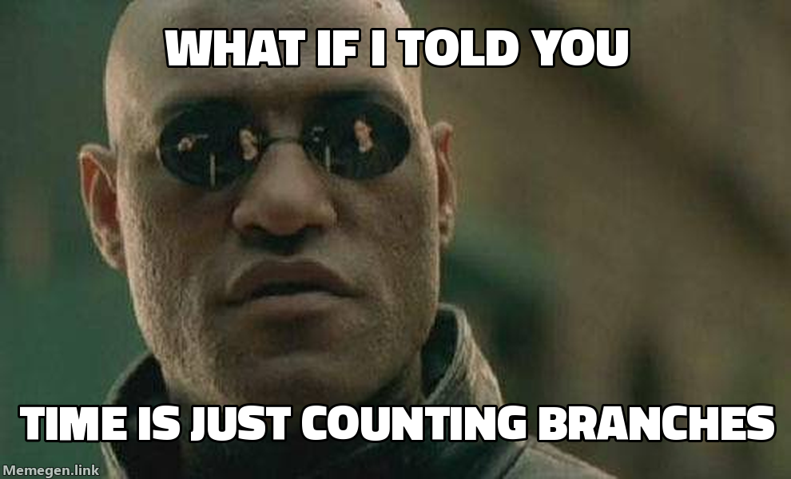
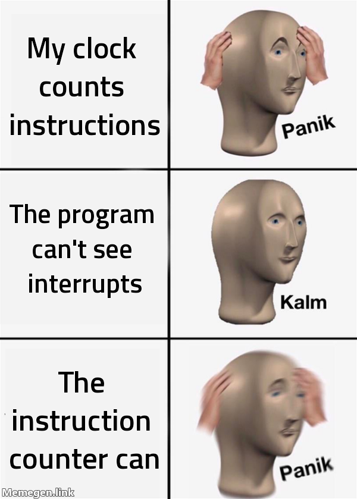
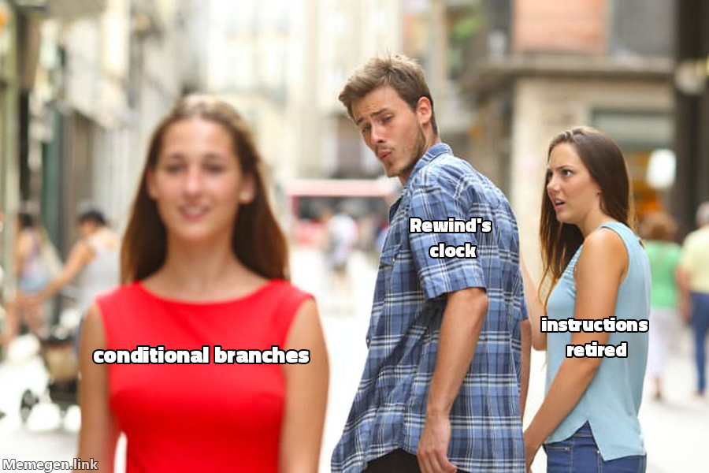

_What is time inside a machine you want to replay?_ 🧘

When building [Rewind](http://rewindvm.dev/), a deterministic VM, you come face-to-face with the idea of how to represent time very quickly. You need a way to measure time inside the guest so that on subsequent replays, the guest sees the same time and makes the same decisions. Time is the master variable.

<!--more-->

You can't simply record the wall-clock time of the host because time spent between two interception points depends on things outside the guest, like host load, CPU frequency, caches and other processes. Therefore the same guest work, a run, takes a different number of nanoseconds on each run.

In [dafuq is a deterministic VM?]() I explained how the clock inside [Rewind VM](https://rewindvm.dev) moves 5 microseconds per step. More specifically, that clock, _exit time_, moves only when the guest exits such as from a `syscall`. It treats everything the program does between two exits as **instant**. Therefore a program that is CPU bound and does nothing but math for a full second between two system calls sees only 5µs go by. 🤦🏻‍♂️


Rewind has a second clock mode as well, _counter time_, that tries to account for the work. The clock advances one nanosecond for every **conditional branch** the guest retired.[^rr]

[^rr]: This is the same approach popularized by the [rr](https://rr-project.org/) debugger. The [rr paper](https://arxiv.org/abs/1705.05937) calls it _deterministic time_.


[](/assets/images/rewind_morpheus_time_meme.png)
{: style="--image-width: 20rem"}

> **Aside:**
> New to Rewind? Start with [a flaky build you only catch once]() and [dafuq is a deterministic VM?]()
{: .alert .alert-note }

Still confused about what I mean by "free" and "branches"? Let's look at a simple example to distinguish between the two clocks.

<figure>
<svg viewBox="0 0 720 250" role="img"
     style="display:block;margin-inline:auto;max-width:44rem;width:100%;height:auto;font-family:var(--mono)"
     aria-label="A guest makes four exits with work between them: 2,000 branches, then one second of math worth a billion branches, then 3,000 branches. Exit time charges 5 microseconds for each exit and nothing for the work, so the clock reads 20 microseconds at the end. Counter time charges 5 microseconds for each exit plus a nanosecond per branch of work: 2 microseconds, 1 second and 3 microseconds, so the clock reads 1.000025 seconds.">
  <style>
    .cc-exit { fill: var(--paper-raised, #ebe6da); stroke: var(--ink, #1a1815); stroke-width: 1.5; }
    .cc-work { fill: var(--accent-wash, #9e34131f); stroke: var(--accent, #9e3413); stroke-width: 1; }
    .cc-row { font-size: 12px; font-weight: 600; fill: var(--ink, #1a1815); }
    .cc-t { font-size: 11px; fill: var(--ink, #1a1815); }
    .cc-m { font-size: 10.5px; fill: var(--ink-muted, #565046); }
    .cc-hot { font-size: 12px; font-weight: 600; fill: var(--accent, #9e3413); }
    .cc-sum { font-size: 12px; font-weight: 600; fill: var(--ink, #1a1815); }
    .cc-rule { stroke: var(--rule, #d9d2c3); stroke-width: 1; }
  </style>

  <text x="10" y="50" class="cc-row">the guest</text>
  <rect x="120" y="26" width="40" height="40" rx="4" class="cc-exit"/>
  <text x="140" y="50" text-anchor="middle" class="cc-t">exit</text>
  <rect x="160" y="26" width="90" height="40" rx="4" class="cc-work"/>
  <text x="205" y="44" text-anchor="middle" class="cc-t">work</text>
  <text x="205" y="58" text-anchor="middle" class="cc-m">2k branches</text>
  <rect x="250" y="26" width="40" height="40" rx="4" class="cc-exit"/>
  <text x="270" y="50" text-anchor="middle" class="cc-t">exit</text>
  <rect x="290" y="26" width="170" height="40" rx="4" class="cc-work"/>
  <text x="375" y="44" text-anchor="middle" class="cc-t">1 second of math</text>
  <text x="375" y="58" text-anchor="middle" class="cc-m">10⁹ branches, no exits</text>
  <rect x="460" y="26" width="40" height="40" rx="4" class="cc-exit"/>
  <text x="480" y="50" text-anchor="middle" class="cc-t">exit</text>
  <rect x="500" y="26" width="90" height="40" rx="4" class="cc-work"/>
  <text x="545" y="44" text-anchor="middle" class="cc-t">work</text>
  <text x="545" y="58" text-anchor="middle" class="cc-m">3k branches</text>
  <rect x="590" y="26" width="40" height="40" rx="4" class="cc-exit"/>
  <text x="610" y="50" text-anchor="middle" class="cc-t">exit</text>
  <text x="680" y="50" text-anchor="middle" class="cc-m">clock</text>

  <line x1="10" y1="84" x2="715" y2="84" class="cc-rule"/>
  <text x="10" y="112" class="cc-row">exit time</text>
  <text x="140" y="112" text-anchor="middle" class="cc-t">+5 µs</text>
  <text x="205" y="112" text-anchor="middle" class="cc-t">+0</text>
  <text x="270" y="112" text-anchor="middle" class="cc-t">+5 µs</text>
  <text x="375" y="112" text-anchor="middle" class="cc-hot">+0, free!</text>
  <text x="480" y="112" text-anchor="middle" class="cc-t">+5 µs</text>
  <text x="545" y="112" text-anchor="middle" class="cc-t">+0</text>
  <text x="610" y="112" text-anchor="middle" class="cc-t">+5 µs</text>
  <text x="680" y="112" text-anchor="middle" class="cc-sum">20 µs</text>

  <line x1="10" y1="132" x2="715" y2="132" class="cc-rule"/>
  <text x="10" y="160" class="cc-row">counter time</text>
  <text x="140" y="160" text-anchor="middle" class="cc-t">+5 µs</text>
  <text x="205" y="160" text-anchor="middle" class="cc-t">+2 µs</text>
  <text x="270" y="160" text-anchor="middle" class="cc-t">+5 µs</text>
  <text x="375" y="160" text-anchor="middle" class="cc-hot">+1 s</text>
  <text x="480" y="160" text-anchor="middle" class="cc-t">+5 µs</text>
  <text x="545" y="160" text-anchor="middle" class="cc-t">+3 µs</text>
  <text x="610" y="160" text-anchor="middle" class="cc-t">+5 µs</text>
  <text x="680" y="160" text-anchor="middle" class="cc-sum">1.000025 s</text>

  <line x1="10" y1="180" x2="715" y2="180" class="cc-rule"/>
  <text x="10" y="210" class="cc-m">exit time: only exits move the clock. Work between two exits is instant.</text>
  <text x="10" y="232" class="cc-m">counter time: exits, plus 1 ns for every conditional branch of work.</text>
</svg>
</figure>

The counter time tries to account for the work whereas the exit time only advanced the clock on exits.[^exits]

[^exits]: The 5µs was my guess at a reasonable cost of a system call and context switch on current hardware. The 1ns is roughly what a conditional branch costs on a current core.

Why branches, though?

## What is time in a replayed machine?

We already understand that we cannot rely on the wall-clock time of the host. We need something to measure that is the same for every run of the same program so that we can equate it to time spent.

What _is_ the same on every run? 

The guest's instruction stream! The CPU is a deterministic machine: the same input, the same registers, the same memory, and the same instructions produce the same next state.

We can measure time by measuring progress through the instruction stream. 💡

Turns out that CPU manufacturers even ship a hardware counter for exactly that. Is it reliable? Let's see. 🧐


Let's use this simple program: count down from a billion.

<div class="side-by-side" markdown="1">

```c
int main(void) {
  long i = 1000000000;
  do {
    i--;
  } while (i != 0);
  return 0;
}
```

```nasm
_start:
    mov  rcx, 1000000000
.loop:
    dec  rcx
    jnz  .loop
    mov  eax, 60    ; exit(0)
    xor  edi, edi
    syscall
```

</div>

The assembly equivalent contains a `mov`, **a billion** `dec`+`jnz` (conditional branch) pairs, then three instructions to exit for a total of **2,000,000,004** instructions.

Let's run it on the CPU twice and count the instructions and conditional branches with `perf stat`:

```console?comments=true
$ nasm -felf64 loop.asm && ld -o loop loop.o
$ taskset -c 5 perf stat -e instructions:u,ex_ret_cond:u ./loop
     2,000,001,025      instructions:u
     1,000,000,000      ex_ret_cond:u

$ taskset -c 5 perf stat -e instructions:u,ex_ret_cond:u ./loop
     2,000,001,054      instructions:u
     1,000,000,000      ex_ret_cond:u
```
{: data-mark="3,7"}


The same program and input gives the same conditional branch count, but the instruction count is off by a thousand or so. Why?

[](/assets/images/rewind_panik_instructions_meme.png)
{: style="--image-width: 16rem"}

Although this loop is CPU bound and only decrements a register, it is still not isolated from the effects of the outside world. Timers tick, network packets arrive, other cores send inter-processor interrupts (IPIs). The program can't see any of that, but the instruction counter we are probing can.

I pinned the loop to a single CPU 5 and counted how many interrupts that CPU took during each run, from `/proc/interrupts`.

```plotnine
import pandas as pd
from plotnine import *

# loop.S pinned to CPU 5 of a Ryzen 7 7840U, 30 runs at each of 100M, 500M,
# 1B and 2B iterations. Each count is what perf saw minus what the program
# executes.
df = pd.read_csv("_data/branch-counter-amd.csv", comment="#")
names = {
    "instructions": "instructions",
    "conditional_branches": "conditional branches",
}
long = df.melt(id_vars=["interrupts"], value_vars=list(names),
               var_name="counter", value_name="extra")
long["counter"] = pd.Categorical(long.counter.map(names), categories=list(names.values()))
note = pd.DataFrame({
    "counter": pd.Categorical(["instructions"], categories=list(names.values())),
    "interrupts": [380], "extra": [1150], "label": ["one extra\nper interrupt"],
})

plot = (
    ggplot(long, aes("interrupts", "extra"))
    + geom_abline(slope=1, intercept=0, linetype="dashed", color="#8a8170")
    + geom_point(aes(color="counter"), size=1.6, alpha=0.8)
    + geom_text(note, aes(label="label"), size=8, color="#8a8170", ha="center")
    + facet_wrap("~counter")
    + scale_color_manual(values=["#b1201d", "#2f6f73"], guide=None)
    + labs(x="interrupts on CPU 5 during the run", y="extra counts\n(counted − executed)")
)
plot.width, plot.height = 7.0, 3.0
```
{: title="Two panels of 120 runs each, plotting extra counts against the interrupts taken during the run. Instructions sit on a dashed line of one extra per interrupt, from about 60 to 1,300. Conditional branches are zero in every run."}

The dashed line is _one extra count per interrupt_, and the instruction counter is almost perfectly on it.[^slope] 
The conditional branch counter on the other hand, stays at zero no matter how many interrupts land.

[^slope]: The fit is 0.94 rather than 1 because `/proc/interrupts` also catches the interrupts that land while `perf` and `taskset` start up and tear down, before and after the loop runs.

Interrupts from the outside-world are not the only thing that can skew the instruction count. The program can also page fault, which is an interrupt too. The instruction counter sees the kernel's detour to handle the fault, but the program does not.

> **Tip**
> Out of the box, AMD Zen also overcounts conditional branches, a few in tens of millions, from a speculation optimization known as SpecLockMap. The fix is to set a particular bit in the PMU MSR, which Rewind does automatically as does [rr#2034](https://github.com/rr-debugger/rr/issues/2034).
{: .alert .alert-tip }

## So, what time is it?

In order to rewind history, we need a measurement of time that is reliable and deterministic. Our traditional wall-clock time is unreliable due to the effects of the outside world but we do have a reliable measurement of progress through the instruction stream: the conditional branch counter.

Using the conditional branch counter as a proxy for time turns out to be a relatively decent approximation.

| Clock        | Time inside the VM | Time on the host |
| ------------ | ------------------ | ---------------- |
| Exit time    | 2.1 s              | 15.7 s           |
| Counter time | 11.7 s             | 14.2 s           |

Why do we care about having a "realistic" representation of time?

Plenty of programs read the clock and make decisions with it, so the guest's clock has to be at least somewhat realistic. Under exit time, computing is "free". A test that checks some work "finishes within 1 s" always passes. If the bug you're chasing is a timeout, exit time will never reproduce it. 🙃

Races get skewed too with an unrealistic clock. With exit time, a whole burst of work lands in the same instant, which crowds the threads together, so a race can fire far more often in the VM than it ever would on real hardware.

[](/assets/images/rewind_distracted_branches_meme.png)
{: style="--image-width: 22rem"}

Some say time is an illusion. I say it's a `jnz` counter.