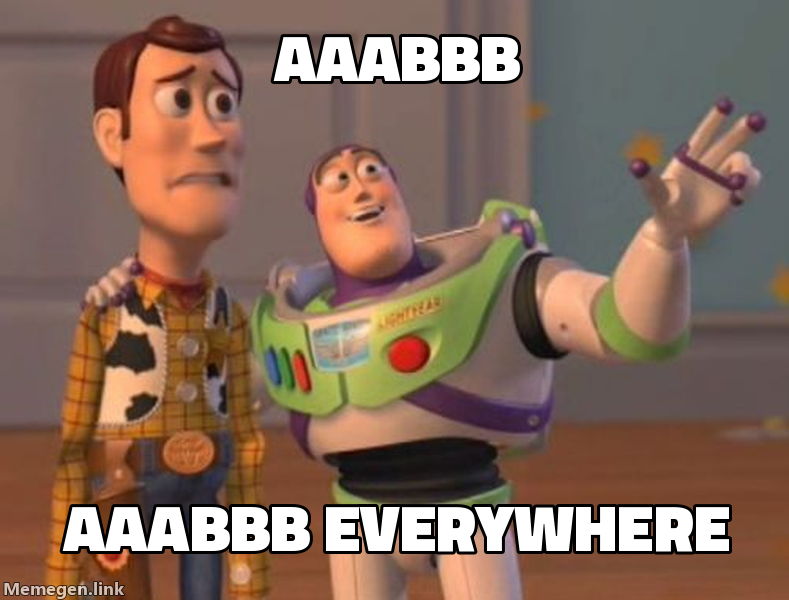

Here is something to think about: bugs are not rare, but rather the ordering of events that triggers them are. What do I mean by this?

<!--more-->

Let's start with a simple story. When I worked at AWS on RDS (Relational Database Service), we built the control-plane for the service using workflows, of course using SWF (Simple Workflow). The workflows would execute a series of steps to create, modify or delete a database instance. Every so often we'd see something that looked impossible: a workflow that seemed to run its steps out of order.

What we actually observed was a pause. A worker would pick up a step and then stop for an unexpectedly long time. While it was stopped it stopped heartbeating, so SWF decided it was dead, and reassigned it to another worker. The new worker finished the step and the workflow moved on. Then the first worker woke up. As far as it could tell no time had passed, so it carried on with the step it was holding, causing havoc in it's wake.

<figure>
<svg viewBox="0 0 720 236" role="img"
     style="display:block;margin-inline:auto;max-width:44rem;width:100%;height:auto;font-family:var(--mono)"
     aria-label="A timeline with three lanes: worker 1, SWF and worker 2. Worker 1 runs snapshot, starts apply config, then pauses. SWF hears no heartbeat, times the step out and hands apply config to worker 2, which runs it and then reboot. Worker 1 wakes up and finishes apply config after the reboot, and SWF rejects its result. The instance saw snapshot, apply config, reboot, apply config.">
  <style>
    .zw-lane { stroke: var(--rule, #dcd5c5); stroke-width: 1; }
    .zw-step { fill: none; stroke: var(--ink, #1a1815); stroke-width: 1.5; }
    .zw-pause { fill: none; stroke: var(--ink-faint, #6f685b); stroke-width: 1; stroke-dasharray: 4 3; }
    .zw-zombie { fill: var(--accent-wash, #9e34131f); stroke: var(--accent, #9e3413); stroke-width: 1.5; }
    .zw-mark { stroke: var(--ink, #1a1815); stroke-width: 1.5; fill: none; }
    .zw-reject { stroke: var(--accent, #9e3413); stroke-width: 1.5; fill: none; }
    .zw-t { font-size: 11px; fill: var(--ink, #1a1815); }
    .zw-l { font-size: 11px; fill: var(--ink-muted, #565046); }
    .zw-h { font-size: 12px; font-weight: 600; fill: var(--ink, #1a1815); }
    .zw-hot { font-size: 11px; fill: var(--accent, #9e3413); }
    .zw-seq { font-size: 12px; fill: var(--ink, #1a1815); }
    .zw-late { fill: var(--accent, #9e3413); font-weight: 600; }
  </style>
  <defs>
    <marker id="zw-tip" viewBox="0 0 8 8" refX="7" refY="4" markerWidth="7" markerHeight="7" orient="auto">
      <path d="M0,0 L8,4 L0,8 z" fill="var(--ink, #1a1815)"/>
    </marker>
  </defs>

  <text x="705" y="22" text-anchor="end" class="zw-l">time &#8594;</text>

  <text x="18" y="64" class="zw-h">worker 1</text>
  <text x="18" y="116" class="zw-h">SWF</text>
  <text x="18" y="168" class="zw-h">worker 2</text>
  <line x1="100" y1="60" x2="705" y2="60" class="zw-lane"/>
  <line x1="100" y1="112" x2="705" y2="112" class="zw-lane"/>
  <line x1="100" y1="164" x2="705" y2="164" class="zw-lane"/>

  <rect x="104" y="47" width="84" height="26" rx="4" class="zw-step"/>
  <text x="146" y="64" text-anchor="middle" class="zw-t">snapshot</text>
  <rect x="196" y="47" width="96" height="26" rx="4" class="zw-step"/>
  <text x="244" y="64" text-anchor="middle" class="zw-t">apply config</text>
  <rect x="292" y="47" width="262" height="26" class="zw-pause"/>
  <text x="423" y="64" text-anchor="middle" class="zw-l">paused</text>
  <text x="292" y="38" text-anchor="middle" class="zw-l">last heartbeat</text>

  <path d="M326,106 L334,118 M334,106 L326,118" class="zw-mark"/>
  <text x="330" y="100" text-anchor="middle" class="zw-l">heartbeat timeout</text>
  <line x1="334" y1="120" x2="356" y2="148" class="zw-mark" marker-end="url(#zw-tip)"/>

  <rect x="350" y="151" width="96" height="26" rx="4" class="zw-step"/>
  <text x="398" y="168" text-anchor="middle" class="zw-t">apply config</text>
  <rect x="454" y="151" width="72" height="26" rx="4" class="zw-step"/>
  <text x="490" y="168" text-anchor="middle" class="zw-t">reboot</text>

  <rect x="560" y="47" width="96" height="26" rx="4" class="zw-zombie"/>
  <text x="608" y="64" text-anchor="middle" class="zw-hot">apply config</text>
  <text x="608" y="38" text-anchor="middle" class="zw-hot">wakes up</text>
  <line x1="620" y1="75" x2="620" y2="106" class="zw-reject"/>
  <path d="M616,108 L624,116 M624,108 L616,116" class="zw-reject"/>
  <text x="630" y="130" class="zw-hot">rejected</text>

  <line x1="18" y1="196" x2="705" y2="196" class="zw-lane"/>
  <text x="18" y="222" class="zw-l">the instance saw:</text>
  <text x="150" y="222" class="zw-seq">snapshot &#8594; apply config &#8594; reboot &#8594; <tspan class="zw-late">apply config</tspan></text>
</svg>
</figure>

We suddenly realized that we were not adequately testing all the possible schedules of events. The workflow code was correct, but the schedule that triggered the bug was not one we had ever seen in our tests. It was a rare schedule, but it was not a rare bug. Thus began adding idempotency tokens to every step and making sure that every step could be run multiple times without breaking anything. It was a lot of work, but it made the system much more robust.

What's the purpose of this story?

I am building [Rewind VM](https://rewindvm.dev), a deterministic VM. It helps finds bugs in software primarily by running the same code under many different schedules.[^schedule] That mere act of shuffling the schedule has found [many bugs](https://rewindvm.dev/bugs.html) thus far.

[^schedule]: I say _schedule_ rather than _thread interleaving_ on purpose. Most of the bugs on that page are races between processes, or between a process and a signal. Only a few are between two threads of one program..

The software under test is not even a distributed system, such as the workflow example above, and yet many of the bugs are still schedule-dependent. No crazy Jepsen test-suite needed. How can this be ? All these projects have tests that validate the code on every change. Why does shuffling the schedule find so many bugs that all those tests never did?


The bugs aren't rare, the schedules your tests run are. An idle, fast machine runs the same handful of orderings nearly every time. A test passes because the order never changes, and the code may only ever have handled that one order.

> **Aside:**
> New to Rewind? Start with [a flaky build you only catch once]() and [dafuq is a deterministic VM?]()
{: .alert .alert-note }

It takes different schedules or unforseen long pauses, similar to the workflow story above, trigger these bugs. The bugs are not rare, but the schedules that trigger them are. How rare are they?

The smallest race I know is `counter++` from two threads.

<div class="side-by-side" markdown="1">

```c
long counter;

void increment(void) {
  counter++;
}
```

```nasm
increment:
    mov  rax, [counter]  ; load
    add  rax, 1          ; add
    mov  [counter], rax  ; store
    ret
```

</div>

Two threads run `increment` once each. Each thread's three steps execute in order, but the two threads can interleave. An ordering is a choice of which 3 of the 6 slots belong to thread A, so there are $$\binom{6}{3} = 20$$ of them.

We can visualize the 20 choices as paths on a grid. A step right is a step of thread A, a step down is a step of thread B, and every path from the top-left corner to the bottom-right one is one ordering.

<figure>
<svg viewBox="0 0 720 300" role="img"
     style="display:block;margin-inline:auto;max-width:44rem;width:100%;height:auto;font-family:var(--mono)"
     aria-label="Left: a 3 by 3 grid. Moving right is a step of thread A, moving down a step of thread B, so every path from the top-left corner to the bottom-right corner is one interleaving, 20 in all. The four inner points, where both threads have loaded and neither has stored, are shaded: every path through them loses an update. Only the two paths along the edges, A then B and B then A, avoid them. Right: the 20 orderings listed, each with the counter it ends with. AAABBB and BBBAAA end at 2; the other 18 end at 1.">
  <style>
    .il-grid { stroke: var(--rule-strong, #c2b9a6); stroke-width: 1; fill: none; }
    .il-zone { fill: var(--accent-wash, #9e34131f); stroke: var(--accent, #9e3413); stroke-width: 1; stroke-dasharray: 4 3; }
    .il-safe { stroke: var(--ink, #1a1815); stroke-width: 2.5; fill: none; }
    .il-lost { stroke: var(--accent, #9e3413); stroke-width: 2; fill: none; }
    .il-dot { fill: var(--ink, #1a1815); }
    .il-l { font-size: 11px; fill: var(--ink-muted, #565046); }
    .il-h { font-size: 12px; font-weight: 600; fill: var(--ink, #1a1815); }
    .il-hot { font-size: 11px; fill: var(--accent, #9e3413); }
    .il-ord { font-size: 13px; fill: var(--ink, #1a1815); }
    .il-bt { fill: var(--accent, #9e3413); font-weight: 600; }
    .il-ok { font-size: 11px; font-weight: 600; fill: var(--ink, #1a1815); }
    .il-bad { font-size: 11px; fill: var(--accent, #9e3413); }
  </style>
  <line x1="70" y1="62" x2="70" y2="230" class="il-grid"/>
  <line x1="70" y1="62" x2="238" y2="62" class="il-grid"/>
  <line x1="126" y1="62" x2="126" y2="230" class="il-grid"/>
  <line x1="70" y1="118" x2="238" y2="118" class="il-grid"/>
  <line x1="182" y1="62" x2="182" y2="230" class="il-grid"/>
  <line x1="70" y1="174" x2="238" y2="174" class="il-grid"/>
  <line x1="238" y1="62" x2="238" y2="230" class="il-grid"/>
  <line x1="70" y1="230" x2="238" y2="230" class="il-grid"/>
  <rect x="114" y="106" width="80" height="80" rx="6" class="il-zone"/>
  <path d="M70,62 L126,62 L126,118 L182,118 L182,174 L238,174 L238,230" class="il-lost"/>
  <path d="M70,62 L238,62 L238,230" class="il-safe"/>
  <path d="M70,62 L70,230 L238,230" class="il-safe"/>
  <circle cx="70" cy="62" r="3" class="il-dot"/>
  <circle cx="70" cy="118" r="3" class="il-dot"/>
  <circle cx="70" cy="174" r="3" class="il-dot"/>
  <circle cx="70" cy="230" r="3" class="il-dot"/>
  <circle cx="126" cy="62" r="3" class="il-dot"/>
  <circle cx="126" cy="118" r="3" class="il-dot"/>
  <circle cx="126" cy="174" r="3" class="il-dot"/>
  <circle cx="126" cy="230" r="3" class="il-dot"/>
  <circle cx="182" cy="62" r="3" class="il-dot"/>
  <circle cx="182" cy="118" r="3" class="il-dot"/>
  <circle cx="182" cy="174" r="3" class="il-dot"/>
  <circle cx="182" cy="230" r="3" class="il-dot"/>
  <circle cx="238" cy="62" r="3" class="il-dot"/>
  <circle cx="238" cy="118" r="3" class="il-dot"/>
  <circle cx="238" cy="174" r="3" class="il-dot"/>
  <circle cx="238" cy="230" r="3" class="il-dot"/>
  <text x="98.0" y="52" text-anchor="middle" class="il-l">load</text>
  <text x="60" y="94.0" text-anchor="end" class="il-l">load</text>
  <text x="154.0" y="52" text-anchor="middle" class="il-l">add</text>
  <text x="60" y="150.0" text-anchor="end" class="il-l">add</text>
  <text x="210.0" y="52" text-anchor="middle" class="il-l">store</text>
  <text x="60" y="206.0" text-anchor="end" class="il-l">store</text>
  <text x="154.0" y="32" text-anchor="middle" class="il-h">thread A &#8594;</text>
  <text x="18" y="150.0" text-anchor="middle" class="il-h" transform="rotate(90 18 150.0)">thread B &#8594;</text>
  <text x="18" y="258" class="il-hot">shaded: both loaded, neither stored</text>
  <text x="18" y="276" class="il-l">edges: AAABBB, BBBAAA. staircase: ABABAB</text>
  <text x="360" y="24" class="il-h">the 20 orderings, and the counter after</text>
  <text x="360 373 386 399 412 425" y="52.5" class="il-ord">AAA<tspan class="il-bt">B</tspan><tspan class="il-bt">B</tspan><tspan class="il-bt">B</tspan></text>
  <text x="450" y="52.5" class="il-ok">2</text>
  <text x="360 373 386 399 412 425" y="74.5" class="il-ord">AA<tspan class="il-bt">B</tspan>A<tspan class="il-bt">B</tspan><tspan class="il-bt">B</tspan></text>
  <text x="450" y="74.5" class="il-bad">1</text>
  <text x="360 373 386 399 412 425" y="96.5" class="il-ord">AA<tspan class="il-bt">B</tspan><tspan class="il-bt">B</tspan>A<tspan class="il-bt">B</tspan></text>
  <text x="450" y="96.5" class="il-bad">1</text>
  <text x="360 373 386 399 412 425" y="118.5" class="il-ord">AA<tspan class="il-bt">B</tspan><tspan class="il-bt">B</tspan><tspan class="il-bt">B</tspan>A</text>
  <text x="450" y="118.5" class="il-bad">1</text>
  <text x="360 373 386 399 412 425" y="140.5" class="il-ord">A<tspan class="il-bt">B</tspan>AA<tspan class="il-bt">B</tspan><tspan class="il-bt">B</tspan></text>
  <text x="450" y="140.5" class="il-bad">1</text>
  <text x="360 373 386 399 412 425" y="162.5" class="il-ord">A<tspan class="il-bt">B</tspan>A<tspan class="il-bt">B</tspan>A<tspan class="il-bt">B</tspan></text>
  <text x="450" y="162.5" class="il-bad">1</text>
  <text x="360 373 386 399 412 425" y="184.5" class="il-ord">A<tspan class="il-bt">B</tspan>A<tspan class="il-bt">B</tspan><tspan class="il-bt">B</tspan>A</text>
  <text x="450" y="184.5" class="il-bad">1</text>
  <text x="360 373 386 399 412 425" y="206.5" class="il-ord">A<tspan class="il-bt">B</tspan><tspan class="il-bt">B</tspan>AA<tspan class="il-bt">B</tspan></text>
  <text x="450" y="206.5" class="il-bad">1</text>
  <text x="360 373 386 399 412 425" y="228.5" class="il-ord">A<tspan class="il-bt">B</tspan><tspan class="il-bt">B</tspan>A<tspan class="il-bt">B</tspan>A</text>
  <text x="450" y="228.5" class="il-bad">1</text>
  <text x="360 373 386 399 412 425" y="250.5" class="il-ord">A<tspan class="il-bt">B</tspan><tspan class="il-bt">B</tspan><tspan class="il-bt">B</tspan>AA</text>
  <text x="450" y="250.5" class="il-bad">1</text>
  <text x="540 553 566 579 592 605" y="52.5" class="il-ord"><tspan class="il-bt">B</tspan>AAA<tspan class="il-bt">B</tspan><tspan class="il-bt">B</tspan></text>
  <text x="630" y="52.5" class="il-bad">1</text>
  <text x="540 553 566 579 592 605" y="74.5" class="il-ord"><tspan class="il-bt">B</tspan>AA<tspan class="il-bt">B</tspan>A<tspan class="il-bt">B</tspan></text>
  <text x="630" y="74.5" class="il-bad">1</text>
  <text x="540 553 566 579 592 605" y="96.5" class="il-ord"><tspan class="il-bt">B</tspan>AA<tspan class="il-bt">B</tspan><tspan class="il-bt">B</tspan>A</text>
  <text x="630" y="96.5" class="il-bad">1</text>
  <text x="540 553 566 579 592 605" y="118.5" class="il-ord"><tspan class="il-bt">B</tspan>A<tspan class="il-bt">B</tspan>AA<tspan class="il-bt">B</tspan></text>
  <text x="630" y="118.5" class="il-bad">1</text>
  <text x="540 553 566 579 592 605" y="140.5" class="il-ord"><tspan class="il-bt">B</tspan>A<tspan class="il-bt">B</tspan>A<tspan class="il-bt">B</tspan>A</text>
  <text x="630" y="140.5" class="il-bad">1</text>
  <text x="540 553 566 579 592 605" y="162.5" class="il-ord"><tspan class="il-bt">B</tspan>A<tspan class="il-bt">B</tspan><tspan class="il-bt">B</tspan>AA</text>
  <text x="630" y="162.5" class="il-bad">1</text>
  <text x="540 553 566 579 592 605" y="184.5" class="il-ord"><tspan class="il-bt">B</tspan><tspan class="il-bt">B</tspan>AAA<tspan class="il-bt">B</tspan></text>
  <text x="630" y="184.5" class="il-bad">1</text>
  <text x="540 553 566 579 592 605" y="206.5" class="il-ord"><tspan class="il-bt">B</tspan><tspan class="il-bt">B</tspan>AA<tspan class="il-bt">B</tspan>A</text>
  <text x="630" y="206.5" class="il-bad">1</text>
  <text x="540 553 566 579 592 605" y="228.5" class="il-ord"><tspan class="il-bt">B</tspan><tspan class="il-bt">B</tspan>A<tspan class="il-bt">B</tspan>AA</text>
  <text x="630" y="228.5" class="il-bad">1</text>
  <text x="540 553 566 579 592 605" y="250.5" class="il-ord"><tspan class="il-bt">B</tspan><tspan class="il-bt">B</tspan><tspan class="il-bt">B</tspan>AAA</text>
  <text x="630" y="250.5" class="il-ok">2</text>
</svg>
</figure>

The shaded square holds the four points where both threads have loaded the counter and neither has stored it. Any path that enters it ends with the counter with a value of 1, with the second writer storing the stale original value.

Only the two paths along the edges provide the "correct result" of 2, A entirely before B or B entirely before A. That is 18 of 20 orderings that lose an update. If every ordering were equally likely, this race would fire in 9 runs out of 10. 😱

What does this look like on a real machine?

Let's build a small program that runs the two threads and records the order of their steps. The program is a bit more complicated than the simple `counter++` above, because it has to record the order of the steps. It also has to be careful not to introduce any new races in the recording itself. The program leverages Rewind's `rewind_point()` to give Rewind VM a place to switch threads.[^barrier]

[^barrier]: The program also has a version that uses a barrier to make the threads collide on purpose to make the race even more likely.

<details markdown="1">
<summary markdown="span">race.c</summary>

```c
/*
 * Two threads each add one to a shared counter in three steps: load the
 * counter, add one, store it back. No lock, so a thread that runs between
 * the other's load and store writes a stale value over it.
 *
 * Each step first takes the next slot of a shared atomic sequence and
 * writes its thread's letter there, so the program prints the order the
 * six steps ran in, such as AABABB, and the final counter.
 *
 * rewind_point() between the steps gives Rewind VM a place to switch
 * threads. main() calls it once before the threads start, so the one
 * failed open it makes outside Rewind happens there; on the host the
 * points inside the threads are a load and a branch.
 *
 * Built with -DSTART_BARRIER, both threads wait on a barrier before the
 * first step, so they start as close together as the host allows.
 *
 * The exit status encodes the outcome so `rewind check` reports it
 * without reading output: ordering index (0..19) * 2 + (1 if an update
 * was lost).
 */
#include <pthread.h>
#include <stdatomic.h>
#include <stdio.h>
#include <string.h>

#include "rewind.h"

enum { THREADS = 2, STEPS = 3, MARKS = THREADS * STEPS };

static volatile long counter;
static atomic_int next_mark;
static char order[MARKS + 1];

#ifdef START_BARRIER
static pthread_barrier_t start;
#endif

/* Record that thread `who` is taking its next step. */
static void mark(char who)
{
	order[atomic_fetch_add(&next_mark, 1)] = who;
}

static void *increment(void *arg)
{
	char who = *(const char *)arg;

#ifdef START_BARRIER
	pthread_barrier_wait(&start);
#endif
	mark(who);
	long seen = counter; /* load */
	rewind_point();
	mark(who);
	seen = seen + 1; /* add */
	rewind_point();
	mark(who);
	counter = seen; /* store */
	return NULL;
}

/* The index of `s` among the 20 orderings of AAABBB, in sorted order. */
static int ordering_index(const char *s)
{
	int index = 0;

	for (int a = 0; a < 64; a++) {
		char candidate[MARKS + 1];
		int as = 0;

		for (int i = 0; i < MARKS; i++) {
			candidate[i] = (a >> (MARKS - 1 - i)) & 1 ? 'B' : 'A';
			as += candidate[i] == 'A';
		}
		candidate[MARKS] = '\0';
		if (as != STEPS) {
			continue;
		}
		if (strcmp(candidate, s) == 0) {
			return index;
		}
		index++;
	}
	return -1;
}

int main(void)
{
	static const char names[THREADS] = { 'A', 'B' };
	pthread_t threads[THREADS];

	/* Open /dev/rewind, or find it missing, before any thread runs. */
	rewind_point();

#ifdef START_BARRIER
	pthread_barrier_init(&start, NULL, THREADS);
#endif
	for (int i = 0; i < THREADS; i++) {
		pthread_create(&threads[i], NULL, increment, (void *)&names[i]);
	}
	for (int i = 0; i < THREADS; i++) {
		pthread_join(threads[i], NULL);
	}

	int lost = counter != THREADS;
	printf("%s %ld\n", order, counter);
	return ordering_index(order) * 2 + lost;
}
```

</details>

I ran each one 10,000 times on my laptop, a Ryzen 7 7840U with 16 idle hardware threads.

```console
$ for i in $(seq 10000); do ./race; done | sort | uniq -c | sort -rn
   9985 AAABBB 2
     15 BBBAAA 2
$ for i in $(seq 10000); do ./race-barrier; done | sort | uniq -c | sort -rn
   9957 BBBAAA 2
     39 AAABBB 2
      2 BBAAAB 1
      1 BAAABB 1
      1 BAABAB 1
```

```plotnine
import pandas as pd
from plotnine import *

# 10,000 runs of race.c per panel on an idle Ryzen 7 7840U. See the header of
# the CSV for how each panel was run.
df = pd.read_csv("_data/schedule-orderings.csv", comment="#")
orders = sorted(df.ordering.unique())
panels = {"create": "pthread_create", "barrier": "pthread_create + barrier"}
host = df[(df.machine == "host") & (df.runs > 0)].copy()
host["panel"] = pd.Categorical(host.start.map(panels), categories=list(panels.values()))

# Orderings that never ran sit on a "0" row under the log scale, so an
# empty column reads as zero rather than as missing.
NEVER_Y = 0.25
never = df[(df.machine == "host") & (df.runs == 0)].copy()
never["panel"] = pd.Categorical(never.start.map(panels), categories=list(panels.values()))
never["runs"] = NEVER_Y
host["outcome"] = host.lost.map({0: "counter = 2", 1: "lost an update"})

plot = (
    ggplot(host, aes("ordering", "runs", color="outcome"))
    + geom_segment(aes(xend="ordering", y=1, yend="runs"), size=1.2)
    + geom_point(size=2)
    + geom_text(aes(label="runs"), nudge_y=0.35, size=7, show_legend=False)
    + geom_point(never, aes("ordering", "runs"), inherit_aes=False, shape="x", size=1.6, color="#9a958c")
    + facet_wrap("~panel", ncol=1)
    + scale_x_discrete(limits=orders)
    + scale_y_log10(limits=(0.15, 40000), breaks=[NEVER_Y, 1, 10, 100, 1000, 10000],
                    labels=["0", "1", "10", "100", "1,000", "10,000"])
    + scale_color_manual(values={"counter = 2": "#2f6f73", "lost an update": "#b1201d"})
    + labs(x="", y="runs of 10,000", color="")
    + theme(axis_text_x=element_text(rotation=90, family="monospace"), legend_position="top",
            panel_grid_minor=element_blank(), panel_grid_major_x=element_blank())
)
plot.width, plot.height = 7.0, 4.6
```
{: title="Two panels of runs per ordering, on a log scale, across the 20 orderings. With pthread_create alone, 9,985 runs are AAABBB and 15 are BBBAAA. With a barrier, 9,957 are BBBAAA, 39 are AAABBB, and 4 runs spread over three orderings that lose an update. The other orderings never ran."}

Across 20,000 runs the idle laptop ran 5 of the 20 orderings and lost an update 4 times.
Interestingly, the barrier was supposed to make them collide. Instead it flipped the order such that 9,957 runs were `BBBAAA`.

A busy machine is a little different. With `stress-ng --cpu 16` keeping every hardware thread busy, the same two binaries ran 13 and 16 of the orderings, and lost an update in 32 and 66 of 10,000 runs. That's still fewer than 1 run in 100 lost an update.

[](/assets/images/rewind_buzz_aaabbb_meme.png)
{: style="--image-width: 20rem"}

Rewind runs the guest on one virtual CPU and only switches threads at an exit, such as a system call (see [dafuq is a deterministic VM?]()) or a `rewind_point` SDK call. This gives Rewind a chance to modify the schedule.

We can then run the same binary with Rewind to see how many of the 20 orderings it can reach.

```console
$ rewind check --epoch 1790985600 --root root --schedules 9999 \
    --all --no-narrow -- /bin/race
...
schedule 9999: exited:0              354 steps    run 9b248f72f742b07f
1492 of 9999 other schedules ended differently
```

Across 10,000 runs Rewind reached 15 of the 20 orderings and lost an update in 1,371 of them. With a barrier it reached all 20 orderings and lost an update in 2,997 of them.

```plotnine
import pandas as pd
from plotnine import *

# The same binaries under rewind check: schedule 0 and 9,999 perturbed ones.
df = pd.read_csv("_data/schedule-orderings.csv", comment="#")
orders = sorted(df.ordering.unique())
panels = {"create": "pthread_create", "barrier": "pthread_create + barrier"}
vm = df[(df.machine == "rewind") & (df.runs > 0)].copy()
vm["panel"] = pd.Categorical(vm.start.map(panels), categories=list(panels.values()))

# Orderings that never ran sit on a "0" row under the log scale, so an
# empty column reads as zero rather than as missing.
NEVER_Y = 0.25
never = df[(df.machine == "rewind") & (df.runs == 0)].copy()
never["panel"] = pd.Categorical(never.start.map(panels), categories=list(panels.values()))
never["runs"] = NEVER_Y
vm["outcome"] = vm.lost.map({0: "counter = 2", 1: "lost an update"})

plot = (
    ggplot(vm, aes("ordering", "runs", color="outcome"))
    + geom_segment(aes(xend="ordering", y=1, yend="runs"), size=1.2)
    + geom_point(size=2)
    + geom_text(aes(label="runs"), nudge_y=0.35, size=7, show_legend=False)
    + geom_point(never, aes("ordering", "runs"), inherit_aes=False, shape="x", size=1.6, color="#9a958c")
    + facet_wrap("~panel", ncol=1)
    + scale_x_discrete(limits=orders)
    + scale_y_log10(limits=(0.15, 40000), breaks=[NEVER_Y, 1, 10, 100, 1000, 10000],
                    labels=["0", "1", "10", "100", "1,000", "10,000"])
    + scale_color_manual(values={"counter = 2": "#2f6f73", "lost an update": "#b1201d"})
    + labs(x="", y="runs of 10,000", color="")
    + theme(axis_text_x=element_text(rotation=90, family="monospace"), legend_position="top",
            panel_grid_minor=element_blank(), panel_grid_major_x=element_blank())
)
plot.width, plot.height = 7.0, 4.6
```
{: title="Two panels of runs per ordering, on a log scale, under rewind check. With pthread_create alone, 8,508 runs are AAABBB and the rest spread over 14 more orderings, 1,371 of them losing an update. With a barrier, all 20 orderings appear, from 5,715 runs of AAABBB down to 1 of BABABA, and 2,997 runs lose an update."}

We can observe that Rewind's perturbations reach more orderings than the host, and that it loses an update more often which helps us find the bug. The table below summarizes the results:


| Where        | Start   | Orderings seen | Runs that lost an update |
| ------------ | ------- | -------------- | ------------------------ |
| idle laptop  | create  | 2 of 20        | 0 of 10,000              |
| idle laptop  | barrier | 5 of 20        | 4 of 10,000              |
| busy laptop  | create  | 13 of 20       | 32 of 10,000             |
| busy laptop  | barrier | 16 of 20       | 66 of 10,000             |
| Rewind       | create  | 15 of 20       | 1,371 of 10,000          |
| Rewind       | barrier | 20 of 20       | 2,997 of 10,000          |

Interleavings though are not the only way to trigger bugs. Long pauses are orderings too, and they can be even rarer than interleavings.

A long pause sits at the far edge of the lattice. Thread A stops, and everything else takes hundreds of steps before A takes its next one. A path like that runs along one edge of the grid for a long time. A short perturbation hands the other side a few steps, so it rarely walks that far.

Rewind has knobs to make long pauses more likely. The `--stall-max` knob raises the maximum stall time, and the `--stall-min` knob lowers the minimum stall time. These settings can help explore even more unlikely schedules to discover bugs that only appear under extreme conditions.

It's kind of surprising that with all the hype of property based testing, fuzzing, and Jepsen, that a simple deterministic VM that shuffles the schedule finds so many bugs. 
Our hardware is so fast that we've become accustomed to thinking that the order of events is always the same. Adding a little randomness to the schedule can expose bugs that have been hiding in plain sight.

Bugs aren't rare, but the schedules that trigger them are.