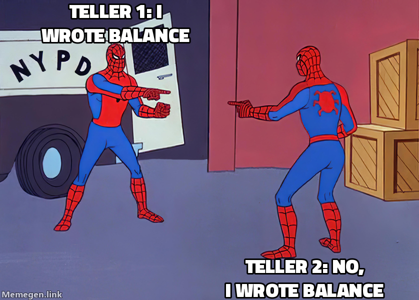
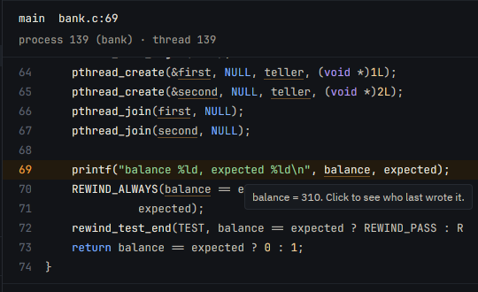
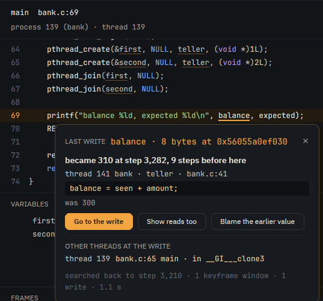

Debuggers are an incredibly powerful and useful tool, but they mostly show you only the present and let you move forward.[^rr] Inspecting the present can help you understand the past, but is that a limitation we must accept?

What if you could travel back in time to see what happened? What if you could see the exact moment a value was written, and who wrote it? What if you could run your debugger _backwards_?

[^rr]: Tools like [rr](https://rr-project.org/) and [Undo](https://undo.io/) record a process and let you run its replay backwards. Rewind records the whole machine, the kernel included, so the same inputs make the same run every time.

[Rewind](https://rewindvm.dev) is a deterministic virtual machine that records a program's execution once, and then lets you replay it identically, many times. This lets you run the debugger backwards, and see the history of a value in memory, including who last read and wrote it.

Turns out that you can go backwards by fast-forwarding.

Going backwards changes how you debug: you can see how a value got there, not just what it is now. In [who wrote this byte?]() `rewind blame` found the program that wrote a byte of a file. That was the easy case. Every write to a file goes through the kernel, and Rewind's kernel logs each one. Writes to memory don't go through the kernel, so there is no log to read.

So instead we go backwards, _by running forwards again_. This is how `rewind blame` can tell us who last read and wrote a value in memory, and it is the same trick that lets gdb run backwards as well. Let's see how it works.

> **Aside:**
> New to Rewind? Start with [a flaky build you only catch once]() and [dafuq is a deterministic VM?]()
{: .alert .alert-note }

## Two tellers, one account

Let's use the [`bank`](https://github.com/fzakaria/rewindvm/tree/main/examples/bank) example from [Nix wrote half of my debugger](). Two tellers each deposit 10, twenty times, into one account:

```c
static long balance;

static void deposit(int teller, long amount)
{
	long seen = balance;
	char line[64];
	int n = snprintf(line, sizeof line, "teller %d: %ld + %ld\n", teller, seen, amount);

	if (write(1, line, n) == n) {
		balance = seen + amount;
	}
}
```
{: data-mark="5,10"}

In our example, crucially, there is no lock around the read and write of `balance`. If the other teller runs in between, one of the deposits is lost.

`rewind check` runs the program under different thread schedules until one fails:

```console
$ rewind check --epoch 1790985600 github:fzakaria/rewindvm#bank
schedule   0: exited:0             4547 steps  2ffd6b62eb30  run b1d6981401d5d15f  holds
schedule   1: exited:2             3768 steps    run 36036ed36994d7d8  violates same-outcome, sdk
...
failing: run 240115d5505149aa, schedule 1 over steps 3245..3246
failing run violates sdk: step 3292: always "balance-adds-up" failed: balance 310, expected 400
```
{: data-mark="6"}

`check` narrows schedule 1's failure down to steps 3,245 and 3,246 and records that run, `240115d5`, which is the one we will dig into. We expected 400 and got 310. Nine deposits are gone. 😬

## rewind blame --at

Our program prints the balance at step 3,291. We can run `rewind blame` at that step and the variable[^expression] to see who last wrote it:

[^expression]: The expression can be a variable, a pointer dereference, or a struct field.

```console
$ rewind blame 240115d5 --at 3291 balance
balance = 310   8 bytes at 0x56055a0ef030, thread 139, bank.c:69

last written at step 3282 by thread 141 (bank)
  bank.c:41  teller  balance = seen + amount;
  was 300

other threads just after the write, in step 3282:
  thread 139  bank.c:65  main  __GI___clone3

searched back to step 3210, 1 keyframe window, 1 write, 3.1s
```
{: data-mark="4-6"}

Rewind goes "backwards" through the run, looking for the last write to that value. We can see that the last write was at step 3,282, by teller 2 (thread 141) on line 41. 

But wait, 300 + 10 is 310. That write is fine! 🤔

[](/assets/images/rewind_spiderman_balance_meme.png)
{: style="--image-width: 22rem"}

The last write is rarely the bug. The money went missing earlier, when a teller wrote a value it had read much earlier. We need to augment `blame` with the reads too, to see that.

## Who read it?

`--reads` lists every read and write of the value, back to the start of the process. Here are the rows around where it goes wrong:

```console
$ rewind blame 240115d5 --at 3291 balance --reads
  step  thread           access  value               where
...
  3244  140 bank         read    110                 bank.c:36  teller  long seen = balance;  balance
  3248  141 bank         read    110                 bank.c:36  teller  long seen = balance;  balance
  3250  140 bank         write   120                 bank.c:41  teller  balance = seen + amount;  balance
  3250  140 bank         read    120                 bank.c:36  teller  long seen = balance;  balance
...
  3257  140 bank         write   190                 bank.c:41  teller  balance = seen + amount;  balance
  3257  140 bank         read    190                 bank.c:36  teller  long seen = balance;  balance
  3258  140 bank         write   200                 bank.c:41  teller  balance = seen + amount;  balance
  3263  141 bank         write   120                 bank.c:41  teller  balance = seen + amount;  balance
...
searched back to step 3210, 1 keyframe window, 40 writes, 41 reads, 1.8s
```
{: data-mark="5,12"}

Reading the chronology, we can see that teller 2 read the balance at step 3,248, and then teller 1 made nine deposits, taking the balance from 110 to 200. Then at step 3,263 teller 2 wrote its stale value of 120, overwriting the balance and losing the nine deposits (90). 💣

In this example, the bug is obvious, but in a real program it can be hard to find. The `--reads` option shows you the whole history of a value, and you can often see where it went wrong without ever setting a breakpoint. You can even see the bug in the plot of the balance over time:

```plotnine
import pandas as pd
from plotnine import *

# rewind blame 240115d5 --at 3291 balance --reads --json: every access to
# balance in the bank example's failing run, one row each, in order.
df = pd.read_csv("_data/bank-balance-accesses.csv", comment="#")
writes = df[df.access == "write"].copy()
writes["expected"] = 10 * (pd.RangeIndex(len(writes)) + 1)
stale = df[(df.thread == "teller 2") & (df.access == "read") & (df.step == 3248)]
notes = pd.DataFrame({
    "step": [3248, 3268, 3274],
    "after": [70, 85, 380],
    "label": ["teller 2 reads 110", "teller 2 writes 110 + 10", "expected"],
})

plot = (
    ggplot(writes, aes("step", "after"))
    + geom_line(aes(y="expected"), linetype="dashed", color="#8a8170")
    + geom_step(color="#8a8170", alpha=0.6)
    + geom_point(aes(color="thread"), size=1.8)
    + geom_point(stale, aes("step", "after"), shape="o", size=4, fill="none",
                 color="#2f6f73", stroke=1.2)
    + geom_text(notes, aes(label="label"), size=8, color="#8a8170")
    + scale_color_manual(values={"teller 1": "#b1201d", "teller 2": "#2f6f73"})
    + labs(x="step", y="balance after the write", color="")
)
plot.width, plot.height = 7.0, 3.2
```
{: title="The balance after each of the 40 writes, by step. Teller 1's writes climb from 10 to 200 by step 3,258. Teller 2 read 110 at step 3,248, and at step 3,263 it writes 120, dropping the balance from 200. It then climbs to 310, while the dashed expected line ends at 400."}

The example is simple and the fix is obvious: a lock around the read and write. In a real program, the bug can be subtle and the fix complex. Seeing the history of a value, and who last wrote it, can be invaluable in tracking down the root cause.

## In the app

The [Rewind app](https://rewindvm.dev) gives the same information but in a more interactive way. The source panel underlines every value that `blame` can watch:

[](/assets/images/rewind-blame-hover.png)
{: style="--image-width: 30rem"}

You can click on the value to see who wrote it, and then click _Show reads too_ to see the whole history of that value.

[](/assets/images/rewind-blame-answer.png)
{: style="--image-width: 30rem"}

_Show reads too_ draws every access, one lane per thread. Teller 2's lone read sits in the middle of teller 1's deposits, and that one dot is the bug. 🙌

[](/assets/images/rewind-blame-reads.png)
{: style="--image-width: 30rem"}

## gdb, backwards

If you would rather drive, `rewind gdb` can go backwards too by setting a watchpoint and `reverse-continue`. Here it is forked at step 3,264, just after teller 2's stale write:

```console
$ rewind gdb 240115d5 3264
(gdb) watch balance
Hardware watchpoint 1: balance
(gdb) reverse-continue

Thread 3 hit Hardware watchpoint 1: balance

Old value = 120
New value = 200
0x000056055a0ec50d in deposit (teller=2, amount=10) at bank.c:41
41			balance = seen + amount;
```
{: data-mark="8-9"}

You can navigate the stack, inspect variables, and step backwards with `reverse-step` and `reverse-next`. 

## Rewinding by fast-forwarding

How does this all work? How do you run a VM backwards?

You don't. 😅

[](/assets/images/rewind_astronaut_reverse_meme.png)
{: style="--image-width: 22rem"}

Rewind replays are completely deterministic: the same run produces the same result every time. Turns out that a simpler way to go backwards is to run forwards again, but stop one instruction sooner than last time. That is all `blame` and `reverse-continue` do.

Rewind keeps a _checkpoint_ of the machine at the start of a step. It rewinds to that checkpoint and then runs forward back to the step you want to inspect making note of every read and write along the way. If no reads or writes are found, it rewinds to the previous checkpoint and runs forward again. It keeps doing this until it finds the last read or write before the step you want to inspect.[^cost]

<svg xmlns="http://www.w3.org/2000/svg" viewBox="0 0 830 300" role="img" class="ff"
     style="display:block;margin-inline:auto;width:100%;height:auto"
     aria-label="How rewind blame and reverse-continue go back. A timeline of the bank run's steps, with the step asked about, 3291, on the right. Step one, the rewind: restore the latest keyframe before the step. Step two, the fast-forward: replay forward from it to the step with the CPU's debug registers watching balance; each of the 40 writes traps, teller 1's in red from step 3234 to 3258 and teller 2's in teal from 3263 to 3282. The last trap before the step is the answer, step 3282, teller 2, 300 to 310. Only if the window held no trap does the search restore the keyframe before and replay that window.">
<style>
  /* Inline in the post, so these rules reach the whole page: every class is
     prefixed, and colours read the site's tokens, which follow its theme. */
  .ff { font-family: ui-monospace, SFMono-Regular, Menlo, Consolas, monospace; }
  .ff-t { font-size: 12px; }
  .ff-s { font-size: 10.5px; }
  .ff-b { font-weight: bold; }
  .ff-ink { fill: var(--ink, #1a1815); }
  .ff-muted { fill: var(--ink-muted, #565046); }
  .ff-faint { fill: var(--ink-faint, #6f685b); }
  .ff-accent { fill: var(--accent, #9e3413); }
  .ff-window { fill: var(--paper-raised, #ebe6da); }
  .ff-before { fill: none; stroke: var(--rule-strong, #c2b9a6); stroke-dasharray: 4 3; }
  .ff-axis { stroke: var(--ink-faint, #6f685b); stroke-width: 1; }
  .ff-line-ink { stroke: var(--ink, #1a1815); }
  .ff-line-accent { stroke: var(--accent, #9e3413); fill: none; }
  .ff-t1 { fill: #b1201d; }
  .ff-t2 { fill: #2f6f73; }
</style>
<defs>
  <marker id="ff-ink-arrow" viewBox="0 0 10 10" refX="9" refY="5" markerWidth="7" markerHeight="7" orient="auto-start-reverse">
    <path d="M0,0 L10,5 L0,10 z" class="ff-ink"/>
  </marker>
  <marker id="ff-accent-arrow" viewBox="0 0 10 10" refX="9" refY="5" markerWidth="7" markerHeight="7" orient="auto-start-reverse">
    <path d="M0,0 L10,5 L0,10 z" class="ff-accent"/>
  </marker>
</defs>
<!-- The window searched first, and the one before it, faint. -->
<rect x="250" y="166" width="440" height="60" rx="4" class="ff-window"/>
<rect x="40" y="166" width="202" height="60" rx="4" class="ff-before"/>
<line x1="40" y1="196" x2="690" y2="196" class="ff-axis"/>
<!-- Keyframes. -->
<path d="M250,187 l9,9 l-9,9 l-9,-9 z" class="ff-ink"/>
<path d="M44,187 l9,9 l-9,9 l-9,-9 z" class="ff-faint"/>
<text x="250" y="242" class="ff-s ff-muted" text-anchor="middle">keyframe</text>
<text x="44" y="242" class="ff-s ff-faint" text-anchor="start">keyframe</text>
<!-- The step asked about. -->
<line x1="690" y1="152" x2="690" y2="230" class="ff-line-accent" stroke-width="1.6"/>
<text x="700" y="192" class="ff-s ff-b ff-accent">step 3291:</text>
<text x="700" y="207" class="ff-s ff-b ff-accent">who wrote balance?</text>
<!-- ① The rewind: restore the keyframe. -->
<path d="M684,148 C610,18 330,18 256,180" class="ff-line-accent" stroke-width="1.4" stroke-dasharray="5 4" marker-end="url(#ff-accent-arrow)"/>
<text x="470.0" y="30" class="ff-t ff-accent" text-anchor="middle"><tspan class="ff-b">1</tspan>  restore the latest keyframe before the step</text>
<!-- ② The fast-forward: replay with the debug registers set. -->
<line x1="262" y1="140" x2="682" y2="140" class="ff-line-ink" stroke-width="1.4" marker-end="url(#ff-ink-arrow)"/>
<text x="470.0" y="158" class="ff-t ff-ink" text-anchor="middle"><tspan class="ff-b">2</tspan>  replay forward, debug registers watching balance</text>
<!-- Every write traps; the last before the step is the answer. -->
<circle cx="304.2" cy="196" r="3.4" class="ff-t1"/>
<circle cx="310.9" cy="196" r="3.4" class="ff-t1"/>
<circle cx="317.7" cy="196" r="3.4" class="ff-t1"/>
<circle cx="324.5" cy="196" r="3.4" class="ff-t1"/>
<circle cx="331.2" cy="196" r="3.4" class="ff-t1"/>
<circle cx="338.0" cy="196" r="3.4" class="ff-t1"/>
<circle cx="344.8" cy="196" r="3.4" class="ff-t1"/>
<circle cx="351.5" cy="196" r="3.4" class="ff-t1"/>
<circle cx="358.3" cy="196" r="3.4" class="ff-t1"/>
<circle cx="365.1" cy="196" r="3.4" class="ff-t1"/>
<circle cx="371.8" cy="196" r="3.4" class="ff-t1"/>
<circle cx="412.5" cy="196" r="3.4" class="ff-t1"/>
<circle cx="419.2" cy="196" r="3.4" class="ff-t1"/>
<circle cx="426.0" cy="196" r="3.4" class="ff-t1"/>
<circle cx="432.8" cy="196" r="3.4" class="ff-t1"/>
<circle cx="439.5" cy="196" r="3.4" class="ff-t1"/>
<circle cx="446.3" cy="196" r="3.4" class="ff-t1"/>
<circle cx="453.1" cy="196" r="3.4" class="ff-t1"/>
<circle cx="459.8" cy="196" r="3.4" class="ff-t1"/>
<circle cx="466.6" cy="196" r="3.4" class="ff-t1"/>
<circle cx="500.5" cy="196" r="3.4" class="ff-t2"/>
<circle cx="507.2" cy="196" r="3.4" class="ff-t2"/>
<circle cx="514.0" cy="196" r="3.4" class="ff-t2"/>
<circle cx="520.8" cy="196" r="3.4" class="ff-t2"/>
<circle cx="527.5" cy="196" r="3.4" class="ff-t2"/>
<circle cx="534.3" cy="196" r="3.4" class="ff-t2"/>
<circle cx="541.1" cy="196" r="3.4" class="ff-t2"/>
<circle cx="547.8" cy="196" r="3.4" class="ff-t2"/>
<circle cx="554.6" cy="196" r="3.4" class="ff-t2"/>
<circle cx="561.4" cy="196" r="3.4" class="ff-t2"/>
<circle cx="568.2" cy="196" r="3.4" class="ff-t2"/>
<circle cx="574.9" cy="196" r="3.4" class="ff-t2"/>
<circle cx="581.7" cy="196" r="3.4" class="ff-t2"/>
<circle cx="588.5" cy="196" r="3.4" class="ff-t2"/>
<circle cx="595.2" cy="196" r="3.4" class="ff-t2"/>
<circle cx="602.0" cy="196" r="3.4" class="ff-t2"/>
<circle cx="608.8" cy="196" r="3.4" class="ff-t2"/>
<circle cx="615.5" cy="196" r="3.4" class="ff-t2"/>
<circle cx="622.3" cy="196" r="3.4" class="ff-t2"/>
<circle cx="629.1" cy="196" r="3.4" class="ff-t2"/>
<circle cx="629.1" cy="196" r="8" fill="none" class="ff-line-accent" stroke-width="1.6"/>
<line x1="629.1" y1="205" x2="629.1" y2="258" class="ff-line-accent" stroke-width="1"/>
<text x="623.1" y="272" class="ff-t ff-accent" text-anchor="end"><tspan class="ff-b">3</tspan>  the last trap is the answer: step 3282, teller 2, 300 → 310</text>
<!-- Legend and the fallback. -->
<circle cx="258" cy="286" r="3.4" class="ff-t1"/>
<text x="266" y="290" class="ff-s ff-muted">teller 1 writes</text>
<circle cx="378" cy="286" r="3.4" class="ff-t2"/>
<text x="386" y="290" class="ff-s ff-muted">teller 2 writes</text>
<text x="141.0" y="190" class="ff-s ff-faint" text-anchor="middle">no trap in the window?</text>
<text x="141.0" y="206" class="ff-s ff-faint" text-anchor="middle">do it again from here</text>
</svg>


[^cost]: A step can be millions of instructions, so this can take a little bit.

Deterministic replay is what makes this work, and it keeps the implementation simple: going back is just going forward again from earlier.

I've been having a lot of fun debugging my own programs this way. It's a bit like time travel without the paradoxes. You can see the whole history of a value, and who wrote it, without setting a breakpoint and restarting the program.

It's git blame for your program's memory.  🔍
