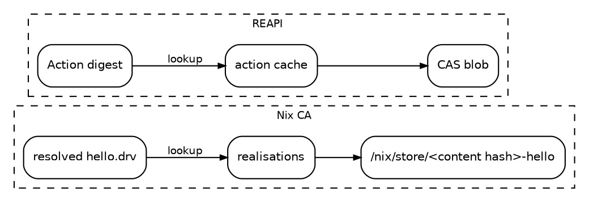

Despite how different they look on the surface, Nix, Bazel and buck2 are remarkably similar under the hood. Don't believe me?
I built a prototype in [one store, two frontends]() to prove it. Turns out though that the similarities are even deeper than I realized.

<!--more-->

Upon further reflection, I realized that the intensional model is an even more substantial common denominator. What is the intensional model? 

> **TIP**
> I've written before about [Nix's intensional model](), better known as content-addressed (CA) derivations. It has been "experimental" in Nix for years. 🧪
{: .alert .alert-tip }


In the intensional model, outputs are addressed by their _content_, and actions refer to their inputs by content as well. The extensional model instead addresses an output by the _recipe_ and _inputs_ that produced it. Nix also calls this "content-addressed derivations" (CA derivations). Bazel and buck2 don't name their model, but they use content-addressing as well.
Consider this coincidence: [Eelco's PhD thesis](https://edolstra.github.io/pubs/phd-thesis.pdf) was published in 2006, the same year that Google started development on Blaze, the predecessor of Bazel [[cite](https://medium.com/better-programming/from-blaze-to-buck2-a-brief-history-of-modern-monorepo-build-systems-563becbcb987)]. 


Let's take a closer look at the three systems with a simple C example and see how all three implement the intensional model. 🥸

```c
// greet.h
void greet(const char *name);

// greet.c
#include <stdio.h>
#include "greet.h"

/* say hi */
void greet(const char *name) {
  printf("hello, %s\n", name);
}

// main.c
#include "greet.h"

int main(void) {
  greet("world");
  return 0;
}
```

In the traditional extensional model (input-addressed), a change anywhere upstream of a build action invalidates the action's output. This occurs even if the change
is irrelevant to the output, such as a comment change in a source file. In contrast, the intensional model (content-addressed) only invalidates an action's output if the content of the output itself changes.

In our C example, if we were to change the comment in `greet.c` from `say hi` to `say hello`, the compiled object file `greet.o` would still be byte-for-byte identical, as the comment does not affect the compiled output. In the ideal world, the linking of `hello` would not need to be redone, as its inputs have not changed in content. 


<details markdown="1">
<summary>Nix example</summary>
```nix
{ pkgs ? import <nixpkgs> {}, ca ? false }:
let
  extra = pkgs.lib.optionalAttrs ca { __contentAddressed = true; };
in rec {
  # The `cp` is needed otherwise the source file's store path ends up
  # in the object file, which is a leak of the extensional model.
  greet = pkgs.runCommandCC "greet" extra ''
    cp ${./greet.h} greet.h; cp ${./greet.c} greet.c
    mkdir -p $out
    cc -c greet.c -o $out/greet.o
  '';
  hello = pkgs.runCommandCC "hello" extra ''
    cp ${./greet.h} greet.h; cp ${./main.c} main.c
    mkdir -p $out/bin
    cc main.c ${greet}/greet.o -o $out/bin/hello
  '';
}
```
</details>

By default, Nix uses the _extensional_ (input-addressed) model. If we _edit the comment_ and rebuild:

```console
$ nix-build -A hello
building '/nix/store/3hwrlpnji5bh5bajdg52s7zbg7ihs6j6-greet.drv'...
building '/nix/store/2k5is7yim1j8pb3qjz89bw45cqzcy2y5-hello.drv'...
/nix/store/122jc3iz6qkrgm907kdz7rrk3lp4qrma-hello
```
{: data-mark="3"}

Everything rebuilt. 😩

The store path in the extensional model is a hash of the _recipe_, and the recipe for `hello` includes the recipe for `greet`. Recursion is fun!
Change one byte anywhere upstream and every path downstream changes with it. 🌀


{: style="--graphviz-height: 6rem"}

> **Warning**
>  The two `hello` binaries are not even byte-identical: the cc-wrapper puts `$out/lib` in the `RUNPATH`, so the binary contains its own store path. The extensional model leaks into the bytes. 🙃
{: .alert .alert-warning }

If we enable the build to use content-addressed derivations we observe `greet` rebuilt, but `hello` did not. 🎉

```console
$ nix-build --extra-experimental-features ca-derivations -A hello --arg ca true
building '/nix/store/qpa1q7g5yjvhdbnfap4y3r2glzyflyv4-greet.drv'...
resolved derivation: '/nix/store/1xnbxrrprs50879ivzmjpv7cbk44w258-hello.drv' -> '/nix/store/rs2j6r2gvz2vi7nfvqj1s3yxx4lqpa3m-hello.drv'...
/nix/store/l2nrycgcg97vrz4nb59icwz9i04ys8jg-hello
```
{: data-mark="3"}


You can read [demystifying Nix's intensional model]() for a more detailed explanation of how CA derivations work, but the short version is that Nix rewrites `hello.drv` to point at `greet`'s _content-addressed_ output instead of `greet.drv`. The resolved `rs2j6r…-hello.drv` is the same one we built before the edit.

Since no "input" changed, Nix avoids the rebuild.

This is the same behavior as Bazel and buck2, which are intensional by default. 

<details markdown="1">
<summary>BUILD example</summary>
```python
cc_library(
    name = "greet",
    srcs = ["greet.c"],
    hdrs = ["greet.h"],
)

cc_binary(
    name = "hello",
    srcs = ["main.c"],
    deps = [":greet"],
)
```
</details>

If we edit the comment and rebuild with Bazel or buck2, we see that the compile ran, but the link was an _action cache hit_.

```console
$ bazel build //:hello --explain=explain.log
INFO: 2 processes: 1 action cache hit, 1 internal, 1 linux-sandbox.

$ cat explain.log
Executing action 'Compiling greet.c': action changed since cached execution.

$ buck2 build //:hello
Commands: 1 (cached: 0, remote: 0, local: 1)
BUILD SUCCEEDED

$ buck2 log what-ran
build  root//:greet (c_compile greet.c (pic))  local  ... clang -c ./greet.c ...
```
{: data-mark="2,8"}

Bazel and buck2 do not have an input-addressed mode. They always use the intensional model. An action's key is a hash of its command line (to force rebuilds) and the _content digests_ of its inputs.


{: style="--graphviz-height: 6rem"}

A change only travels as far as the bytes actually change. This optimization is called _early cutoff_, and it is the whole selling point of the intensional model.

There is a clear mapping between Nix's CA derivations and Bazel's action cache.

| Nix (intensional) | Bazel / buck2 (REAPI) |
| --- | --- |
| resolved derivation | `Action`: command + input digests |
| realisation: `drv output → store path` | action cache: `action digest → output digests` |
| content-addressed store path | blob in the CAS |

A resolved derivation _is_ a Bazel/buck2 action. 🤯


{: style="--graphviz-height: 8rem"}

You may see the output paths in Bazel and buck2 and think they are extensional (i.e. `bazel-out/k8-fastbuild/bin/hello`), but they are just a convenient place on disk. The real addresses are the digests. `buck2` can even make this explicit with `declare_output(has_content_based_path=True)`.

Until [dynamic derivations]() stabilize, people will continue to reach for Bazel and buck2 for the granularity on large builds. The intensional model is a big part of why they are so fast, and Nix has the same model. The two implementations are nearly identical in concept.

Nix described the intensional model in 2006. Google started building on it the same year. Twenty years later, maybe it's time they compared notes. 🥸
