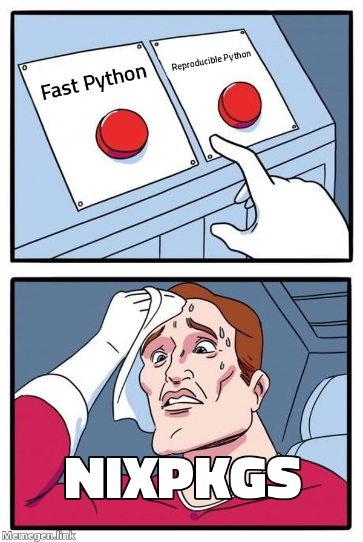
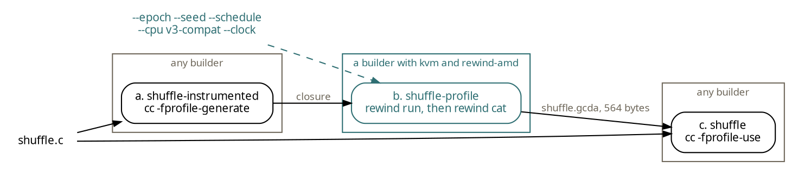

Profile-guided optimization (PGO) is an easy way to speed up a program, especially if the workload is somewhat stable. In [leaving performance on the table]() I built a profile-guided sqlite3 variant for a 1.32x speedup for our select workloads.

Compilers and interpreters make excellent candidates for PGO, since the training workload looks like the real one: compiling code is compiling code. They also benefit the most from it, since they underpin so many other programs; a small speedup in the compiler or interpreter can have a large effect on the overall system performance.

Despite their benefits, PGO is not widely used in package-managers. For instance, Python and GCC both support profile-guided builds but are explicitly disabled in Nixpkgs ([Python](https://github.com/NixOS/nixpkgs/blob/0ec91f273c5f2edc3ed4e390acdbb18105e285d1/pkgs/development/interpreters/python/cpython/default.nix#L79-L122), [GCC](https://github.com/NixOS/nixpkgs/blob/0ec91f273c5f2edc3ed4e390acdbb18105e285d1/pkgs/development/compilers/gcc/default.nix#L204-L206)), and Guix ([Python](https://codeberg.org/guix/guix/src/commit/866708b91c7385e1a49470e31075681fe9d72d20/gnu/packages/python.scm#L974-L977)).

> **Aside**
> Nix and Guix both do not need reproducible builds to stay consistent. Their store paths are input-addressed, meaning the path is derived from the inputs only. They can produce outputs with different bytes claiming the same path, and whichever one reaches the binary cache first is the one everybody downloads.
{: .alert .alert-note }

[](/assets/images/rewind_pgo_buttons_meme.png)
{: style="--image-width: 18rem"}

Why are they disabled? Reproducibility!

Many package managers have reproducible builds as a <u>goal</u>, and **PGO is not reproducible**. 

> When compiling from the same source on independent infrastructure yields bit-by-bit identical results, this gives confidence that the build infrastructure was not compromised and the artifact really does correspond to the source.
>
> -- [reproducible.nixos.org](https://reproducible.nixos.org/)

To build a profile-guided program, the compiler first builds it with instrumentation. Running that build on a training workload collects profile data, which is the "profile-guided" part. The compiler then uses the profile to optimize the program in a second build.[^optimize] The problem is that the training run is not reproducible,[^world] so the profile can differ between builds, and with it the optimized binary.

[^world]: The training run depends on the machine it runs on: the CPU, the clock, thread scheduling and anything else that changes between builds.

[^optimize]: The instrumented program counts which branches it takes, and the second build compiles the program again with those counts. The compiler uses them to decide what to inline, which blocks to lay out together, and which functions are hot or cold.

We want profile-guided builds though, because it is such an easy way to speed up a program. Can we make PGO reproducible so that we can have our cake and eat it too?

I have been building [Rewind](https://rewindvm.dev), a deterministic virtual machine. A program's execution becomes a pure function of its inputs. I have primarily been using it to investigate and find bugs[^leaderboard] or as a way to [make builds bit-reproducible](). It occurred to me that the same properties that make Rewind useful for debugging and reproducible builds can also make PGO reproducible.

[^leaderboard]: [Rewind's bug leaderboard](https://rewindvm.dev/bugs) tracks bugs found in the wild.

> **Aside:**
> New to Rewind? Start with [a flaky build you only catch once]() and [dafuq is a deterministic VM?]()
{: .alert .alert-note }

Here is a program whose profile depends on the order in which its threads run. It hands 100,000 jobs to two workers: one worker always runs `checksum` and the other always runs `compress`, so how often each function runs depends on which worker takes each job. That depends on the thread schedule, which is non-deterministic, so the profile is non-deterministic too.

```c
static void *worker(void *arg)
{
	long id = (long)arg, acc = 0;

	for (int job; (job = take()) != DONE;) {
		/* The seed picks which worker checksums and which compresses. */
		if ((id ^ seed) & 1) {
			acc += checksum(job ^ seed);
		} else {
			acc += compress((job ^ seed) & 0xffff);
		}
	}
	return (void *)acc;
}
```

<details markdown="1">
<summary>shuffle.c</summary>
```c
/* main() hands jobs to two workers through a small queue. Which worker
 * takes a job decides which code path runs, so the profile depends on
 * the schedule. */
#include <pthread.h>
#include <stdio.h>
#include <sys/random.h>

#define JOBS 100000
#define SLOTS 8
#define DONE -1

static pthread_mutex_t lock = PTHREAD_MUTEX_INITIALIZER;
static pthread_cond_t not_empty = PTHREAD_COND_INITIALIZER;
static pthread_cond_t not_full = PTHREAD_COND_INITIALIZER;
static int queue[SLOTS], head, count;
static unsigned seed;

__attribute__((noinline)) static long checksum(long x)
{
	for (int i = 0; i < 64; i++) {
		x = x * 6364136223846793005L + 1442695040888963407L;
	}
	return x;
}

__attribute__((noinline)) static long compress(long x)
{
	while (x > 1) {
		x = (x & 1) ? 3 * x + 1 : x / 2;
	}
	return x;
}

static void put(int job)
{
	pthread_mutex_lock(&lock);
	while (count == SLOTS) {
		pthread_cond_wait(&not_full, &lock);
	}
	queue[(head + count++) % SLOTS] = job;
	pthread_cond_signal(&not_empty);
	pthread_mutex_unlock(&lock);
}

static int take(void)
{
	pthread_mutex_lock(&lock);
	while (count == 0) {
		pthread_cond_wait(&not_empty, &lock);
	}
	int job = queue[head];
	head = (head + 1) % SLOTS;
	count--;
	pthread_cond_signal(&not_full);
	pthread_mutex_unlock(&lock);
	return job;
}

static void *worker(void *arg)
{
	long id = (long)arg, acc = 0;

	for (int job; (job = take()) != DONE;) {
		/* The seed picks which worker checksums and which compresses. */
		if ((id ^ seed) & 1) {
			acc += checksum(job ^ seed);
		} else {
			acc += compress((job ^ seed) & 0xffff);
		}
	}
	return (void *)acc;
}

int main(void)
{
	pthread_t t[2];

	getrandom(&seed, sizeof seed, 0);
	for (long i = 0; i < 2; i++) {
		pthread_create(&t[i], NULL, worker, (void *)i);
	}
	for (int job = 0; job < JOBS; job++) {
		put(job);
	}
	for (int i = 0; i < 2; i++) {
		put(DONE);
	}
	for (int i = 0; i < 2; i++) {
		pthread_join(t[i], NULL);
	}
	puts("done");
	return 0;
}
```
</details>

A typical Nix derivation does all three PGO steps in its `buildPhase`, and keeps the profile in `$out` so we can inspect it:

```nix
{
  pkgs ? import <nixpkgs> { },
}:
pkgs.stdenv.mkDerivation {
  name = "shuffle-pgo";
  src = ./shuffle.c;
  dontUnpack = true;

  buildPhase = ''
    cp $src shuffle.c

    # 1. Build with instrumentation.
    cc -O2 -pthread -fprofile-generate -c shuffle.c -o shuffle.o
    cc -pthread -fprofile-generate shuffle.o -o shuffle

    # 2. Train: the run writes its counters to shuffle.gcda.
    ./shuffle

    # 3. Rebuild using the counters.
    cc -O2 -pthread -fprofile-use -c shuffle.c -o shuffle.o
    cc -pthread shuffle.o -o shuffle
  '';

  installPhase = ''
    install -Dm755 shuffle $out/bin/shuffle
    install -Dm644 shuffle.gcda $out/share/shuffle.gcda
  '';
}
```

Build it, then ask Nix to build it again and compare:

```console
$ nix-build
/nix/store/3ynxjxlc05afxwk675ysdbvi7vp4vpqm-shuffle-pgo

$ nix-build --check -K
error: derivation '/nix/store/f4522l48yf8wdd488yg4p604xqx1i2z3-shuffle-pgo.drv' may not be deterministic: output "/nix/store/3ynxjxlc05afxwk675ysdbvi7vp4vpqm-shuffle-pgo" differs from "/nix/store/3ynxjxlc05afxwk675ysdbvi7vp4vpqm-shuffle-pgo.check"
```

Rebuilding the derivation multiple times and reading the profile shows that the counts are different every time.

| build    | `checksum` calls | `compress` calls | ran first  | binary         |
| -------- | ---------------: | ---------------: | ---------- | -------------- |
| original |           55,163 |           44,837 | `compress` | `ba528bca18f5` |
| check 1  |           57,725 |           42,275 | `checksum` | `2bb3ff5e19d2` |
| check 2  |           57,066 |           42,934 | `compress` | `ba528bca18f5` |
| check 3  |           57,443 |           42,557 | `compress` | `ba528bca18f5` |
| check 4  |           58,522 |           41,478 | `checksum` | `2bb3ff5e19d2` |
| check 5  |           58,486 |           41,514 | `checksum` | `2bb3ff5e19d2` |
| check 6  |           57,799 |           42,201 | `checksum` | `2bb3ff5e19d2` |

> **Aside**
> Interestingly, only two binaries are produced (`ba528bca18f5` and `2bb3ff5e19d2`), but the profile is different every time. `-fprofile-use` turns on `-fprofile-reorder-functions`, which lays functions out in order of first use. We could disable that and get the same binary every time for this toy, but the counts still change, and in a real program they decide inlining and block layout.
{: .alert .alert-note }

Inside Rewind the run is fixed by its boot clock, seed and thread schedule, so the same inputs give the same profile. To use Rewind, we split the derivation into three separate derivations: one for the instrumented build, one for the training run, and one for the final build. Compiling is already deterministic, so the two compiles remai ordinary derivations. Only the training run in the middle needs a deterministic machine, and that one runs inside Rewind.n



The one part of the deterministic VM the model does not fix is the vendor. Intel and AMD differ in ways that cannot be hidden from the guest, so they are exposed to the program and _could_ change the program execution and therefore the profile. That means the training run must be pinned to a vendor, and the derivation must require that vendor.[^check]

[^check]: The derivation checks the vendor against `/proc/cpuinfo` and refuses to run if it does not match.

```nix
{
  pkgs ? import <nixpkgs> { },
  rewind ?
    (builtins.getFlake "github:fzakaria/rewindvm/v0.12.0")
    .packages.${pkgs.stdenv.hostPlatform.system}.default,
  # The CPU vendor to train on. Rewind's fixed CPU model keeps the host's
  # vendor, so each vendor trains its own profile.
  vendor ? "amd",
}:
let
  # What /proc/cpuinfo calls each vendor.
  vendorIds = {
    amd = "AuthenticAMD";
    intel = "GenuineIntel";
  };

  # The training run's inputs: the VM's clock at boot, the seed for its
  # randomness, the thread schedule, and what moves its clock.
  epoch = "1790985600";
  seed = "0";
  schedule = "1";
  clock = "branches";

  # a. The program built with instrumentation, natively.
  instrumented = pkgs.runCommandCC "shuffle-instrumented" { } ''
    cp ${./shuffle.c} shuffle.c
    cc -O2 -pthread -fprofile-generate -c shuffle.c -o shuffle.o
    mkdir -p $out/bin
    cc -pthread -fprofile-generate shuffle.o -o $out/bin/shuffle
  '';

  # b. The training run, inside Rewind. The instrumented program writes
  # its counters to /build/shuffle.gcda, where it was compiled.
  profile =
    pkgs.runCommand "shuffle-profile"
      {
        nativeBuildInputs = [
          rewind
          pkgs.jq
        ];
        # A builder whose Rewind module says this vendor, with KVM.
        requiredSystemFeatures = [
          "kvm"
          "rewind-${vendor}"
        ];
        closure = pkgs.closureInfo { rootPaths = [ instrumented ]; };
      }
      ''
        export HOME=$TMPDIR

        # Another vendor would train another profile: refuse instead.
        if ! grep -q "vendor_id.*: ${vendorIds.${vendor}}$" /proc/cpuinfo; then
          echo "this profile trains on ${vendor}; this builder is $(grep -m1 vendor_id /proc/cpuinfo)" >&2
          exit 1
        fi

        # A root filesystem holding the program and its closure.
        mkdir -p root/nix/store root/build
        xargs -I{} cp -a {} root/nix/store/ < $closure/store-paths

        rewind run --root root --cwd /build --json \
          --epoch ${epoch} --seed ${seed} --schedule ${schedule} \
          --cpu v3-compat --clock ${clock} \
          -- ${instrumented}/bin/shuffle > run.json
        jq . run.json >&2

        # Read the profile as it was when the run ended.
        id=$(jq -r .id run.json)
        steps=$(jq -r .steps run.json)
        mkdir -p $out
        rewind cat --progress off $id $steps /build/shuffle.gcda > $out/shuffle.gcda
      '';
in
# c. The program rebuilt with the profile, natively.
pkgs.runCommandCC "shuffle" { passthru = { inherit instrumented profile; }; } ''
  cp ${./shuffle.c} shuffle.c
  cp ${profile}/shuffle.gcda shuffle.gcda
  cc -O2 -pthread -fprofile-use -c shuffle.c -o shuffle.o
  mkdir -p $out/bin
  cc -pthread shuffle.o -o $out/bin/shuffle
''
```

Nix puts `/dev/kvm` inside the sandbox on a machine that lists `kvm` in its `system-features`, as NixOS does by default. `kvm` alone does not say the machine can train this profile, so the derivation also requires `rewind-amd`. A builder can opt-in easily through Rewind's NixOS module:

```nix
programs.rewind = {
  enable = true;
  systemFeature = "amd";
  # AMD only: make the branch counter exact at every boot.
  amdBranchCounterWorkaround = true;
};
```

Build it, then check both the profile and the final program:

```console
$ nix-build
/nix/store/f1yqkk8a3binrq4iqrm6mdl1p7zp5dvv-shuffle

$ nix-build -A passthru.profile --check
/nix/store/ywv05plinnpg868b0p66b1lpfjnr9sp1-shuffle-profile

$ nix-build --check
/nix/store/f1yqkk8a3binrq4iqrm6mdl1p7zp5dvv-shuffle
```

This means our profile-guided build is bit-for-bit reproducible!

The profile is a function of the derivation now along with the other arguments to Rewind: `--epoch` `--seed` `--schedule` `--cpu` and `--clock`. If any of those change, the profile changes too.

In our example above, we picked `--schedule 1` why?

This is a little beyond the reproducible build story, but picking a workload is a bit-of-an-art. You want to pick a workload that resembles production, so that the profile is useful.

Since our toy-example is heavily influenced by the thread schedule, we can try different schedules and see what profile they produce.

| schedule | `checksum` calls | `compress` calls |
| -------: | ---------------: | ---------------: |
|        0 |          100,000 |                0 |
|        1 |           50,004 |           49,996 |
|        2 |          100,000 |                0 |
|        3 |          100,000 |                0 |

Three of the four gave every job to one worker, so `compress` would never run in training, and a profile from them would tell GCC or Clang that `compress` is dead code. Schedule 1 is closer to what we hypothetically expect which is about a 50/50 split.

In a more realistic program, picking any schedule would likely be fine, since the program's execution is less dependent on the schedule.

Although our profiles are vendor-specific, having a meaningful way forward to having reproducible profile-guided builds can help unlock a lot of easy performance wins.

Fast Python or reproducible Python? Press both buttons.