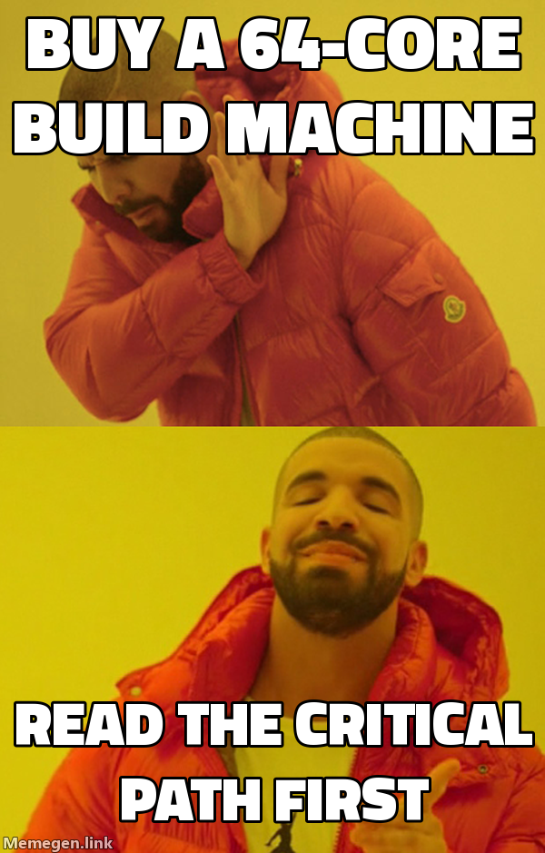
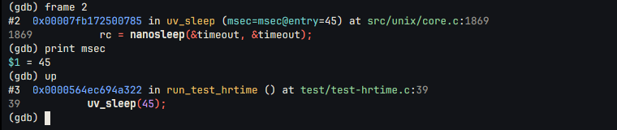
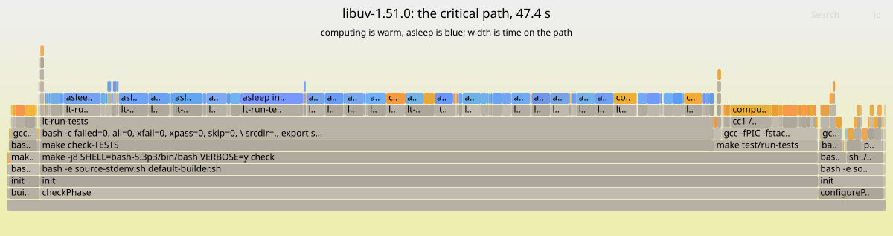

Okay, I am the first to admit that I'm a bit manic with AI. When you are working on a problem that has endless possibilities, it is difficult to constrain yourself to a limited set of features.

Can I just add one more?

[](/assets/images/rewind_time_hypno_gregg.png)
{: style="--image-width: 12rem"}

I have been amazed at all the fun and useful things that a deterministic VM like [Rewind](https://rewindvm.dev) enables. I have been using it to help [find heisenbugs](), to make [profile-guided optimization reproducible](), and to make [Nix builds bit-reproducible](). But the most fun has been using it to understand performance.

Turns out that performance is yet another area where Rewind shines. I have been using it to analyze the critical path of builds.

What is the critical path?

The critical path is the longest chain of dependent work in a program. It is the minimum time that the program can take to complete, regardless of how many resources you throw at it. The only way to make a program faster is to shorten the critical path.

<figure>
<svg viewBox="0 0 620 160" role="img"
     style="display:block;margin-inline:auto;max-width:38rem;width:100%;height:auto;font-family:var(--mono)"
     aria-label="Five tasks. A runs first. B, C and D start when A ends and run side by side. E starts when all three have ended. C is the longest, so B and D finish early and wait. The critical path, A then C then E, is highlighted: no number of CPUs makes the run shorter than that chain.">
  <rect x="20" y="54" width="90" height="26" rx="4" fill="none" stroke="#b1201d" stroke-width="2"/>
  <text x="65" y="72" font-size="12" text-anchor="middle" fill="#b1201d">A</text>

  <line x1="110" y1="67" x2="130" y2="27" stroke="currentColor" stroke-width="1.5" opacity="0.5"/>
  <line x1="110" y1="67" x2="130" y2="67" stroke="#b1201d" stroke-width="2"/>
  <line x1="110" y1="67" x2="130" y2="107" stroke="currentColor" stroke-width="1.5" opacity="0.5"/>

  <rect x="130" y="14" width="90" height="26" rx="4" fill="none" stroke="currentColor" stroke-width="1.5" opacity="0.5"/>
  <text x="175" y="32" font-size="12" text-anchor="middle" fill="currentColor" opacity="0.5">B</text>
  <line x1="220" y1="27" x2="340" y2="27" stroke="currentColor" stroke-width="1.5" stroke-dasharray="4 3" opacity="0.4"/>
  <line x1="340" y1="27" x2="350" y2="67" stroke="currentColor" stroke-width="1.5" opacity="0.5"/>

  <rect x="130" y="54" width="200" height="26" rx="4" fill="none" stroke="#b1201d" stroke-width="2"/>
  <text x="230" y="72" font-size="12" text-anchor="middle" fill="#b1201d">C</text>
  <line x1="330" y1="67" x2="350" y2="67" stroke="#b1201d" stroke-width="2"/>

  <rect x="130" y="94" width="50" height="26" rx="4" fill="none" stroke="currentColor" stroke-width="1.5" opacity="0.5"/>
  <text x="155" y="112" font-size="12" text-anchor="middle" fill="currentColor" opacity="0.5">D</text>
  <line x1="180" y1="107" x2="340" y2="107" stroke="currentColor" stroke-width="1.5" stroke-dasharray="4 3" opacity="0.4"/>
  <text x="260" y="101" font-size="12" text-anchor="middle" fill="currentColor" opacity="0.75">waits</text>
  <line x1="340" y1="107" x2="350" y2="67" stroke="currentColor" stroke-width="1.5" opacity="0.5"/>

  <rect x="350" y="54" width="100" height="26" rx="4" fill="none" stroke="#b1201d" stroke-width="2"/>
  <text x="400" y="72" font-size="12" text-anchor="middle" fill="#b1201d">E</text>
  <text x="462" y="72" font-size="13" fill="#b1201d" font-weight="600">← critical path</text>

  <text x="20" y="150" font-size="12" fill="currentColor" opacity="0.75">extra CPUs run B, C and D concurrently; A → C → E still sets the minimum runtime</text>
</svg>
</figure>

If you worship at the altar of Brendan Gregg, you know he spent years turning performance analysis from a dark art into a science. This is a small offering to him. 🤲

I added a new `rewind time` command to Rewind that analyzes a recording and tells you where the time went and what would make the run finish sooner. You can drill into any part of that answer and see the source lines responsible for it. It's like [Brendan Gregg's flame graphs](https://www.brendangregg.com/flamegraphs.html) but ~~on steroids~~ for the critical path and with a debugger attached.[^ideas]

[^ideas]: All the ideas for the command are either inspired by or directly influenced by [Brendan Gregg's work](https://www.brendangregg.com/). Kneel before Zod!

> **Aside:**
> New to Rewind? Start with [a flaky build you only catch once]() and [dafuq is a deterministic VM?]()
{: .alert .alert-note }

Let's see how it works by analyzing the critical path of a [libuv](https://github.com/libuv/libuv) build and test run. The build and test suite takes 78 seconds inside Rewind, and even with 64 cores it still takes 47 seconds. Why?

The usual answer is to look at a CPU profile, and in this case a CPU profile would be almost useless. For two thirds of those 47 seconds, the work the build is waiting on is not computing at all: it is _asleep_. 💤💤💤

## Where the time goes

Every `rewind time` starts with two numbers:

```console
$ rewind time 7a29e716
libuv-1.51.0
    78.0 s  elapsed on the VM's one CPU
    47.4 s  critical path: the least it can take on any number of CPUs
            67% asleep (epoll_pwait 23.1 s, clock_nanosleep 8.53 s, futex 100 ms), 33% computing
```
{: data-mark="3,4"}

The first is how long the run took on the VM's one virtual CPU. The second is the **critical path**: the longest chain of work where each step had to wait for the one before.

No number of CPUs makes a run shorter than its critical path, so the gap between the two numbers is all that parallelism can buy you.

[](/assets/images/rewind_time_drake_meme.png)
{: style="--image-width: 16rem"}

The line under the two numbers applies Gregg's [thread state analysis](https://www.brendangregg.com/tsamethod.html). Here the biggest state is asleep: 23 seconds in `epoll_pwait` and 8.5 in `clock_nanosleep`.

A sleeping thread is invisible to a CPU profiler. Gregg's answer is [off-CPU analysis](https://www.brendangregg.com/offcpuanalysis.html): look at where threads block, not only where they compute.

On a live machine, off-CPU analysis is hard. Linux can trace which thread woke which, and Gregg built [wakeup and off-wake profiling](https://www.brendangregg.com/blog/2016-02-01/linux-wakeup-offwake-profiling.html) on top of that, but you have to be tracing before the slow run happens, the tracing has a cost, and most of the sleeps you capture are noise. Rewind already logs every context switch because it needs them to replay, and now it records every wakeup and who caused it too. All that _juicy_ information is in every recording. 🤤

Here is the whole output for libuv:

```console
$ rewind time 7a29e716
libuv-1.51.0
    78.0 s  elapsed on the VM's one CPU
    47.4 s  critical path: the least it can take on any number of CPUs
            67% asleep (epoll_pwait 23.1 s, clock_nanosleep 8.53 s, futex 100 ms), 33% computing

The critical path by phase
    3.54 s  configurePhase  ██
    1.67 s  buildPhase      █
    42.0 s  checkPhase      █████████████████████
     99 ms  5 other phases

The critical path by process
   on path      pid  process, with what it started
    47.4 s       34  init › bash -e source-stdenv.sh default-builder.sh
    41.9 s     4076  ├─ make -j8 SHELL=bash-5.3p3/bin/bash VERBOSE=y check
    36.4 s     4910  │  ├─ make › bash › lt-run-tests
    3.38 s     5412  │  │  ├─ lt-run-tests hrtime hrtime  asleep in clock_nanosleep 3.38 s
    2.00 s     5013  │  │  ├─ lt-run-tests delayed_accept delayed_accept  asleep in epoll_pwait 2.00 s
    1.62 s     5126  │  │  ├─ lt-run-tests fs_event_watch_dir fs_event_watch_dir  asleep in epoll_pwait 1.62 s
    1.60 s     5103  │  │  ├─ lt-run-tests fs_event_close_in_callback fs_event_close_in…  asleep in epoll_pwait 1.60 s
    1.60 s     5508  │  │  ├─ lt-run-tests metrics_idle_time metrics_idle_time  asleep in epoll_pwait 1.00 s, computing 600 ms
    1.24 s     6095  │  │  ├─ lt-run-tests tcp_write_ready tcp_write_ready
    1.14 s     5510  │  │  ├─ lt-run-tests metrics_idle_time_thread metrics_idle_time_t…  asleep in epoll_pwait 1.00 s
    1.10 s     5132  │  │  ├─ lt-run-tests fs_event_watch_file_current_dir fs_event_wat…  asleep in epoll_pwait 1.10 s
    22.6 s           │  │  └─ 279 more
    5.59 s     4077  │  └─ make test/run-tests
    2.22 s     4183  │     ├─ gcc -fPIC -fstack-clash-protection -O2 -U_FORTIFY_SOURCE …
    2.10 s     4189  │     │  └─ cc1 /build/source/test/test-fs.c
    3.35 s           │     └─ 20 more
    1.99 s       68  ├─ sh ./autogen.sh
    1.99 s           │  └─ 9 more
    1.67 s     2642  ├─ make -j8 SHELL=bash-5.3p3/bin/bash
    1.67 s           │  └─ 5 more
    1.53 s      403  └─ bash ./configure --disable-static --disable-dependency-tracking…
    1.47 s              └─ 581 more

What would shorten it
    sooner      pid  if this took no time
    36.1 s           every lt-run-tests, 600 processes
    6.66 s           every cc1, 283 processes
    3.38 s     5412  75 sleeps in clock_nanosleep: lt-run-tests hrtime hrtime
    2.00 s     5013  2 sleeps in epoll_pwait: lt-run-tests delayed_accept delayed_accept
    1.76 s     4189  cc1 /build/source/test/test-fs.c
    1.62 s     5126  30 sleeps in epoll_pwait: lt-run-tests fs_event_watch_dir fs_event_watc…
    1.60 s     5103  16 sleeps in epoll_pwait: lt-run-tests fs_event_close_in_callback fs_ev…
    1.60 s     5508  lt-run-tests metrics_idle_time metrics_idle_time
    1.22 s           every perl, 9 processes
    1.14 s     5510  lt-run-tests metrics_idle_time_thread metrics_idle_time_thread

Look closer
  rewind time 7a29e716 --in PID             one process: its threads, sleeps and waits
  rewind time 7a29e716 --folded             the path for flamegraph.pl or speedscope.app
  rewind time 7a29e716 --perfetto F         every process on a timeline, for ui.perfetto.dev
```

The second table is the path as a **tree of processes** based on Gregg's [colony graph](https://www.brendangregg.com/ColonyGraphs/execution.html) idea. Each line is a process with everything it started, and its time on the critical path.[^ps]

[^ps]: A `ps` snapshot might miss short-lived process invocations; the recording has every fork, regardless of how brief.

In this build, `make check` needs 41.9 of the total 47.4 seconds, and 36.4 of that is `lt-run-tests`, libuv's test runner. The test runner invokes 287 tests each spending 1-3 seconds.

All of those tests are on the path, and the path is a single chain, so the runner ran them one after another. Worse, most of each test is spent asleep, waiting on timers.

Drag can be less than time on the path.
{: .aside}

The last table answers a different question: how much sooner would the run finish if this part took no time? The critical path method calls this _drag_.

For the truly magical part, we can jump to any part of the path and see what was happening, invoke `gdb` and fork the run at that moment. A profiler hands you a stack, sampled at some moment you can never go back to. Every frame in `rewind time` is a moment in a recording, and Rewind can replay the run to it.

`--in` looks inside one process,[^pid] so let's dive into the `hrtime` test that spent 3.38 seconds asleep in `clock_nanosleep`:

[^pid]: It can take a pid, a program or a word of the command line.

```console
$ rewind time 7a29e716 --in hrtime
lt-run-tests hrtime hrtime (pid 5412)
    3.38 s  on the critical path with what it started, 7% of the 47.4 s path
            100% asleep (clock_nanosleep 3.38 s), <1% computing

What would shorten it
    sooner      pid  if this took no time
    3.38 s           75 sleeps in clock_nanosleep

Look closer
  rewind where 7a29e716 115894 --pid 5412   the source line the first row's time starts at
  rewind time 7a29e716 --perfetto F         every process on a timeline
```
{: data-mark="11"}

Since this test spent 100% of its time asleep, the step provided on the last line is where it began. `rewind where` replays the run to that step and asks gdb where the thread was:

```console
$ rewind where 7a29e716 115894 --pid 5412
process 5412 (lt-run-tests), thread 5412, at step 115894
#2 uv_sleep (src/unix/core.c:1869)
    1867
    1868    do
>   1869      rc = nanosleep(&timeout, &timeout);
    1870    while (rc == -1 && errno == EINTR);
    1871
arguments:
  msec = 45
locals:
  timeout = {tv_sec = 0, tv_nsec = 45000000}
  rc = <optimized out>
  __PRETTY_FUNCTION__ = <error: Cannot access memory at address 0x7fb172519ae8>
called from #3 run_test_hrtime (test/test-hrtime.c:39)
called from #4 __libc_start_call_main (../sysdeps/nptl/libc_start_call_main.h:58)
```
{: data-mark="6"}

🎯 We can see that the test is calling `uv_sleep(45)` from line 39 of `test/test-hrtime.c`, and that it is sleeping for 45 milliseconds.
It does that 75 times for a total of 3.38 seconds.[^purpose]

[^purpose]: Turns out that the test sleeps on purpose: it is checking how far `uv_hrtime` moves across a sleep. There is nothing to optimize in this case.

[](/assets/images/rewind_time_pigeon_meme.png)
{: style="--image-width: 22rem"}

As the cherry on top: the run is deterministic, so step 115,894 is the same instruction every time you replay it. You can open `rewind gdb` at that step and investigate to your heart's content.

The Rewind app's _Time_ tab shows the same answers. The path becomes a flame graph, colored the way Gregg colors his [off-CPU flame graphs](https://www.brendangregg.com/FlameGraphs/offcpuflamegraphs.html): computing is warm, asleep is blue, and a process shades from one to the other by how much of its time it slept.

[](/assets/images/rewind-time-overview.png)
{: style="--image-width: 34rem"}

Clicking a frame picks it and moves the playhead there, so the build log, the process tree and the files all show that moment; clicking a process again zooms into it. When you pick a blue frame, the app replays the run to that part's longest sleep and shows the stack where it slept:

[](/assets/images/rewind-time-where.png)
{: style="--image-width: 34rem"}

Under the stack, _Show source_ opens the source panel at that moment on that thread, and _Open gdb here_ opens gdb in a fork of the run at the sleep:

[](/assets/images/rewind-time-gdb.png)

If you'd rather use tools you already know, `rewind time` can emit the data in their formats: folded stacks for [flamegraph.pl](https://github.com/brendangregg/FlameGraph) and [speedscope](https://www.speedscope.app), or a Perfetto trace for [ui.perfetto.dev](https://ui.perfetto.dev).

The flame graph below is the real flamegraph.pl output: click a frame to zoom in, or [open it on its own](/assets/images/rewind-time-libuv-flamegraph.svg).
{: .aside}

<figure>
<object data="/assets/images/rewind-time-libuv-flamegraph.svg" type="image/svg+xml" aria-label="A flame graph of libuv's critical path made by flamegraph.pl from rewind time --folded: checkPhase is most of the width, with lt-run-tests' tests in a row of blue asleep frames, and configurePhase and the test compiles in warm colors at the right"
        style="display:block;width:100%;aspect-ratio:1200/318">
  
</object>
</figure>

## Kneeling at the altar

Every idea here predates Rewind. Gregg has been drawing off-CPU and wakeup flame graphs for over a decade, and build systems have reported critical path information potentially even longer.[^bazel] I have been inspired by his work since I first dabbled in [eBPF](https://ebpf.io/), back when [flame graphs](https://www.brendangregg.com/flamegraphs.html) were new. 🙇

[^bazel]: [Bazel's critical path analysis](https://bazel.build/advanced/performance/build-performance-metrics) is a great example of this, and it has been around for years.

What Rewind adds is the data. _Lots of it._

Rewind has that data because it can't replay without it. On a single CPU the only thing that changes from run to run is the scheduler, so every recording already logs every context switch. 

This changes the economics of performance analysis. On a live machine, you have to trace before the run, and tracing has a cost. You can only trace a few runs, and you have to pick which ones. Rewind traces every run, so you can analyze any of them later, and do so exactly. 

It has just been a ~~manic fever~~ joy to take ideas I have admired for years, point them at a deterministic VM, and watch them work in ways that are hard or impossible on a normal machine.

Please accept `rewind time` as my offering at the altar of Brendan Gregg.