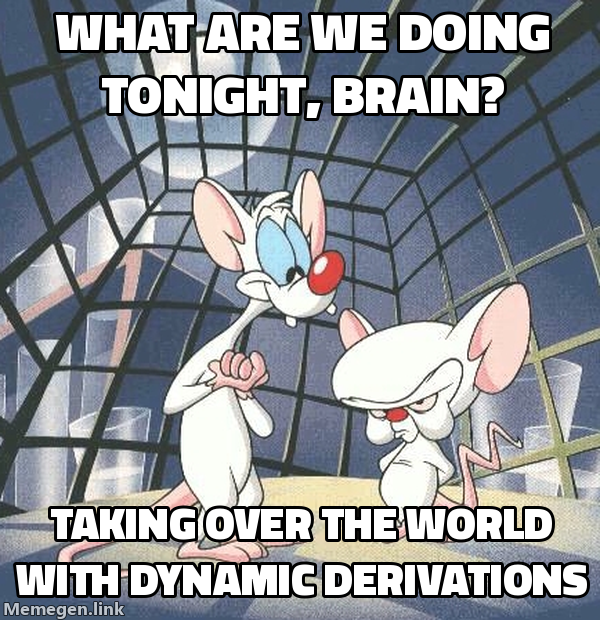

Have you heard about [dynamic derivations]()? 


They are an experimental-feature in Nix that lets a derivation produce other derivations as its output. Why ? This lets you dynamically create your build graph, instead of having to know it all at evaluation time. It's Nix's answer to try and match the build speed of other build systems like [Bazel](https://https://bazel.build/) or [buck2](https://buck2.build/).

[](/assets/images/dyn_drv_so_hot_meme.png)
{: style="--image-width: 20rem"}

There is not much written about dynamic derivations, and the documentation is sparse. I have [written]() [a]() [few]() [posts]() about them, so I sometimes get questions about them.

Recently, I got a DM from [Evan Porter](https://www.linkedin.com/in/evanwp/) over [LinkedIn](https://www.linkedin.com/), the ultimate bug triaging network, about whether it is possible to query the deriver of a dynamic derivation to get the initial derivation.


> For dynamic derivations let's say I have a .drv.drv file. This file outputs a derivation.
> Is it usually possible to query deriver the output derivation to obtain the initial derivation?

They had tried it and got this:

```console
$ nix-store --query --deriver \
    $(nix-store --query --deriver ./result)
unknown-deriver
```

That should work. 🤨 Every path a build registers carries a `deriver`, the `.drv` that produced it, and a `.drv` that came out of a build is still a path a build registered.

When I tried it, it worked. 🤷

You will need `extra-experimental-features = dynamic-derivations ca-derivations recursive-nix` in your `nix.conf` to drive the samples in this post.
{: .aside}


```console
$ nix build -f default.nix \
    --print-out-paths
/nix/store/v4hkwn8y4m083gsap6523c0m5r985ygr-result

$ nix-store --query --deriver \
    /nix/store/v4hkwn8y4m083gsap6523c0m5r985ygr-result
/nix/store/6pniymfhwcyrmkns0np7ap1argjziqq2-result.drv

$ nix-store --query --deriver \
    /nix/store/6pniymfhwcyrmkns0np7ap1argjziqq2-result.drv
/nix/store/m5x261fv29jkn0rvznqj2fzkaql01xiy-result.drv.drv
```

Turns out, there is a case where you do get `unknown-deriver` if you set `__contentAddressed = true` on the producer. If the producer is content-addressed, its output path is not known until after the build, and Nix does not fill in the `deriver` of a path that already exists.
I filed [NixOS/nix#16823](https://github.com/NixOS/nix/issues/16823).

The question though made me wonder how far back you can walk the chain of dynamic derivations. I had to try it. 😈

Let's pick a fun example to see how far we can go. Here is a derivation that imitates the classic song _99 bottles of beer_ by producing a chain of derivations, each one outputting the next verse.[^recursive-nix]

[^recursive-nix]: The builder writes the next derivation by hand in [ATerm](), so there is no recursive Nix and no `nix-instantiate` involved.

```bash
export PATH=$busybox/bin

# A content-addressed derivation does not know its output path, so its
# "out" variable holds this placeholder and Nix swaps in the real path at
# build time. It is "/" + nix32(sha256("nix-output:out")), the same for
# every derivation with an output named "out".
OUT_PLACEHOLDER=/1rz4g4znpzjwh1xymhjpm42vipw92pr73vdgl6xs1hycac8kf2n9

bottles() {
  case $1 in
    0) echo "no more bottles" ;;
    1) echo "1 bottle" ;;
    *) echo "$1 bottles" ;;
  esac
}

# The last derivation in the chain writes the punchline instead of a .drv.
if [ "$n" -eq 0 ]; then
  echo "No more bottles of beer on the wall, no more bottles of beer." >&2
  echo "Go to the store and buy some more." > $out
  exit 0
fi

next=$((n - 1))
echo "$(bottles $n) of beer on the wall, $(bottles $n) of beer." >&2
echo "Take one down, pass it around, $(bottles $next) of beer on the wall." >&2

# Input sources must be sorted.
srcs=$(printf '"%s"\n' "$busybox" "$script" | sort | paste -sd, -)

# Write the derivation for the next verse. A .drv is a single line of
# ATerm, so strip the spaces and newlines that are only here for reading.
# Nix takes a derivation's name from its store path, so the next name is
# ours minus one ".drv".
tr -d ' \n' > $out <<EOF
Derive(
  [("out", "", "text:sha256", "")],
  [],
  [$srcs],
  "$system",
  "$busybox/bin/sh",
  ["$script"],
  [
    ("builder", "$busybox/bin/sh"),
    ("busybox", "$busybox"),
    ("n", "$next"),
    ("name", "${name%.drv}"),
    ("out", "$OUT_PLACEHOLDER"),
    ("outputHashAlgo", "sha256"),
    ("outputHashMode", "text"),
    ("script", "$script"),
    ("system", "$system")
  ]
)
EOF
```

> **Tip**
> A derivation whose output is a `.drv` must set `outputHashMode = "text"`.
{: .alert .alert-tip}

In our example we are using a content-addressed derivation, but the same idea works with an input-addressed one, but it's more work to compute the output path in the shell, unless you are using `nix-instantiate` to do it for you with recursive Nix.

The Nix side builds the first derivation and then follows `builtins.outputOf` once per bottle.

```nix
let
  pkgs = import (fetchTarball {
    url = "https://github.com/NixOS/nixpkgs/archive/6dadaf4375be35033e1c84395adbd53ff5fded96.tar.gz";
  }) { };
  inherit (pkgs) lib;

  # maximum bottles of beer on the wall,
  # 50 is the most that fits in a store path!?
  bottles = 50;

  top = derivation {
    name = "beer" + lib.concatStrings (lib.replicate bottles ".drv");
    system = builtins.currentSystem;
    builder = "${pkgs.busybox}/bin/sh";
    args = [ ./bottles.sh ];
    script = ./bottles.sh;
    busybox = pkgs.busybox;
    n = bottles;
    __contentAddressed = true;
    outputHashMode = "text";
    outputHashAlgo = "sha256";
  };
in
# Follow the chain of outputs down to the last derivation.
lib.foldl' (drv: _: builtins.outputOf drv "out") top.outPath (lib.range 1 bottles)
```

While working through this example, I hit a bug in Nix that made me set `__contentAddressed = true` on the top derivation. That is not necessary for a derivation that outputs a `.drv`, but it works around the bug. I filed [NixOS/nix#16830](https://github.com/NixOS/nix/issues/16830).
{: .aside}

You might notice that we limit the number of beers to 50. Why 50 and not 99?

Well, 50 is the most that fits in a store path.

The maximum length of a store path is [211 characters](https://github.com/NixOS/nix/blob/7d83031e0c3c4f7e6767ce94ae81ae93b6c04322/src/libstore/include/nix/store/path.hh#L48). A derivation's store path must include the `.drv` suffix, and every `.drv` in a chain adds four characters. The top derivation is named `beer` and if you add 51 `.drv`s we get 208 characters. No room for any more beer. 🍻

```console
error: path '…-beer.drv.drv.drv…' is not a valid store path:
  name 'beer.drv.drv.drv…' must be no longer than 211 characters
```

```plotnine
import pandas as pd
from plotnine import *

# The .drv file at the top of an n-bottle chain is "beer" plus n + 1 ".drv"s.
MAX_NAME_LEN = 211
df = pd.DataFrame({"bottles": range(0, 56)})
df["length"] = len("beer") + len(".drv") * (df.bottles + 1)
df["fits"] = df.length.le(MAX_NAME_LEN).map({True: "fits", False: "too long"})

# The longest chain that still fits.
best = df[df.length.le(MAX_NAME_LEN)].iloc[[-1]]
best_label = f"{best.bottles.item()} bottles\n({best.length.item()} characters)"

plot = (
    ggplot(df, aes("bottles", "length", color="fits"))
    + geom_hline(yintercept=MAX_NAME_LEN, linetype="dashed", color="#9a958c")
    + annotate("text", x=4, y=MAX_NAME_LEN + 9, label="211 character limit", ha="left", size=8)
    + geom_vline(xintercept=best.bottles.item(), linetype="dashed", color="#9a958c")
    + geom_point(best, size=4.5, fill="none", stroke=1.2, show_legend=False)
    + annotate("text", x=best.bottles.item() - 1, y=40, label=best_label, ha="right", size=8)
    + geom_point(size=1.6)
    + scale_color_manual(values={"fits": "#2f6f73", "too long": "#b1201d"})
    + labs(x="bottles of beer", y="length of the top .drv name", color="")
    + theme(legend_position="bottom")
)
plot.width, plot.height = 6.0, 3.2
```

Let's ~~build~~ sing it.

```console
$ nix build -f beer.nix \
    --print-out-paths \
    --print-build-logs
building '/nix/store/di5x9yrhh6pfn214c41bnpxh1avya51c-beer.drv.drv.drv.drv.drv.drv.drv.drv.drv.drv.drv.drv.drv.drv.drv.drv.drv.drv.drv.drv.drv.drv.drv.drv.drv.drv.drv.drv.drv.drv.drv.drv.drv.drv.drv.drv.drv.drv.drv.drv.drv.drv.drv.drv.drv.drv.drv.drv.drv.drv.drv'...
beer.drv.drv.drv.drv.drv.drv.drv.drv.drv.drv.drv.drv.drv.drv.drv.drv.drv.drv.drv.drv.drv.drv.drv.drv.drv.drv.drv.drv.drv.drv.drv.drv.drv.drv.drv.drv.drv.drv.drv.drv.drv.drv.drv.drv.drv.drv.drv.drv.drv.drv> 50 bottles of beer on the wall, 50 bottles of beer.
beer.drv.drv.drv.drv.drv.drv.drv.drv.drv.drv.drv.drv.drv.drv.drv.drv.drv.drv.drv.drv.drv.drv.drv.drv.drv.drv.drv.drv.drv.drv.drv.drv.drv.drv.drv.drv.drv.drv.drv.drv.drv.drv.drv.drv.drv.drv.drv.drv.drv.drv> Take one down, pass it around, 49 bottles of beer on the wall.
building '/nix/store/zg35ykl6qvh6gasy6q4pc6d4kyqcq0sd-beer.drv.drv.drv.drv.drv.drv.drv.drv.drv.drv.drv.drv.drv.drv.drv.drv.drv.drv.drv.drv.drv.drv.drv.drv.drv.drv.drv.drv.drv.drv.drv.drv.drv.drv.drv.drv.drv.drv.drv.drv.drv.drv.drv.drv.drv.drv.drv.drv.drv.drv'...
beer.drv.drv.drv.drv.drv.drv.drv.drv.drv.drv.drv.drv.drv.drv.drv.drv.drv.drv.drv.drv.drv.drv.drv.drv.drv.drv.drv.drv.drv.drv.drv.drv.drv.drv.drv.drv.drv.drv.drv.drv.drv.drv.drv.drv.drv.drv.drv.drv.drv> 49 bottles of beer on the wall, 49 bottles of beer.
beer.drv.drv.drv.drv.drv.drv.drv.drv.drv.drv.drv.drv.drv.drv.drv.drv.drv.drv.drv.drv.drv.drv.drv.drv.drv.drv.drv.drv.drv.drv.drv.drv.drv.drv.drv.drv.drv.drv.drv.drv.drv.drv.drv.drv.drv.drv.drv.drv.drv> Take one down, pass it around, 48 bottles of beer on the wall.
building '/nix/store/g07drgnkmwkbyccwk8vzzibbfdznpqjd-beer.drv.drv.drv.drv.drv.drv.drv.drv.drv.drv.drv.drv.drv.drv.drv.drv.drv.drv.drv.drv.drv.drv.drv.drv.drv.drv.drv.drv.drv.drv.drv.drv.drv.drv.drv.drv.drv.drv.drv.drv.drv.drv.drv.drv.drv.drv.drv.drv.drv'...
beer.drv.drv.drv.drv.drv.drv.drv.drv.drv.drv.drv.drv.drv.drv.drv.drv.drv.drv.drv.drv.drv.drv.drv.drv.drv.drv.drv.drv.drv.drv.drv.drv.drv.drv.drv.drv.drv.drv.drv.drv.drv.drv.drv.drv.drv.drv.drv.drv> 48 bottles of beer on the wall, 48 bottles of beer.
beer.drv.drv.drv.drv.drv.drv.drv.drv.drv.drv.drv.drv.drv.drv.drv.drv.drv.drv.drv.drv.drv.drv.drv.drv.drv.drv.drv.drv.drv.drv.drv.drv.drv.drv.drv.drv.drv.drv.drv.drv.drv.drv.drv.drv.drv.drv.drv.drv> Take one down, pass it around, 47 bottles of beer on the wall.
...
building '/nix/store/0vr55qvmaswc2vkjvy4i2blcgc6phv85-beer.drv.drv'...
beer.drv> 1 bottle of beer on the wall, 1 bottle of beer.
beer.drv> Take one down, pass it around, no more bottles of beer on the wall.
building '/nix/store/kb16larpavss7y26ivyib5mgc23gicn6-beer.drv'...
beer> No more bottles of beer on the wall, no more bottles of beer.
/nix/store/kp2aln1pr2cy4gn9qs8vzkq850blj60i-beer

$ cat result
Go to the store and buy some more.
```

Fifty-one builds, one after another[^cost]. Evaluation knows about only the first one. Nix discovers each of the other 50 by building the one before it. 🍺

[^cost]: A single trivial build takes about 1.5 seconds on my laptop, so the cost of building 51 derivations is about 75 seconds largely due to substituter lookups. If you disable substituters `--option substituters ''`, the builds take about 1.3 seconds in total.

```graphviz
digraph beer {
  rankdir=LR;
  node [shape=box, style="rounded,filled", fillcolor="#f6d5cc", fontname="Helvetica", fontsize=10];
  edge [arrowsize=0.6, fontname="Helvetica", fontsize=9];

  top  [label="di5x…-beer.drv×51\n50 bottles"];
  b49  [label="zg35…-beer.drv×50\n49 bottles"];
  more [label="… 47 more …", shape=plaintext, style=""];
  b1   [label="0vr5…-beer.drv.drv\n1 bottle"];
  b0   [label="kb16…-beer.drv\nno more bottles"];
  out  [label="kp2a…-beer\n\"Go to the store…\"", fillcolor="#d5ead2", style="rounded,filled,bold"];

  top -> b49 -> more -> b1 -> b0 -> out [label="out"];
}
```


{: style="--graphviz-height: 6rem"}

Back to the original question: can we query the deriver of the output derivation to get the initial derivation? Yes, we can. 

Let's put `nix-store --query --deriver` in a loop that walks from the result all the way back to the top.

```console
$ p=$(readlink result)
$ while [ "$p" != unknown-deriver ]; do
    echo "$p"
    p=$(nix-store --query --deriver "$p")
  done > chain.txt

$ wc -l < chain.txt
52

$ head -4 chain.txt
/nix/store/kp2aln1pr2cy4gn9qs8vzkq850blj60i-beer
/nix/store/kb16larpavss7y26ivyib5mgc23gicn6-beer.drv
/nix/store/0vr55qvmaswc2vkjvy4i2blcgc6phv85-beer.drv.drv
/nix/store/flj05chf2yyn5bxsjq41if7mihcjjqkp-beer.drv.drv.drv
```

We have the result plus 51 derivations. 💪

Since every derivation in the chain was built, every one has a build log, and you can ask any of them to sing its verse again.

```console
$ nix log "$(sed -n 26p chain.txt)"
24 bottles of beer on the wall, 24 bottles of beer.
Take one down, pass it around, 23 bottles of beer on the wall.
```

I'm very excited for the future of dynamic derivations. [tomberek](https://github.com/tomberek) is [leading a working-group](https://discourse.nixos.org/t/dynamic-derivations-dynamic-build-graphs-next-steps/79409/) to finalize the feature and are currently meeting weekly. With dynamic derivations, Nix will be able to compete with other build systems in terms of speed and flexibility and _take over the world_. Nix the world.

[](/assets/images/dyn_drv_pinky_brain_meme.png)
{: style="--image-width: 20rem"}
