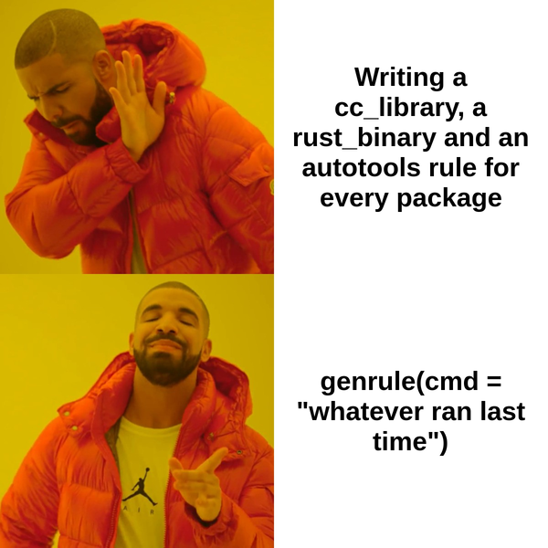

As a build systems enthusiast, [Build Systems à la Carte](https://doi.org/10.1145/3236774) is one of my favourite papers. It defines a way to think about build systems that is both precise and surprisingly practical.

As a Nix enthusiast, I am deeply fond of hermetic builds, where every dependency is explicitly declared and the build can be replicated. I have already explored the idea of [leveraging Guix derivations in Nix]() by proving that any system that claims to be hermetic can be transmogrified into another lossless one. Where else can this idea be applied?

The holy grail of build systems is to combine the best of both worlds: the hermetic guarantees of Nix with the efficient scheduling and incremental rebuilds of systems like Bazel.

In the paper's vocabulary, it defines tasks as being either *applicative* or *monadic*. Applicative tasks have static dependencies that can be listed before running anything, while monadic tasks have dynamic dependencies discovered as the task executes.

Although the dependencies for Nix itself must be known and declared upfront, many build tasks it orchestrates are monadic, discovering their dependencies dynamically as they execute.
Is it possible to take a monadic build, like the ones orchestrated by Nix, and convert it into an applicative form that Bazel can understand and schedule efficiently?

What if I had a complete trace of every build action and could write that graph by watching Nix build hello once?

What if I had a deterministic VM that could replay every system call and file access exactly as it happened during the original build?

Turns out, maybe a little obviously, that retroactively converting a monadic build into an applicative one is feasible if you have a complete trace of the build's execution.

With the help of [Rewind](https://github.com/fzakaria/rewind), we can record a Nix build, follow it *à la trace*,[^trace] and generate a `BUILD.bazel` and a `BUCK` file for [Bazel](https://bazel.build/) and [buck2](https://buck2.build/) to build the bit-for-bit exact same thing out of nothing but `genrule`. 

[^trace]: Turns out that _trace_ is French for following something by the trail it left. This makes me happy.

[](/assets/images/genrule_drake_meme.png)
{: style="--image-width: 18rem"}

> **tl;dr**
> [genrulify](https://github.com/fzakaria/genrulify) takes a Nix build recorded by Rewind and compiles it into a `BUILD.bazel` and a `BUCK` file made of nothing but genrules, one per command the build ran. GNU hello, built that way by both tools, comes out with the same NAR hash that [cache.nixos.org](https://cache.nixos.org) serves. Explore sample packages at [fzakaria.github.io/genrulify](https://fzakaria.github.io/genrulify/).
{: .alert .alert-note }

## A build is a list of things that ran

The idea of creating a trace to convert a build system into another is not new. Other tools have explored this space before, often relying on system call tracing, `strace` or similar mechanisms, to infer dependencies.


[Rewind](https://rewindvm.dev) runs a Nix build inside a deterministic VM and lets us _rewind_ to any step, so by default we have a trace of the entire build's execution.

> **Aside:**
> New to Rewind? Start with [a flaky build you only catch once]() and [dafuq is a deterministic VM?]()
{: .alert .alert-note }

We actually have more than a trace, we have the full filesystem state at every step of the build. This allows us to reconstruct exactly what each process saw, byte for byte.

```console
$ rewind cat --archive tar 534fa58c62c668f8 2607 /build | tar -t
build/
build/env-vars
build/source/
build/source/LICENSE
build/source/main.cpp
```

Turns out that having a file's contents, or a hash of it, is incredibly useful when attempting to construct accurate build dependencies.

## Where to cut

A Nix build though is a complex sequence of shell commands, environment setups, and file manipulations, all orchestrated by the Nix builder: a `bash` process that runs stdenv's `setup.sh` and then executes the build commands.

What is the important unit of work that needs to be captured for the conversion? If I simply wrapped the whole Nix build as one unit, I would lose all the benefit of granularity I seek from even bothering to migrate to Bazel or Buck.

As a starting default: I call the builder, and every subshell it forks, the **driver**. A **cut** is the moment a driver process calls `execve`. From there until that process and its children exit is one unit of work.

## Everything is a compiler

Breaking up a recording though is not enough. We also need to account for the fact that many build tools modify files in place,[^examples] which conflicts with the single-producer requirement of Bazel and Buck.

[^examples]: Examples include `ar` appending to an archive, `strip` rewriting a binary in place, and `configure` appending to `config.log`.

Bazel and buck2 want every file to have exactly one producer.

Thankfully, this is a problem compilers solved in the 1980s. A variable assigned twice becomes two values. Static single assignment, but for files. Confused?

Let's use this derivation as an example:

```nix
${dd} if=${header} of=bundle status=none
${dd} if=${body} of=bundle oflag=append conv=notrunc status=none
${dd} if=bundle of="$out" status=none
```

<figure>
<svg viewBox="0 0 560 150" role="img" style="display:block;margin-inline:auto;max-width:38rem;width:100%;height:auto;font-family:var(--mono)"
     aria-label="Three dd processes in a row. The first writes /build/bundle version 1. The second reads version 1 and writes /build/bundle version 2. The third reads version 2 and writes the output path. The two versions of bundle are separate boxes even though they share a path.">
  <g font-size="12" fill="var(--ink)">
    <rect x="8" y="14" width="96" height="34" rx="6" fill="none" stroke="var(--accent)" stroke-width="2"/>
    <text x="56" y="35" text-anchor="middle" fill="var(--accent)">dd #1</text>
    <rect x="232" y="14" width="96" height="34" rx="6" fill="none" stroke="var(--accent)" stroke-width="2"/>
    <text x="280" y="35" text-anchor="middle" fill="var(--accent)">dd #2</text>
    <rect x="456" y="14" width="96" height="34" rx="6" fill="none" stroke="var(--accent)" stroke-width="2"/>
    <text x="504" y="35" text-anchor="middle" fill="var(--accent)">dd #3</text>

    <rect x="104" y="92" width="136" height="40" rx="6" fill="none" stroke="var(--ink)" stroke-width="1.5"/>
    <text x="172" y="109" text-anchor="middle">/build/bundle</text>
    <text x="172" y="125" text-anchor="middle" fill="var(--ink-muted)">%dd_735  cb94…</text>
    <rect x="320" y="92" width="136" height="40" rx="6" fill="none" stroke="var(--ink)" stroke-width="1.5"/>
    <text x="388" y="109" text-anchor="middle">/build/bundle</text>
    <text x="388" y="125" text-anchor="middle" fill="var(--ink-muted)">%dd_764  50f5…</text>
  </g>
  <g stroke="var(--ink-muted)" stroke-width="1.5" fill="none">
    <path d="M56,48 C56,80 120,70 150,92"/>
    <path d="M200,92 C230,70 250,70 262,48"/>
    <path d="M298,48 C310,70 340,70 366,92"/>
    <path d="M416,92 C450,70 480,70 494,48"/>
  </g>
  <g fill="var(--ink-muted)">
    <polygon points="146,84 152,93 142,92"/>
    <polygon points="256,56 263,47 266,57"/>
    <polygon points="360,86 368,93 358,94"/>
    <polygon points="488,56 495,47 498,57"/>
  </g>
</svg>
<figcaption>The append reads <code>%dd_735</code> and defines <code>%dd_764</code>.</figcaption>
</figure>

Although the path `/build/bundle` appears only once in the filesystem, it actually has two distinct versions in the build graph.

Remember when I said that it will be really useful to have access to the contents of every file version? This is exactly why: the same path can have multiple versions, and we need to distinguish between them.

I have been using [LLVM](https://llvm.org/) at `$DAYJOB$` for a while and I've briefly skirted with [MLIR](https://mlir.llvm.org/), a compiler infrastructure that makes it easy to define new intermediate representations and transformations on them.

This seemed like a natural fit for representing the build graph, since each file version can be treated as a distinct entity and the relationships between them can be captured explicitly.[^fun]

[^fun]: If you want another reason: I also like to learn new things and have fun. I enjoy experimenting with new tools and techniques.

Our `/build/bundle` example converted to MLIR looks like this:

```mlir
%sandbox_717 = splice.literal "sandbox" at 717 -> [
    #splice.entry<"/build" dir 700 mtime 1>
]
%dd_735 = splice.exec "dd" at 735(%sandbox_717) -> [
    #splice.entry<"/build/bundle" file 644 mtime 1 "cb94740a…">
]
%dd_764 = splice.exec "dd" at 764(%sandbox_717, %dd_735) -> [
    #splice.entry<"/build/bundle" file 644 mtime 1 "50f55425…">
]
%dd_782 = splice.exec "dd" at 782(%sandbox_717, %dd_764) -> [
    #splice.entry<"/nix/store/l1dx8g9m…-genrulify-example" file 644 mtime 1 "50f55425…">
]
splice.output "out" "/nix/store/l1dx8g9m…-genrulify-example"(%dd_782)
```

Using MLIR turned out to be a good choice because it came with some prebuilt support for canonicalization and optimization passes, which I could leverage to simplify and analyze the build graph without writing custom passes from scratch such as dead code elimination or constant folding.

> **Aside**
> [genrulify](https://github.com/fzakaria/genrulify) includes  passes such as constant folding, merging same outputs, raising copies, and link, which help simplify the build graph automatically.
> 
> The [web interface](https://fzakaria.github.io/genrulify/) for genrulify also visualizes the build graph and the effects of these passes, making it easier to understand how the build is simplified.
{: .alert .alert-note}

## The least Bazel-y Bazel

With so much of the build graph already captured and canonicalized, the lowering step becomes almost trivial.

Every `splice.exec` in the MLIR graph is translated into a corresponding Bazel or Buck `genrule`.

```python
genrule(
    name = "s2685_g__",
    srcs = [
        ":s2016_cp/build/source/main.cpp",
        ":actions/s2685_g__.manifest",
        ":closure.txt",
        ":env/25.env",
        ":sandbox.sh",
        # …
    ],
    outs = [
        "s2685_g__/build/source/a.out",
        "s2685_g__.ok",
    ],
    cmd = " ".join([
        "./sandbox.sh --in . --in $(RULEDIR) --out $(RULEDIR)",
        "--name s2685_g__ --timeout 300",
        "run --cwd /build/source --env 25 --fd 0=null --fd 1=err --fd 2=err --status 0 --argc 35 --",
        "/nix/store/5q6b…-gcc-16.2.0/bin/g++ -fPIC -fstack-clash-protection -O2 … main.cpp …",
    ]),
    tags = ["no-remote"],
)
```

The `cmd` is the `execve` as Rewind captured it during the original build with every argument, environment variable, and file descriptor it observed as Bazel labels as inputs.

> **Aside**
> A recorded command only makes sense in the context where it ran. It expects the `/build` directory, its environment, and its file descriptors to be exactly as they were during the original build. That is why every `genrule` includes the sandbox script, `sandbox.sh`, and all necessary inputs to recreate that context.
{: .alert .alert-note}

There is no `cc_library`. There is no toolchain. There is no provider, aspect, transition or configuration. It is Bazel but without the extra language features and abstractions that usually come with it. Crucially though, it still captures the full dependency graph and the exact commands needed to reproduce the build so we can leverage remote-execution capabilities effectively.

[](/assets/images/genrule_always_has_been_meme.png)
{: style="--image-width: 24rem"}

## Fine, have your cc_library

Converting Nix builds into a series of Bazel `genrule`s is straightforward but verbose. Each command becomes a `genrule` with all its inputs and outputs explicitly listed.

It's not elegant, but it works.

MLIR and compilers have a solution for this as well.
We can pattern match on the recorded commands and elevate them into higher-level abstractions like `cc_object`, `cc_library`, and `cc_binary`, known as raising in _MLIR-speak_.

```python
cc_object(
    name = "s95823_gcc",
    src = ":s1378_tar/build/hello-2.12.3/src/hello.c",
    hdrs = [":s1378_tar/build/hello-2.12.3/src/system.h", ":s4254_bash/build/hello-2.12.3/config.h", …],
    out = "s95823_gcc/build/hello-2.12.3/src/hello.o",
    # …
)
```

We now have a higher-level representation of the build, where individual commands are grouped into meaningful abstractions like `cc_object`, `cc_library`, and `cc_binary`.

These are very syntactic abstractions though as they are just macros over `genrule` and do not change the underlying execution semantics.

## Is this junk science or a breakthrough?

I asked at the top whether a monadic build can be turned into an applicative one. For a build that has already happened, the answer is yes, and it's effectively a tautology. A recording is a monadic build in which every choice has been made.

So, is this a breakthrough? What is the significance of the trace and the ability to convert to Buck or Bazel rules?

Consider a Nix build whom may set the environment variable `MAKEFLAGS=-j1` or run with `make -j1`. When we handed the graph to Bazel, it could see that none of those compiles need each other's output, and will run the commands in parallel.

Code written as first-class citizens in Buck or Bazel can also better integrate with the output of the converted build graph, allowing for more efficient and parallel execution while maintaining correctness.

I have spent years reading arguments about whether Bazel's rules or Nix's derivations are the right abstraction.  I am not the one who will end that holy war but I can at least build the same package in both systems and compare the results. 

For now, enjoy a Nix-y Bazel-y Bazel. 🥸