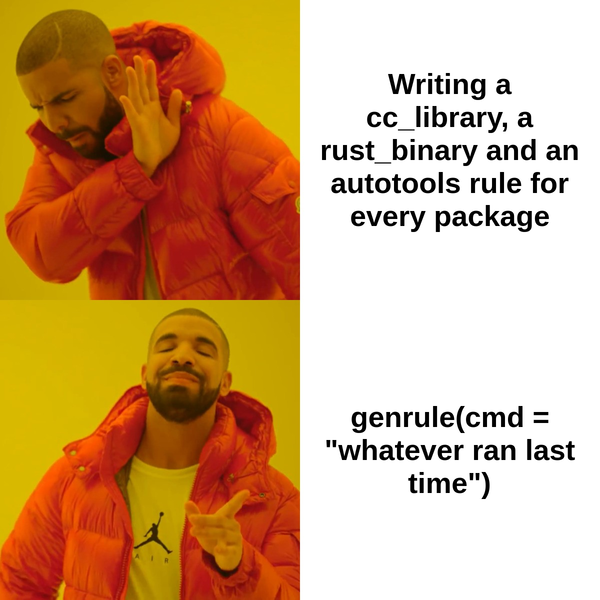
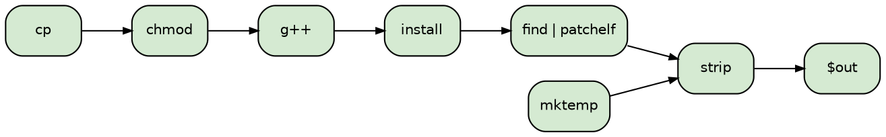
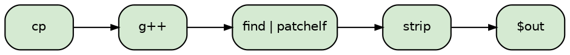

I have a confession about converting a project to [Bazel](https://bazel.build/) or [buck2](https://buck2.build/). The honest way is a lot of work.

You learn the toolchain rules. You write a `cc_library` for every library and argue with `rules_foreign_cc` about autotools. Somebody's `Makefile` runs a Perl script that writes a header, and now you own a Starlark rule for that too.

I wanted to cheat. 😈

What if I never wrote a single rule? What if the *entire* build graph was `genrule`, the escape hatch every Bazel style guide tells you to avoid?

<!--more-->

[](/assets/images/genrule_drake_meme.png)
{: style="--image-width: 18rem"}

> **tl;dr**
> [genrulify](https://github.com/fzakaria/genrulify) takes a Nix build recorded by Rewind and compiles it into a `BUILD.bazel` and a `BUCK` file made of nothing but genrules, one per command the build ran. GNU hello, built that way by both tools, comes out with the same NAR hash that [cache.nixos.org](https://cache.nixos.org) serves. Poke at twenty converted packages at [fzakaria.github.io/genrulify](https://fzakaria.github.io/genrulify/).
{: .alert .alert-note }

## A build is a list of things that ran

Strip away the language and every build system is doing the same job. It decides which processes to run, and in what order.

Once the build has finished, that decision stops being a plan. It is a fact. Some processes called `execve`, they read some files, they wrote some files. If you had a perfect record of that, you would not need to know whether `make`, `ninja`, `cargo` or a 4,000 line `configure` script was in charge.

This idea is old. Memoize and Fabricate ran your build under `strace` and learned the dependencies afterwards. [Riker](https://www.usenix.org/conference/atc22/presentation/curtsinger) does it properly with a trace IR.

The hard part has always been the word *perfect*. `strace` sees system calls go by. It cannot tell you what a directory looked like a moment ago.

> **Aside:**
> New to Rewind? Start with [a flaky build you only catch once]() and [dafuq is a deterministic VM?]()
{: .alert .alert-note }

[Rewind](https://rewindvm.dev) runs a Nix build inside a deterministic VM and lets me go back to any step of it. So I can ask a question no tracer can answer:

```console
$ rewind cat --archive tar 534fa58c62c668f8 2607 /build | tar -t
build/
build/env-vars
build/source/
build/source/LICENSE
build/source/main.cpp
```

That is `/build` at step 2607 of a build that finished an hour ago. The exact bytes the compiler was about to see.

AHA. 💡 If I can have the whole filesystem at any step, I do not need to trace writes at all. I snapshot before a process starts, snapshot after it exits, and diff.

## Where to cut

A Nix builder is a `bash` process running stdenv's `setup.sh`. Most of what it does happens *inside* that one process: `cd`, `export`, `$(...)`, redirections. There is no command line to run again for any of it.

So I call the builder, and every subshell it forks, the **driver**. A **cut** is the moment a driver process calls `execve`. From there until that process and its children exit is one unit I can replay.

The driver ends up a little bigger than that. `make` forced the issue, and it gets its own section further down.
{: .aside}

Here is [colstr](https://github.com/NixOS/nixpkgs/tree/master/pkgs/by-name/co/colstr), a single C++ file from nixpkgs:

```console
$ genrulify record 534fa58c62c668f8 /nix/store/…-colstr-1.0.0.drv recording
$ jq '.groups | length' recording/recording.json
54
```

It makes 83 `execve` calls. Processes joined by a pipe have to be replayed together, so those become 54 **groups**. One of them is the compiler. The other 53 are stdenv being stdenv.

## The same file, twice

The first thing that breaks a naive conversion is that builds overwrite files. `ar` appends to an archive. `strip` rewrites a binary in place. `configure` appends to `config.log` four hundred times.

Bazel and buck2 want every file to have exactly one producer.

This is a problem compilers solved in the 1980s. A variable assigned twice becomes two values. Static single assignment, but for files. Take this derivation:

```nix
${dd} if=${header} of=bundle status=none
${dd} if=${body} of=bundle oflag=append conv=notrunc status=none
${dd} if=bundle of="$out" status=none
```

<figure>
<svg viewBox="0 0 560 150" role="img" style="display:block;margin-inline:auto;max-width:38rem;width:100%;height:auto;font-family:var(--mono)"
     aria-label="Three dd processes in a row. The first writes /build/bundle version 1. The second reads version 1 and writes /build/bundle version 2. The third reads version 2 and writes the output path. The two versions of bundle are separate boxes even though they share a path.">
  <g font-size="12" fill="var(--ink)">
    <rect x="8" y="14" width="96" height="34" rx="6" fill="none" stroke="var(--accent)" stroke-width="2"/>
    <text x="56" y="35" text-anchor="middle" fill="var(--accent)">dd #1</text>
    <rect x="232" y="14" width="96" height="34" rx="6" fill="none" stroke="var(--accent)" stroke-width="2"/>
    <text x="280" y="35" text-anchor="middle" fill="var(--accent)">dd #2</text>
    <rect x="456" y="14" width="96" height="34" rx="6" fill="none" stroke="var(--accent)" stroke-width="2"/>
    <text x="504" y="35" text-anchor="middle" fill="var(--accent)">dd #3</text>

    <rect x="104" y="92" width="136" height="40" rx="6" fill="none" stroke="var(--ink)" stroke-width="1.5"/>
    <text x="172" y="109" text-anchor="middle">/build/bundle</text>
    <text x="172" y="125" text-anchor="middle" fill="var(--ink-muted)">%dd_735  cb94…</text>
    <rect x="320" y="92" width="136" height="40" rx="6" fill="none" stroke="var(--ink)" stroke-width="1.5"/>
    <text x="388" y="109" text-anchor="middle">/build/bundle</text>
    <text x="388" y="125" text-anchor="middle" fill="var(--ink-muted)">%dd_764  50f5…</text>
  </g>
  <g stroke="var(--ink-muted)" stroke-width="1.5" fill="none">
    <path d="M56,48 C56,80 120,70 150,92"/>
    <path d="M200,92 C230,70 250,70 262,48"/>
    <path d="M298,48 C310,70 340,70 366,92"/>
    <path d="M416,92 C450,70 480,70 494,48"/>
  </g>
  <g fill="var(--ink-muted)">
    <polygon points="146,84 152,93 142,92"/>
    <polygon points="256,56 263,47 266,57"/>
    <polygon points="360,86 368,93 358,94"/>
    <polygon points="488,56 495,47 498,57"/>
  </g>
</svg>
<figcaption>One path, two values. The append reads <code>%dd_735</code> and defines <code>%dd_764</code>.</figcaption>
</figure>

`/build/bundle` has two versions. They are different artifacts that happen to live at the same path inside the sandbox, and a build system is perfectly happy with that.

## An MLIR dialect for a filesystem

I could have written this graph as JSON. I wrote it as an [MLIR](https://mlir.llvm.org/) dialect instead, partly because it is fun and partly because of what MLIR gives away for free.

The dialect has one type, `!splice.entry`, which is one version of one path. It starts with three operations:

```mlir
%sandbox_717 = splice.literal "sandbox" at 717 -> [
    #splice.entry<"/build" dir 700 mtime 1>
]
%dd_735 = splice.exec "dd" at 735(%sandbox_717) -> [
    #splice.entry<"/build/bundle" file 644 mtime 1 "cb94740a…">
]
%dd_764 = splice.exec "dd" at 764(%sandbox_717, %dd_735) -> [
    #splice.entry<"/build/bundle" file 644 mtime 1 "50f55425…">
]
%dd_782 = splice.exec "dd" at 782(%sandbox_717, %dd_764) -> [
    #splice.entry<"/nix/store/l1dx8g9m…-genrulify-example" file 644 mtime 1 "50f55425…">
]
splice.output "out" "/nix/store/l1dx8g9m…-genrulify-example"(%dd_782)
```

`splice.exec` runs a recorded group of processes. Its operands are the file versions it gets to see and its results are the versions it leaves behind. `splice.literal` is bytes taken straight from the recording, for things with no `execve` behind them, like the build directory Nix creates or a line the shell wrote with `echo`. `splice.output` is the derivation output.

A value is named after the command that made it and the step it ran at. `%dd_764` is whatever `dd` left behind at step 764. I started with MLIR's default `%0`, `%1`, `%2` and got tired of counting.
{: .aside}

I mark `splice.exec` as `Pure`.

That one word is a claim about the build: what a process writes is a function of the files it was given. And if that is true, an operation whose results nobody uses is dead code.

MLIR already knows how to delete dead code. I did not write a pass. I ran the stock canonicalizer.

For colstr, 47 of 54 groups vanish. Every `date +%s`. Every `find` that only looked. The `rm` that cleans up a temporary file. The compiler's temporary `.s` file. stdenv's `env-vars` dump.

What survives is the build:


{: style="--graphviz-height: 5rem"}

Seven nodes. I never told it colstr was C++.

## Cooking up more passes

One pass, and I did not even write it. That felt thin for a project with "MLIR" in the description. 😆

So I went looking through that graph for work that is not really work. There is a lot of it.

**Fold constants.** Look at `mktemp` up there. Its entire contribution to colstr is one empty file with a silly name. An empty file has no bytes for anybody to compute. Neither does a directory, and neither does a symlink. The entry *is* the value. So those results move out of the command that made them and into a `splice.literal` marked `folded`, and `mkdir -p`, `ln -s`, `touch` and `mktemp` stop being things a build system has to run.

`mktemp` used to be my least favourite box. The name it picks is random, and the *next* command has the old name baked into its `argv`, so re-running it never matched. Now it never runs. Problem solved by not having the problem.
{: .aside}

**Merge same outputs.** `chmod` took `main.cpp` and left `main.cpp`. Same path, same bytes, different mode. A build system does not need a process for that. The result becomes a second name for the file it was given.

**Raise copies.** `install` took `a.out` and wrote the same bytes to `$out/bin/colstr`. That is what `cp` and `mv` do too. So those get rolled up into a fourth operation, `splice.copy`:

```mlir
%cp_2016:3 = splice.exec "cp" at 2016(%sandbox_716) -> [ … ]
%chmod_2049_0 = splice.copy "chmod" at 2049(%cp_2016#2) -> <"/build/source/main.cpp" file 644 mtime 1 "c60e9167…">
%g___2685 = splice.exec "g++" at 2685(%sandbox_716, %chmod_2049, %chmod_2049_0) -> [ … ]
%install_3122_1 = splice.copy "install" at 3122(%g___2685) -> <"/nix/store/s7lf…-colstr-1.0.0/bin/colstr" file 755 mtime 1794960000 "bd25c499…">
```

A copy needs no rule at all. Whoever reads the copy is handed the original file and told where to put it.

There is a fifth pass, **link**, for programs that move their own outputs around. `cargo` hard-links the binary it just had compiled to its final name, in-process, with no `execve` to see. A file like that, with the bytes of a file that already exists, becomes a copy of it.

Here is colstr as each pass is switched on, counting the rule that packs the output:

| Passes on | Rules |
| --- | ---: |
| none | 55 |
| eliminate dead code | 8 |
| + fold constants | 7 |
| + merge same outputs | 6 |
| + raise copies | 5 |


{: style="--graphviz-height: 4rem"}

Four commands and an archive. Nothing else needs to run.

Is any of this allowed? Yes, and for a boring reason. Every value in the graph stands for an entry the recording already holds. A constant is that entry by definition. A copy has the right bytes as long as the file it copies does. A rewrite changes how much gets re-run. It never changes what a value *is*.

Even my three-line example had fat on it. That last `dd if=bundle of="$out"` is a copy. Two rules.

Here is the split for the two builds so far, and for GNU hello, which is coming up:

```plotnine
import pandas as pd
from plotnine import *

rows = [
    ("in-place append", "replayed", 2), ("in-place append", "copies", 1), ("in-place append", "constants", 0), ("in-place append", "dead", 0),
    ("colstr", "replayed", 4), ("colstr", "copies", 2), ("colstr", "constants", 1), ("colstr", "dead", 47),
    ("hello", "replayed", 132), ("hello", "copies", 75), ("hello", "constants", 50), ("hello", "dead", 393),
]
df = pd.DataFrame(rows, columns=["package", "outcome", "groups"])
df["share"] = df["groups"] / df.groupby("package")["groups"].transform("sum")
df["package"] = pd.Categorical(df["package"], ["hello", "colstr", "in-place append"])
df["outcome"] = pd.Categorical(df["outcome"], ["dead", "constants", "copies", "replayed"])
plot = (
    ggplot(df, aes("package", "share", fill="outcome"))
    + geom_col()
    + coord_flip()
    + scale_y_continuous(labels=lambda values: [f"{value:.0%}" for value in values])
    + scale_fill_manual(values={"replayed": "#2f6f73", "copies": "#b8527a", "constants": "#6f7f93", "dead": "#c9c5bc"})
    + labs(x="", y="share of process groups", fill="")
)
plot.width, plot.height = 6.0, 2.4
```
{: title="Stacked bars of the share of process groups by outcome. The in-place append example has 3 groups: 2 replayed and 1 copy. colstr has 54: 4 replayed, 2 copies, 1 constant and 47 dead. hello has 650: 132 replayed, 75 copies, 50 constants and 393 dead."}

Only the dark green part is something a build system has to run.

The [explorer](https://fzakaria.github.io/genrulify/) has a switch for each pass. Flip them in any combination and watch the graph shrink.

## Trust, then verify

`Pure` is a nice thing to write down. It is also exactly the kind of claim that is false in annoying ways. So genrulify checks it.

Constants and copies need no checking. They were decided by comparing hashes in the recording. Every `splice.exec` that is left does. Each one gets replayed alone inside [bubblewrap](https://github.com/containers/bubblewrap). The store closure is mounted read-only at its real paths. The filesystem contains *only* the group's operands, pulled out of the recording. Each process gets its recorded `argv`, environment, working directory and file descriptors, and the pipes between them are rebuilt.

Then every file it was supposed to write is hashed against the recording. The whole thing runs twice, because passing once could be luck.

A group that fails walks down a ladder, and I learned something on every rung:

1. **Narrow.** Give it the files it opened. Most things pass here.
2. **Near.** Also give it everything else in the directories it worked in. Plenty of tools call `stat` on a file without ever opening it, and the trace records opens.
3. **Wide.** Give it every file that existed.
4. **Traced.** Now that it passes, run it once more under `strace` and see what it *really* looked at. Cut its inputs down to that and check again. hello's `configure` goes from all 555 entries of the source tree to the 143 it touches.
5. **Pinned.** Let it run, but take the files it cannot reproduce from the recording. `configure` writes the same `Makefile` every time and a different `config.log`.
6. **Literal.** Do not run it at all. Everything it wrote comes from the recording.

## The least Bazel-y Bazel

Lowering is almost embarrassing. Every file version becomes a real file, named after the rule that wrote it, and each `splice.exec` becomes this:

```python
genrule(
    name = "s2685_g__",
    srcs = [
        ":s2016_cp/build/source/main.cpp",
        ":actions/s2685_g__.manifest",
        ":closure.txt",
        ":env/25.env",
        ":sandbox.sh",
        …
    ],
    outs = [
        "s2685_g__/build/source/a.out",
        "s2685_g__.ok",
    ],
    cmd = " ".join([
        "./sandbox.sh --in . --in $(RULEDIR) --out $(RULEDIR)",
        "--name s2685_g__ --timeout 300",
        "run --cwd /build/source --env 25 --fd 0=null --fd 1=err --fd 2=err --status 0 --argc 35 --",
        "/nix/store/5q6b…-gcc-16.2.0/bin/g++ -fPIC -fstack-clash-protection -O2 … main.cpp …",
    ]),
    tags = ["no-remote"],
)
```

The last line of `cmd` is the `execve` Rewind saw: the real `g++`, with every flag nixpkgs' wrapper script added on the way. One source goes in. It is `main.cpp` as `cp` wrote it, because the `chmod` in between is a copy and copies have no rule. One file comes out, `a.out`. The SSA values from the MLIR are now Bazel labels.

My first version of this had `cmd = "genrulify replay plan.json"` and it was wrong in spirit. It built, the hashes matched, and the BUILD file told you nothing. If the joke is that the build is just genrules, the commands have to be *in* the genrules.

A recorded command only makes sense where it ran, though. It wants `/build`, its environment, its file descriptors. So every workspace carries `sandbox.sh`, about 450 lines of bash. It copies the declared inputs back to their recorded paths, mounts the store closure with bubblewrap, runs the command the way the line above it says, and then hashes every output against the rule's manifest. A wrong hash fails the rule. genrulify itself is not needed to build any of it.

There is no `cc_library`. There is no toolchain. There is no provider, aspect, transition or configuration. It is Bazel with everything that makes it Bazel removed, and it still has a correct dependency graph, because the graph was observed and not declared.

[](/assets/images/genrule_always_has_been_meme.png)
{: style="--image-width: 24rem"}

## hello

colstr is one file. So I pointed it at GNU hello, which is autotools, gnulib, a test suite and `make install`.

```console
$ genrulify convert nixpkgs#hello hello
650 process groups: 132 replayed and reproduced, 75 raised to copies, 50 folded to constants, 0 kept as recorded bytes, 393 dead
cca3804d340495150db44b1e762655d8a0b4fe6d37b8350f1a0d8fa33c27c8cc  /nix/store/5z2yp3ysx8476c8g5w25b0smlgkjvaq3-hello-2.12.3

$ cd hello/workspace && bazel build //:archive
$ sha256sum bazel-bin/archive.nar
cca3804d340495150db44b1e762655d8a0b4fe6d37b8350f1a0d8fa33c27c8cc  bazel-bin/archive.nar
```

Then I asked the cache what it thinks hello is:

```console
$ nix path-info --json --store https://cache.nixos.org \
    /nix/store/5z2yp3ysx8476c8g5w25b0smlgkjvaq3-hello-2.12.3 | jq -r '.[].narHash'
sha256-zKOATTQElRUNtEsediZV2KC0/m03uDUPGg2PozwnyMw=
```

Same hash, in base64. 🎉

Bazel and buck2 each built GNU hello out of 133 genrules, without knowing what a C compiler is, and produced the bytes Hydra produced.

84 of those rules run `gcc`. 39 run `sed`, because gnulib builds its headers that way. The rest are `tar`, `configure`, `ar`, a `strip` and friends. The 46 `install` commands and 26 `mv` commands are copies, and the 49 `mkdir` commands are constants, so none of them is a rule at all.

## make is not a genrule

That number used to be much smaller, and I was not proud of it.

My first cuts were exactly what I described at the top: wherever the *builder* calls `execve`. stdenv's builder calls `make`. So hello used to come out like this, and you can still ask for it:

```console
$ genrulify convert --coarse nixpkgs#hello hello-coarse
70 process groups: 9 replayed and reproduced, 1 raised to copies, 2 folded to constants, 0 kept as recorded bytes, 58 dead
```

Ten genrules, and one of them is "run `make`". The entire compile, hiding inside a single box. That is a little *too* cheaty, even for me.

The obvious fix was to say `make` is driver code too, so the cuts move down to its children. I did that first, with a pattern of program names to open. It worked, and it bothered me. A list of names is knowledge about build systems, and the whole premise was that I have none.

The trace already knows. Look at what `make` does all day. It starts commands. It never opens a file for writing. Everything it accomplished, its children accomplished.

So that is the rule now. **A process that ran other commands and wrote no file of its own is driver code**, at any depth. That takes in `make`, the recipe shell that runs one command, `xargs`, and the wrapper script in front of every compiler. The cuts land on `gcc`, `sed`, `install` and `strip`.

`configure` stays one rule, on purpose. It writes files itself, and what its checks learn lives in shell variables that never touch the disk. Open it and `config.h` turns into recorded bytes. `cargo` and `ninja` write their own bookkeeping too, so they stay closed unless you name them.
{: .aside}

Which gets me the rule I wanted to see from the start:

```python
genrule(
    name = "s95823_gcc",
    srcs = [
        ":s1378_tar/build/hello-2.12.3/src/hello.c",
        ":s1378_tar/build/hello-2.12.3/src/system.h",
        ":s4254_bash/build/hello-2.12.3/config.h",
        ":s92094_sed/build/hello-2.12.3/lib/sys/types.h-t",
        … 26 more headers
        ":sandbox.sh",
    ],
    outs = [
        "s95823_gcc/build/hello-2.12.3/src/hello.o",
        "s95823_gcc.ok",
    ],
    cmd = " ".join([
        "./sandbox.sh --in . --in $(RULEDIR) --out $(RULEDIR)",
        "--name s95823_gcc --timeout 300",
        "run --cwd /build/hello-2.12.3 --env 62 --fd 0=null --fd 1=err --fd 2=err --status 0 --argc 40 --",
        "/nix/store/5q6b…-gcc-16.2.0/bin/gcc … -g -O2 -c -o src/hello.o src/hello.c …",
    ]),
    tags = ["no-remote"],
)
```

`hello.c` and `system.h` as `tar` unpacked them. `config.h` as `configure` wrote it. A gnulib header that `sed` generated, read under the name `sed` gave it because the `mv` that renamed it is a copy. Nobody declared any of that. The compiler opened those files while Rewind was watching.

Here is my favourite part. Nix built hello with `make -j1`. Bazel looked at the graph, saw 84 compiles that do not depend on each other, and ran them in parallel.

Nobody told it the compiles were independent. The recording did. 🤯

## Fine, have your cc_library

By now I had a few hundred genrules that all looked alike. A compile, a link and a `sed` were the same shape with a different last line. So one more pass, and this one goes *up*.

It reads each command's recorded arguments. `gcc -c` is a `cc_object`. An `ar` that adds members is a `cc_library`. A link is a `cc_binary`. In the dialect the kind rides along:

```mlir
%gcc_95823 = splice.exec "gcc" at 95823 as "cc_object"(%tar_1378#52, …) -> [ … ]
```

and the build file stops saying `genrule`:

```python
cc_object(
    name = "s95823_gcc",
    src = ":s1378_tar/build/hello-2.12.3/src/hello.c",
    hdrs = [":s1378_tar/build/hello-2.12.3/src/system.h", ":s4254_bash/build/hello-2.12.3/config.h", …],
    out = "s95823_gcc/build/hello-2.12.3/src/hello.o",
    …
)
```

hello is now 83 `cc_object`, one `cc_library`, one `cc_binary` and 47 other commands. bash is 194 `cc_object`, 40 `cc_shared_library` for its loadable builtins, four `cc_library` and four `cc_binary`.

I have not betrayed the premise. 😅 `cc_object` is defined in a `genrulify.bzl` that ships in the workspace, and it is a few lines of macro over `genrule` that run the same recorded command through the same sandbox. The kind decides how a rule *reads*. It never decides what a rule *does*. If my guess from the arguments is wrong, a rule is mislabelled and not one byte changes.

## Gazelle, but it watched

Everything so far converts a package out of nixpkgs. That is a party trick. What I actually want is to point this at *my* project.

The catch is where sources come from. With `src = ./.`, Nix copies your tree into the store, and the build starts with `cp -r /nix/store/…-source source`. Rules that read the store path build a frozen copy. Edit a file and nothing happens.

So `convert` takes `--source`:

```console
$ genrulify convert --source examples/project .#project /tmp/recording
$ cd examples/project && bazel build //:archive
```

Now the source tree is part of the graph. The unpacking `cp` is a pile of copies, the raise pass deletes it, and a compile reads `:main.c`, your file, in your checkout. The `BUILD.bazel` lands next to the sources.

Change a string in `greet.c` and Bazel reruns five of six actions. The compile of `main.c` is reused. Add an `#include` of a header the compiler never opened before, and the rule fails and tells you to convert again.

That is Gazelle's deal. Generate, build, and regenerate when the *shape* of the build changes. The difference is that Gazelle reads your source and guesses, and this watched the build happen.

## Does it work on anything else?

Two packages is an anecdote. So I ran the whole thing, record to verify, over twenty packages chosen to be as unlike each other as I could manage: plain Makefiles (`tree`, `sl`, `lua`), autotools (`sed`, `gawk`, `bash`, `which`, `patchelf`), SQLite and its 9 MB single source file, CMake (`jsoncpp`, `tinyxml2`, `lz4`), a hand-rolled `configure` (`zlib`), Go (`hello-go`), Python (`six`), Rust (`hexyl`), Perl scripts (`cowsay`), and `ninja`, which bootstraps itself with Python and then builds itself with itself.

All twenty convert. Between them they have 45 outputs, and for every single one the NAR out of Bazel and the NAR out of buck2 is the NAR that was recorded. `bash` makes 11,847 `execve` calls and comes out as 366 rules.

It was not free, and two of the failures taught me more than the successes.

**hexyl passed for the wrong reason.** Every hash matched on the first try, which should have made me suspicious. stdenv installs a Rust binary like this:

```bash
xargs -r cp -t "$out/bin" <<< "$bins"
```

That here-string is a pipe written by the *shell*, which I do not replay. So back then `xargs` could not be re-run, its output was taken from the recording, and that output was the binary. `rustc` ran 176 times in the recording and zero times in Bazel. 🤦 A conversion that verifies is only as real as the share of it that was re-executed, which is why genrulify reports that share.

The fix was more of the same trick. At the moment `xargs` starts, the bytes are sitting in the pipe, and Rewind can read them at that step. Now the pipe's contents are part of the recording, the install replays, the `cargo build` is live, and it reproduces the binary.

That still left `cargo build` as one rule, which is `make` as a genrule all over again. cargo writes its own fingerprint files, so the trace cannot show it to be a driver and I have to name it:

```console
$ genrulify convert --open cargo nixpkgs#hexyl hexyl
```

The first try was worse than not asking. cargo hands both ends of its jobserver pipe to every `rustc` it starts, and I put any two commands that share a pipe in one group. All 48 commands of the build became one group, the group did not replay, and the whole build was carried as recorded bytes. 🙃

A pipe that every command holds both ends of has no upstream. So now it only joins commands that ran at the same time. hexyl comes out as 30 `rust_library` rules, 3 `rust_proc_macro` rules and a link, with nothing remembered. The same flag on `inih`, which is Meson and Ninja, gives one rule per compile.

**sed's `configure` is flaky.** It passed its replay check twice and then wrote a different `config.h` inside Bazel's sandbox, while four other conversions were hammering the machine. The genrule caught it, because every rule re-verifies its hashes, and it said exactly which files differed. So a failed build became one more sample: pin those files, rebuild. On a quiet machine the same package converts first time.

Across all twenty packages, the number of commands that could not be re-run and had to be carried as recorded bytes is zero.

So I started counting the thing that matters. Across those 45 outputs there are 2,385 files, directories and symlinks. 1,601 of them are files that trace back to a process Bazel re-ran: 172 written by it and 1,429 copied from something it wrote. 773 are directories, symlinks and empty files, which need no process at all. The other 11 are tiny files like `nix-support/propagated-build-inputs` that the builder's shell wrote itself with a `>`, where there is no process to re-run.

## Build systems à la trace

If you have read [Build Systems à la Carte](https://doi.org/10.1145/3236774) by Mokhov, Mitchell and Peyton Jones, all of this should feel familiar. It is one of my favourite papers, and it is where the theory for this comes from.

The paper says a build system is two independent choices over a set of *tasks*. A **scheduler** decides what order to run them in. A **rebuilder** decides whether a task needs to run at all. Make is a topological scheduler with a dirty bit. Bazel is a restarting scheduler with constructive traces. Nix is a suspending scheduler with deep constructive traces. Pick one from each column and you have a build system, hence the menu.

It also splits tasks by how they find their dependencies. An *applicative* task has static dependencies: you can list them before running anything. A *monadic* task has dynamic ones: it learns its next dependency from the value of the previous one. A C compiler is monadic. It only knows it needs `stdio.h` after it has read `main.c`.

Monadic tasks are what make converting a build hard. You cannot write down a `genrule`'s `srcs` if the compiler has not told you yet.
{: .aside}

Here is the trick, in their vocabulary. A recording is a monadic build *in which every choice has already been made*. The compiler did discover its headers one `#include` at a time, and the trace knows exactly which ones it found. So for this one run, every task becomes applicative: a fixed list of inputs, known up front.

And the recording itself is what the paper calls a **constructive trace**: for each key, the hashes of what it depended on, and the value. That gives the operations of the dialect their meaning. `splice.exec` is running the task. `splice.literal` is fetching the value from the trace. `splice.copy` is noticing that the trace already has this value under another key.

So genrulify is ordering à la carte. Keep Nix's tasks, swap in Bazel's scheduler and Bazel's rebuilder, and follow the build *à la trace*.[^trace]

[^trace]: French for following something by the trail it left. I am very pleased with this.

The paper's definition of a correct build is that every key ends up with the value you get by running its task against the final store. That is the property I check, one task at a time.

Every `splice.exec` was replayed against its *recorded* inputs. A `splice.literal` is the recorded bytes by definition, and a `splice.copy` has the recorded bytes whenever the file it copies does. So walk the graph in dependency order: the first rule gets recorded inputs and, by its check, produces recorded outputs. Those are the next rule's inputs, which are therefore also recorded, and so on to the end. By induction every value in the graph is the value from the recording, and the output NAR is the recorded NAR. The [theory page](https://fzakaria.github.io/genrulify/theory.html) has it written out properly, with the math typeset and everything.

Two things fall out of that.

The conversion can never fail. Make everything a literal and every check passes trivially. The ladder only ever moves down, so it terminates. What changes between packages is how much is *computed* versus *remembered*, and genrulify reports that per group.

The scheduler is free. The proof only needs a topological order, which is exactly what an applicative task graph gives you. Bazel can run rules in parallel, cache them or skip them, and the answer does not change.

## What I am not claiming

The proof is about **one build**. A converted package checks every output against the recording, so it reproduces that build and nothing else. A converted project drops that check so your edits can build, and then you are trusting that each command still reads the files it read last time. The input sets are what the process *opened*, which is not everything that could have mattered. Add a file, a header or a flag and you convert again.

A check is also a sample. A process that is secretly nondeterministic can pass twice, and sed's `configure` did. The good news is that every genrule re-verifies its own output hashes on every build, so it fails loudly instead of handing something different downstream.

And the trace has holes. Rewind records opens, so anything a process learns with `stat` or a directory listing I have to recover by tracing the replay a second time.

One funny consequence of all this precision: Bazel does not run hello's tests. The install step is nothing but copies of files the compile wrote, so nothing in the output depends on the test suite having run.

I have spent years reading arguments about whether Bazel's rules or Nix's derivations are the right abstraction. I still do not know. But I now have GNU hello in both, bit for bit, and neither one had to understand it.

It was genrules the whole time. 🥸
