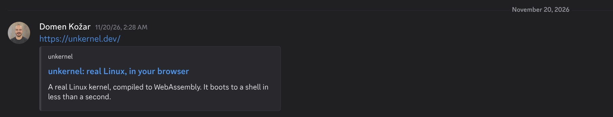
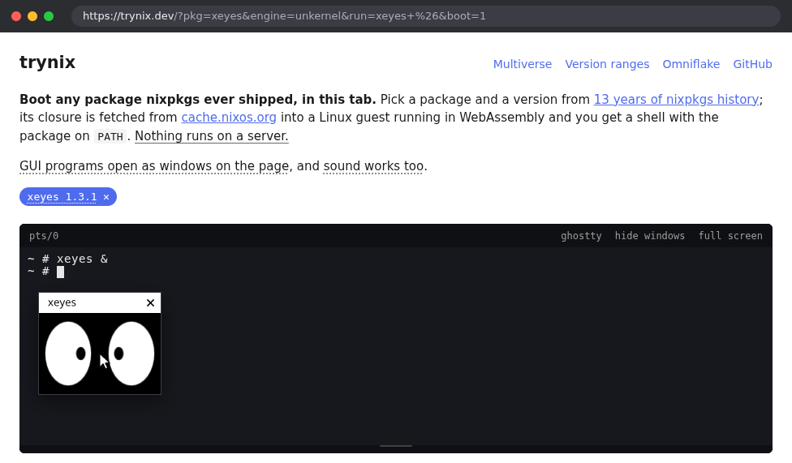
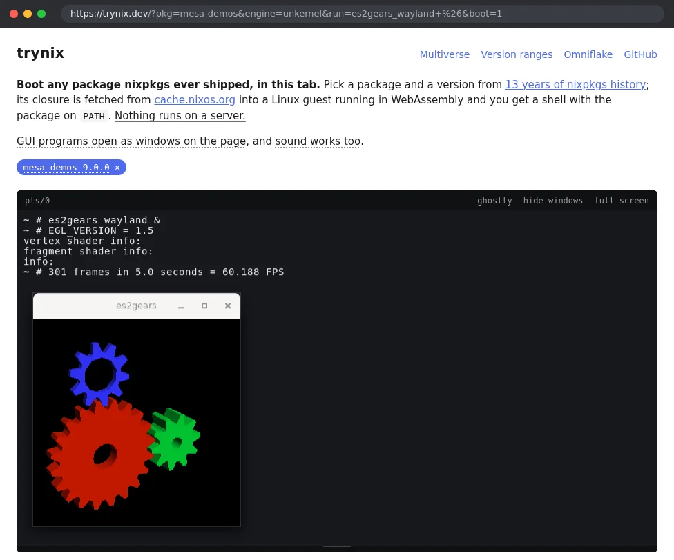
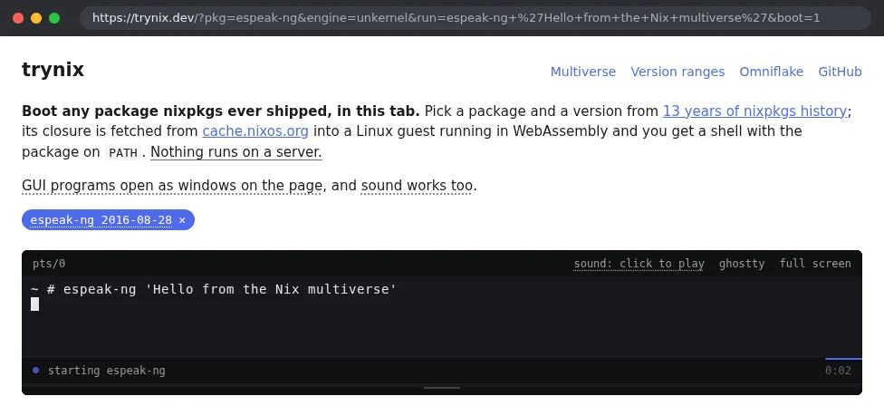
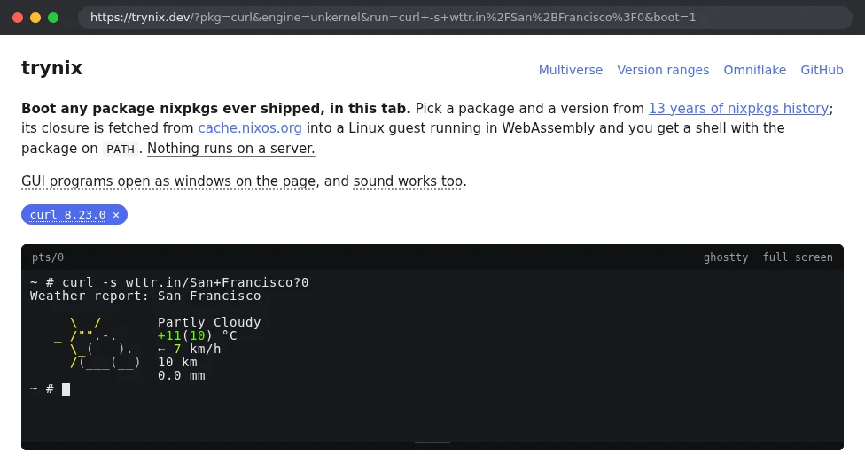
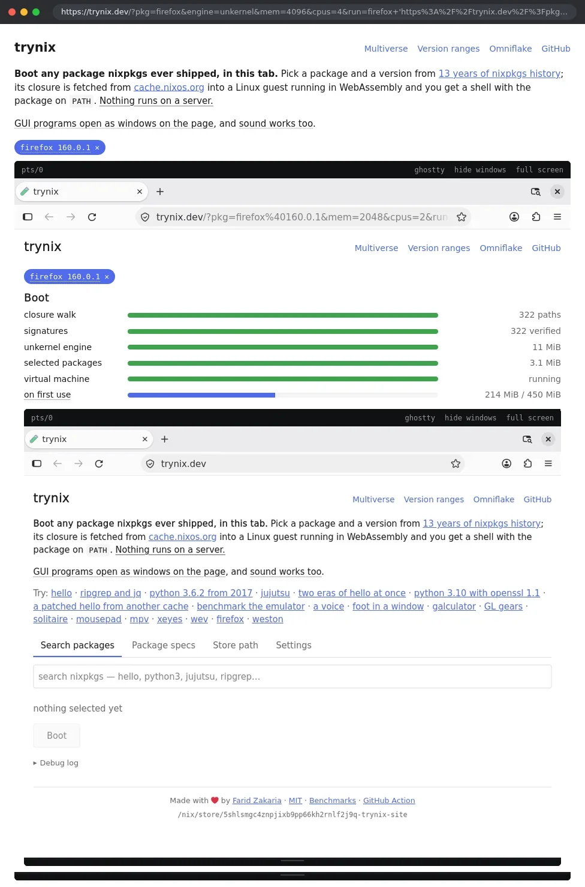

> **tl;dr** [trynix.dev](https://trynix.dev/) boots GUI programs now. Try [solitaire](https://trynix.dev/?pkg=aisleriot&engine=unkernel&run=sol+%26&boot=1), [GL gears](https://trynix.dev/?pkg=mesa-demos&engine=unkernel&run=es2gears_wayland+%26&boot=1), [xeyes](https://trynix.dev/?pkg=xeyes&engine=unkernel&run=xeyes+%26&boot=1), [a voice](https://trynix.dev/?pkg=espeak-ng&engine=unkernel&run=espeak-ng+%27Hello+from+the+Nix+multiverse%27&boot=1), [the weather over curl](https://trynix.dev/?pkg=curl&engine=unkernel&run=curl+-s+wttr.in%2FSan%2BFrancisco%3F0&boot=1), or [Firefox](https://trynix.dev/?pkg=firefox&engine=unkernel&mem=2048&run=firefox+%26&boot=1).

I remember watching the talk [The Birth & Death of JavaScript](https://www.destroyallsoftware.com/talks/the-birth-and-death-of-javascript) by [Gary Bernhardt](https://x.com/garybernhardt) and falling in love with the whimsical yet dreadfully serious unfolding of the story of how JavaScript will come to dominate all software.

Others have noted the inevitability of JavaScript's dominance, so perhaps it was not surprising that Atwood's Law holds true.

> **Atwood’s Law**Any application that can be written in JavaScript, will eventually be written in JavaScript.
> — [Jeff Atwood, 2009](https://blog.codinghorror.com/all-programming-is-web-programming/)

I highly recommend watching the talk if you have not already seen it, but the short and skinny is a lookback from 2035 and how JavaScript came to be the defacto language for all software.

In Bernhardt's retelling of events, the date is worked back from 2035, however unsurprisingly, large language models have rapidly sped up the timeline. What was once perceived to be the end-state at 2035 has arrived years earlier and you can witness it unfolding at [trynix.dev](https://trynix.dev/).

```plotnine
import pandas as pd
from plotnine import *

# Gary Bernhardt's "The Birth & Death of JavaScript" (PyCon 2014), told
# from 2035, and where trynix landed on it. Each milestone sits above or
# below the axis at its height, its name nearest the axis.

# The blog's ink: its plotnine plugin turns this colour into the page's
# text colour, so labels read in the light and the dark theme alike.
INK = "#010203"
events = pd.DataFrame({
    "year": [1995, 2013, 2022.5, 2025, 2029, 2035, 2026.9],
    "y": [1.0, -1.0, 1.0, -1.0, -2.3, 1.0, 2.5],
    "title": ["JavaScript", "asm.js", "the war", "GIMP in a tab", "METAL",
              "JavaScript dies", "trynix, Nov 2026"],
    "note": ["written in ten days;\nevery browser runs it",
             "C and C++ compile to it\nat near-native speed",
             "2020 to 2025:\nfive years of nothing",
             "desktop programs\ncompiled for the web",
             "the browser's VM\nbecomes the OS",
             "nobody writes it;\neverything runs on it",
             "Firefox on Linux,\nin a browser tab"],
    "kind": ["talk", "talk", "talk", "talk", "talk", "talk", "us"],
})
up = events["y"] > 0
events["note_y"] = events["y"] + up.map({True: 0.42, False: -0.42})
events["title_va"] = up.map({True: "bottom", False: "top"})
war = pd.DataFrame({"x": [2020], "xend": [2025]})

plot = (
    ggplot(events)
    + geom_segment(aes(x=1993, xend=2038, y=0, yend=0), color=INK, alpha=0.5,
                   size=0.8, arrow=arrow(length=0.08, type="closed"))
    + geom_segment(war, aes(x="x", xend="xend", y=0, yend=0), color="#BBBBBB", size=4)
    + geom_segment(aes(x="year", xend="year", y=0, yend="y", color="kind"),
                   linetype="dotted", size=0.6)
    + geom_point(aes(x="year", y=0, color="kind"), size=3.2)
    + geom_text(events[up], aes(x="year", y="y", label="title", color="kind"),
                va="bottom", size=8.5, fontweight="bold")
    + geom_text(events[~up], aes(x="year", y="y", label="title", color="kind"),
                va="top", size=8.5, fontweight="bold")
    + geom_text(events[up], aes(x="year", y="note_y", label="note"),
                va="bottom", size=6.5, color=INK, alpha=0.75)
    + geom_text(events[~up], aes(x="year", y="note_y", label="note"),
                va="top", size=6.5, color=INK, alpha=0.75)
    + geom_text(pd.DataFrame({"x": [1995, 2005, 2015, 2025, 2035]}),
                aes(x="x", y=-0.22, label="x"), size=6.5, color=INK, alpha=0.55,
                va="top")
    + scale_color_manual(values={"talk": "#4C78A8", "us": "#E45756"}, guide=None)
    + scale_x_continuous(limits=(1990, 2041))
    + scale_y_continuous(limits=(-3.4, 3.5))
    + theme_void()
    + theme(figure_size=(6.5, 3.6))
)
```


One of the most impressive creations I've managed to build leveraging [nixpkgs-multiverse]() is [https://trynix.dev](https://trynix.dev/).

It still baffles my mind that I can run **any Nix package**, over 300,000 distinct package versions, straight from my browser. Truly insane capability.
I was however a little dismayed at the speed of the QEMU emulation in the browser. It was slow enough that the creation tipped more towards novelty than practicality.

I woke on November 20th and saw [Domen Kožar](https://x.com/domen_koz) sharing a single message in our [TacoSprint](https://tacosprint.org) Discord channel: [unkernel.dev](https://unkernel.dev)

[](/assets/images/domen_discord_unkernel.png)

It was the fast browser Linux experience I had sought to achieve, _but with Nix_.

> **Aside**
> What is [unkernel](https://unkernel.dev)?
> It is Linux compiled _to_ WebAssembly, allowing the kernel and system components to run at wasm speed while only user programs are emulated. It was published by [Pooya Parsa](https://x.com/_pi0_) on November 19th, 2026.
{: .alert .alert-note }

In an AI induced manic frenzy, I adopted the new engine along with a slough of long-wished features almost immediately.

```plotnine
import pandas as pd
from plotnine import *

# Hours from unkernel's first npm release (2026-11-19 09:28 PST) to
# each event: npm publish times for unkernel, author dates of the trynix
# commits that landed each feature.
df = pd.DataFrame({
    "event": [
        "unkernel on npm",
        "trynix boots on unkernel by default",
        "unkernel ships a Wayland desktop",
        "GUI windows on the page",
        "downloads on first use",
        "sound",
        "network",
        "X11 programs",
        "a strip that says what is loading",
    ],
    "who": ["unkernel", "trynix", "unkernel", "trynix", "trynix",
            "trynix", "trynix", "trynix", "trynix"],
    "hours": [0, 24.75, 88.15, 95.11, 98.45, 103.76, 104.18, 104.73, 105.58],
})
df["event"] = pd.Categorical(df["event"], categories=df["event"][::-1], ordered=True)

plot = (
    ggplot(df, aes("hours", "event", color="who"))
    + geom_segment(aes(x=0, xend="hours", yend="event"), size=0.6, alpha=0.35)
    + geom_point(size=3)
    + scale_x_continuous(
        breaks=[0, 24, 48, 72, 96],
        labels=["Thu", "Fri", "Sat", "Sun", "Mon"],
        limits=(0, 112),
    )
    + scale_color_manual(values={"unkernel": "#E45756", "trynix": "#4C78A8"})
    + labs(x="", y="", color="")
    + theme(figure_size=(6.5, 3.2), legend_position="top")
)
```

The proof is in the pudding: unkernel delivers remarkable speed improvements over [qemu-wasm](https://github.com/ktock/qemu-wasm),[^patches] especially on first runs where kernel work dominates. The new engine is able to deliver 2x to 32x faster performance depending on the workload.[^benchmark]

[^benchmark]: The [benchmark page](https://trynix.dev/bench/) tracks both engines over time, measured through the real page and shell.

[^patches]: With a very healthy set of patches applied to make it even faster.

```plotnine
import pandas as pd
from plotnine import *

# docs/unkernel.md in trynix: leviathan (EPYC 7763, four pinned cores),
# headless Chromium 152, 2026-11-20. Guest seconds, first run.

# The blog's ink: its plotnine plugin turns this colour into the page's
# text colour, so labels read in the light and the dark theme alike.
INK = "#010203"
cmds = ["hello", "rg --version", "jj --version", "python3 -c 'print(1)'",
        "python, 3M-iteration sum()", "opencode --version"]
qemu = [0.68, 0.55, 1.98, 3.46, 28.8, 116.5]
unk = [0.021, 0.056, 0.20, 0.66, 8.7, 56]
df = pd.DataFrame({
    "command": cmds * 2,
    "engine": ["qemu-wasm"] * 6 + ["unkernel"] * 6,
    "seconds": qemu + unk,
})
df["command"] = pd.Categorical(df["command"], categories=cmds[::-1], ordered=True)
gaps = pd.DataFrame({"command": cmds, "fast": unk, "slow": qemu})
gaps["command"] = pd.Categorical(gaps["command"], categories=cmds[::-1], ordered=True)
gaps["label"] = [f"{s / f:.0f}x faster" for s, f in zip(qemu, unk)]

plot = (
    ggplot(df, aes("seconds", "command"))
    + geom_segment(gaps, aes(x="fast", xend="slow", y="command", yend="command"),
                   color="#BBBBBB", size=1.2)
    + geom_point(aes(color="engine"), size=3.5)
    + geom_text(gaps, aes(x="slow", y="command", label="label"),
                ha="left", nudge_x=0.12, size=8, color=INK)
    + scale_x_log10(limits=(0.01, 2000), breaks=[0.01, 0.1, 1, 10, 100],
                    labels=["0.01", "0.1", "1", "10", "100"])
    + scale_color_manual(values={"qemu-wasm": "#A8C7E5", "unkernel": "#4C78A8"})
    + labs(x="seconds, first run (log scale)", y="", color="")
    + theme(figure_size=(6.5, 3.2), legend_position="top",
            panel_grid_minor=element_blank())
)
```

JavaScript & WebAssembly nirvana.

Amazingly not only does the kernel boot quickly, it also enables networking, full-fledged graphical and audio experiences directly in the browser.

**Windows.** A program's Wayland surfaces are composited in the page by [wland](https://github.com/pithings/wland), and they float over the terminal you started them from.

[](/assets/images/trynix-xeyes.webp)

**GL.** The VM includes a minimal Mesa build with only the virgl driver, compiled to WebAssembly, rendering through your browser's WebGL2.

[](/assets/images/trynix-gears.webp)

**Sound.** The VM has an ALSA sound card, and can play audio through your browser.

[](/assets/images/trynix-voice.webp)

**Network.** `curl`, `git clone` and `pip install` work. Each TCP connection goes over one WebSocket to a [Wisp](https://github.com/MercuryWorkshop/wisp-protocol) relay.[^wisp]

[^wisp]: Thank you to [@\_pi0\_](https://x.com/_pi0_) for adding [trynix.dev](https://trynix.dev) to his Wisp relay allow-list.

[](/assets/images/trynix-weather.webp)


The best joke in Bernhardt's talk is a browser running inside another browser: the Windows GIMP under Wine, in Chrome, in Firefox. Of course, I had to try it with trynix. 😈

```plotnine
import pandas as pd
from plotnine import *

# Bernhardt's stack slide next to the stack trynix ran. Each layer runs
# on the one below it, so a stack reads from the bottom up, and each bar
# sits a step right of the one above it, as on his slide. Browsers are
# red, as on his slide.

# The blog's ink: its plotnine plugin turns this colour into the page's
# text colour, so the titles read in the light and the dark theme alike.
INK = "#010203"
BROWSER = "#A63D32"
LAYER = "#4A4E5C"
LABEL = "#FBF3DB"
BROWSERS = {"Chrome", "Firefox"}

# Bar geometry, in data units: a bar's width, its height within its
# row, the step right per row, and the room between the two stacks.
WIDTH = 3.4
HEIGHT = 0.82
STEP = 0.16
GAP = 6.4

stacks = {
    "Bernhardt's 2035, drawn in 2014": [
        "GIMP", "Wine", "X Windows", "CC", "asm.js", "Chrome", "Cacao",
        "CC", "asm.js", "Firefox",
    ],
    "trynix, November 2026": [
        "trynix.dev", "Firefox", "Wayland", "Linux", "WebAssembly",
        "trynix", "Firefox", "Wayland", "Linux", "WebAssembly", "trynix",
        "Firefox",
    ],
}

# One row per bar, top of the stack first; one title per stack.
bars = []
titles = []
for column, (title, layers) in enumerate(stacks.items()):
    left = column * GAP
    titles.append({"x": left, "y": 0.45, "title": title})
    for depth, layer in enumerate(layers):
        x = left + depth * STEP
        bars.append({
            "xmin": x, "xmax": x + WIDTH,
            "ymin": -depth - HEIGHT, "ymax": -depth,
            "x": x + WIDTH / 2, "y": -depth - HEIGHT / 2,
            "label": layer,
            "fill": BROWSER if layer in BROWSERS else LAYER,
        })
bars = pd.DataFrame(bars)
titles = pd.DataFrame(titles)

plot = (
    ggplot()
    + geom_rect(bars, aes(xmin="xmin", xmax="xmax", ymin="ymin",
                          ymax="ymax", fill="fill"))
    + geom_text(bars, aes("x", "y", label="label"), color=LABEL,
                fontweight="bold", size=9)
    + geom_text(titles, aes("x", "y", label="title"), color=INK,
                ha="left", va="bottom", fontweight="bold", size=9.5)
    + scale_fill_identity()
    + theme_void()
    + theme(figure_size=(6.5, 4.6))
)
```

Here is [Firefox in trynix](https://trynix.dev/?pkg=firefox&engine=unkernel&mem=2048&run=firefox+https%3A%2F%2Ftrynix.dev+%26&boot=1), and it loading [trynix.dev](https://trynix.dev), and then loading Firefox again inside itself.[^inception]

[^inception]: Do not be too overjoyed. It took more than an hour for this to render.

[](/assets/images/trynix-inception.webp)

Sit and bask in that insanity. That is Firefox, on Linux compiled to WebAssembly, in a Firefox tab, loading the site and then loading Firefox again inside itself. 🤯

2035 came early.