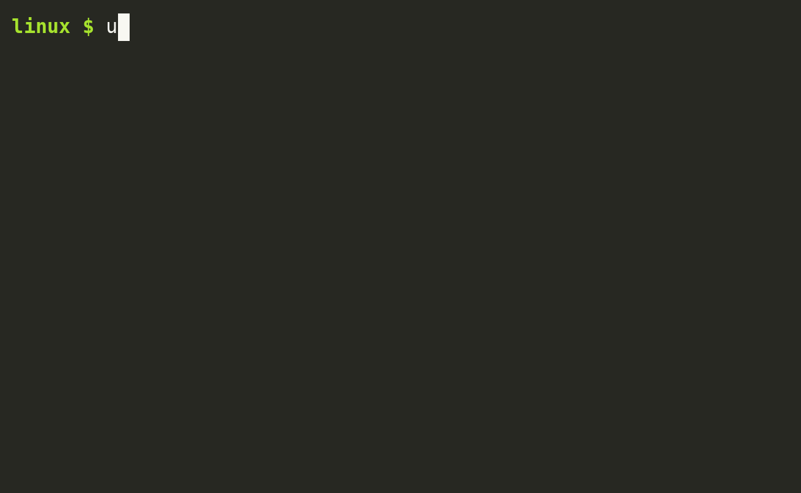

> **tl;dr** [tabc](https://github.com/fzakaria/tabc) is a container runtime, like runc, that runs each container in a Chromium tab.
> `docker run --runtime tabc alpine` works and starts in under a second. 
> On a Mac it needs <u>no VM at all</u>; Linux for everyone!

Despite my zealot love for [Nix](https://nixos.org), there is no denying the convenience and ubiquity of Docker.
Containers have become the standard unit of software deployment, providing a consistent environment across different machines and simplifying the management of dependencies.[^containers]

<!--more-->

Despite all the footguns you can get yourself into by writing a non-reproducible Dockerfile, it was a still a remarkable step forward in making software deployment more predictable and portable.

[^containers]: Containers are not even a "real" thing within the Linux kernel although there are [recent attempts](https://lore.kernel.org/all/20261019-cells-rfc-6f4c85415f29@toxicpanda.com/) to formalize them as a kernel-level abstraction.

Nothing has really challenged Docker's dominance in the container space and it's reliance on Linux as the underlying platform. The absurdity of the situation has become that developers on MacOS end up running a Linux virtual machine to simply run containers.

People, even the creator of Docker, believed a common runtime for software isolation would have been a game-changer and that WebAssembly could have played that role if it had existed earlier.

> "If WASM+WASI existed in 2008, we wouldn't have needed to created Docker. That's how important it is." - [Solomon Hykes, 2019](https://x.com/solomonstre/status/1111004913222324225)

Here we are, 7 years later, we still have Docker, and WebAssembly is mostly used for speeding up web applications.

Is there another way to achieve the same level of isolation and portability without relying on the host being Linux?

What if though Docker ran its containers on WebAssembly instead of directly on the Linux kernel?

What if the isolation provided by the browser could replace the kernel-level isolation that containers rely on?

This idea, the holy grail of running Linux in a browser is not new. [JSLinux](https://bellard.org/jslinux/) did it in 2011, and [v86](https://github.com/copy/v86), [WebVM](https://webvm.io) and [qemu-wasm](https://github.com/ktock/qemu-wasm) are also attempts in the same direction. They all have their share of limitations: 32-bit only, performance issues, incomplete hardware emulation, that make them impractical for general-purpose use.


```plotnine
import pandas as pd
from plotnine import *

# trynix.dev's two engines on one laptop (Ryzen 7 7840U), headless
# Chromium, 2026-11-25, measured by trynix's exec-bench: seconds for a
# program's first run, timed in the page. The qemu engine is trynix's
# patched qemu-wasm with an x86-64 guest, resumed from a snapshot;
# unkernel runs the aarch64 build of the same package.

# The blog's ink: its plotnine plugin turns this colour into the page's
# text colour, so labels read in the light and the dark theme alike.
INK = "#010203"
cmds = ["hello", "rg --version", "jj --version", "python3 -c 'print(1)'"]
qemu = [0.595, 0.436, 1.394, 2.719]
unk = [0.078, 0.033, 0.127, 0.560]
df = pd.DataFrame({
    "command": cmds * 2,
    "engine": ["a whole machine emulated"] * 4 + ["only your program emulated"] * 4,
    "seconds": qemu + unk,
})
df["command"] = pd.Categorical(df["command"], categories=cmds[::-1], ordered=True)
gaps = pd.DataFrame({"command": cmds, "fast": unk, "slow": qemu})
gaps["command"] = pd.Categorical(gaps["command"], categories=cmds[::-1], ordered=True)
gaps["label"] = [f"{s / f:.0f}x" for s, f in zip(qemu, unk)]

plot = (
    ggplot(df, aes("seconds", "command"))
    + geom_segment(gaps, aes(x="fast", xend="slow", y="command", yend="command"),
                   color="#BBBBBB", size=1.2)
    + geom_point(aes(color="engine"), size=3.5)
    + geom_text(gaps, aes(x="slow", y="command", label="label"),
                ha="left", nudge_x=0.1, size=8, color=INK)
    + scale_x_log10(limits=(0.02, 10), breaks=[0.03, 0.1, 0.3, 1, 3],
                    labels=["0.03", "0.1", "0.3", "1", "3"])
    + scale_color_manual(values={"a whole machine emulated": "#A8C7E5",
                                 "only your program emulated": "#E45756"})
    + labs(x="seconds, first run (log scale)", y="", color="")
    + theme(figure_size=(6.5, 2.7), legend_position="top",
            panel_grid_minor=element_blank())
)
```

[unkernel](https://github.com/pithings/unkernel) is a newly developed project by [Pooya Parsa](https://github.com/pithings) that changes the economics of what is possible. unknernel compiles the Linux kernel to WebAssembly, allowing it to run directly in the browser without relying on traditional hardware emulation. Only your container's own code goes through an emulator, and everything else the kernel does runs at near native speed.

It is now practical to run Linux containers directly in the browser, leveraging the isolation provided by WebAssembly and the browser environment with acceptable performance.

[](/assets/images/tabc-demo.webp)
{: style="--image-width: 25rem"}

That is a real `docker run`, on a real Docker daemon, starting a real Alpine image. This works even on a Mac with no Docker installed and <u>no virtual machine running</u>. 🤯

In my [last post]() I was inspired from Gary Bernhardt's [The Birth & Death of JavaScript](https://www.destroyallsoftware.com/talks/the-birth-and-death-of-javascript) and its discussion of the evolution of software isolation.

In the talk's future a project called METAL moves the JavaScript VM into the kernel. Programs stop needing the hardware to keep them apart, because the VM already does. Process isolation becomes a software problem that was solved somewhere else, for another reason.

We did not need to move the VM into the kernel. A browser tab is the VM Bernhardt imagined.


## One tab per container

[tabc](https://github.com/fzakaria/tabc) is a OCI container runtime that runs each container in its own browser tab. That means you can use it with Docker just like any other runtime.

Whereas the default Docker runtime, [runc](https://github.com/opencontainers/runc), starts your program as a process on the host's kernel, tabc leverages the browser as its execution environment, running each container in a separate tab with its own instance of the Linux kernel compiled to WebAssembly.[^unkernel]

[^unkernel]: The tab boots [unkernel](https://github.com/pithings/unkernel), and the "container" runs within it.

This is the part that I'm most excited about: at no point does your container ever touch the host's kernel and require Linux.
All tabc asks of the host is a browser, <u>nothing needs Linux underneath</u>.

This is a complete rethinking of the container stack on macOS. Docker on a Mac is a Linux virtual machine with a nice installer. Docker Desktop, [Colima](https://github.com/abiosoft/colima), OrbStack and Podman Machine all boot a Linux VM first. Even Apple's own [container](https://github.com/apple/container) tool boots a VM per container.

<figure>
<svg viewBox="0 0 640 250" role="img" style="display:block;margin-inline:auto;max-width:40rem;width:100%;height:auto;font-family:var(--mono)"
     aria-label="Two stacks on a Mac. Docker Desktop: your container on a Linux kernel, in a virtual machine, on a hypervisor, on macOS. tabc: your container on a Linux kernel compiled to WebAssembly, in a Chrome tab, on macOS. The tabc stack has no virtual machine and no hypervisor.">
  <g font-size="13" fill="var(--ink)" text-anchor="middle">
    <text x="150" y="20" font-weight="bold">Docker on a Mac</text>
    <rect x="30" y="34" width="240" height="34" rx="5" fill="none" stroke="var(--ink)" stroke-width="1.5"/>
    <text x="150" y="56">your container</text>
    <rect x="30" y="76" width="240" height="34" rx="5" fill="none" stroke="var(--ink)" stroke-width="1.5"/>
    <text x="150" y="98">Linux kernel</text>
    <rect x="30" y="118" width="240" height="34" rx="5" fill="none" stroke="var(--ink-muted)" stroke-width="1.5" stroke-dasharray="5 4"/>
    <text x="150" y="140" fill="var(--ink-muted)">virtual machine</text>
    <rect x="30" y="160" width="240" height="34" rx="5" fill="none" stroke="var(--ink-muted)" stroke-width="1.5" stroke-dasharray="5 4"/>
    <text x="150" y="182" fill="var(--ink-muted)">hypervisor</text>
    <rect x="30" y="202" width="240" height="34" rx="5" fill="none" stroke="var(--ink)" stroke-width="1.5"/>
    <text x="150" y="224">macOS</text>

    <text x="490" y="20" font-weight="bold" fill="var(--accent)">tabc</text>
    <rect x="370" y="76" width="240" height="34" rx="5" fill="none" stroke="var(--ink)" stroke-width="1.5"/>
    <text x="490" y="98">your container</text>
    <rect x="370" y="118" width="240" height="34" rx="5" fill="none" stroke="var(--accent)" stroke-width="2"/>
    <text x="490" y="140" fill="var(--accent)">Linux kernel, as WebAssembly</text>
    <rect x="370" y="160" width="240" height="34" rx="5" fill="none" stroke="var(--accent)" stroke-width="2"/>
    <text x="490" y="182" fill="var(--accent)">a Chrome tab</text>
    <rect x="370" y="202" width="240" height="34" rx="5" fill="none" stroke="var(--ink)" stroke-width="1.5"/>
    <text x="490" y="224">macOS</text>
  </g>
</svg>
</figure>


On Linux, Docker pulls the image and hands it to tabc. A Mac with no VM has no Docker daemon to do that, so tabc run pulls the image itself.

```console
$ tabc run -it alpine sh
/ # uname -sm
Linux aarch64
```

Without Linux and namespaces, what is giving the container its isolation?

The browser! 💡

Browsers such as Chromium are an incredibly battle-tested sandbox, and we only use them for web pages. 🤦
Rather than simply relying on the host kernel's isolation mechanisms, tabc leverages the browser's sandbox to create an additional layer of security.[^separate]

[^separate]: Every container may also get a browser of its own, with its own profile, so two containers share no process and no storage.

<figure>
<svg viewBox="0 0 640 262" role="img" style="display:block;margin-inline:auto;max-width:40rem;width:100%;height:auto;font-family:var(--mono)"
     aria-label="Nested boxes. Under runc, a program sits inside namespaces, seccomp and capabilities, directly on the host's kernel. Under tabc, a program sits inside a Linux kernel in the tab, inside WebAssembly in V8, inside Chromium's renderer sandbox, on the host's kernel.">
  <g font-size="12" fill="var(--ink)">
    <text x="150" y="18" text-anchor="middle" font-size="13" font-weight="bold">runc</text>
    <rect x="20" y="30" width="260" height="222" rx="6" fill="none" stroke="var(--ink)" stroke-width="1.5"/>
    <text x="32" y="48">the host's kernel</text>
    <rect x="44" y="134" width="212" height="104" rx="6" fill="none" stroke="var(--ink)" stroke-width="1.5"/>
    <text x="56" y="152">namespaces, seccomp,</text>
    <text x="56" y="168">capabilities</text>
    <rect x="68" y="184" width="164" height="40" rx="6" fill="none" stroke="var(--ink)" stroke-width="2"/>
    <text x="150" y="209" text-anchor="middle" font-weight="bold">your program</text>

    <text x="490" y="18" text-anchor="middle" font-size="13" font-weight="bold" fill="var(--accent)">tabc</text>
    <rect x="340" y="30" width="290" height="222" rx="6" fill="none" stroke="var(--ink)" stroke-width="1.5"/>
    <text x="352" y="48">the host's kernel</text>
    <rect x="354" y="60" width="262" height="180" rx="6" fill="none" stroke="var(--accent)" stroke-width="2"/>
    <text x="366" y="78" fill="var(--accent)">Chromium's renderer sandbox</text>
    <rect x="368" y="90" width="234" height="138" rx="6" fill="none" stroke="var(--accent)" stroke-width="2"/>
    <text x="380" y="108" fill="var(--accent)">WebAssembly, in V8</text>
    <rect x="382" y="120" width="206" height="96" rx="6" fill="none" stroke="var(--ink)" stroke-width="1.5"/>
    <text x="394" y="138">Linux, in the tab</text>
    <rect x="402" y="156" width="166" height="46" rx="6" fill="none" stroke="var(--ink)" stroke-width="2"/>
    <text x="485" y="183" text-anchor="middle" font-weight="bold">your program</text>
  </g>
</svg>
</figure>


Starting a container in a browser tab is surprisingly fast, and most of the time is spent starting the browser itself.
On my Linux laptop[^machine] a container takes roughly 0.87 seconds from command to exit. This startup cost can be
eliminated by using your browser's already running instance via `--open` or `--link`, _more on that later_.

[^machine]: I ran fifteen runs of `echo hi` from an Alpine bundle on a Ryzen 7 7840U.

```plotnine
import pandas as pd
from plotnine import *

# tabc on a Ryzen 7 7840U, 2026-11-25: medians of 15 runs of `echo hi`
# from an Alpine bundle, stage boundaries from tabc's log.

# The blog's ink: its plotnine plugin turns this colour into the page's
# text colour, so labels read in the light and the dark theme alike.
INK = "#010203"
stages = pd.DataFrame({
    "stage": ["Chromium opens the page", "Linux boots, mounts the image",
              "echo hi runs and exits", "everything else"],
    "start": [0.007, 0.517, 0.606, 0.0],
    "end": [0.510, 0.601, 0.862, 0.0],
})
other = 0.867 - sum(stages["end"] - stages["start"])
stages.loc[3, ["start", "end"]] = [0.862, 0.862 + other]
stages["stage"] = pd.Categorical(stages["stage"], categories=stages["stage"][::-1], ordered=True)
stages["label"] = [f"{(e - s) * 1000:.0f} ms" for s, e in zip(stages["start"], stages["end"])]
stages["kind"] = ["browser", "linux", "program", "other"]

plot = (
    ggplot(stages)
    + geom_segment(aes(x="start", xend="end", y="stage", yend="stage", color="kind"), size=7)
    + geom_text(aes(x="end", y="stage", label="label"), ha="left", nudge_x=0.012,
                size=8, color=INK)
    + scale_color_manual(values={"browser": "#BBBBBB", "linux": "#E45756",
                                 "program": "#4C78A8", "other": "#DDDDDD"}, guide=None)
    + scale_x_continuous(limits=(0, 1.0), breaks=[0, 0.25, 0.5, 0.75],
                         labels=["0", "0.25", "0.5", "0.75"])
    + labs(x="seconds since the command", y="")
    + theme(figure_size=(6.5, 2.4), panel_grid_minor=element_blank(),
            panel_grid_major_y=element_blank())
)
```

Unkernel has drastically improved the performance of running Linux in the browser but since the processes themselves are still emulated, 
there can be some noticeable delay for larger compute-heavy workloads.

> **Aside**
> You can get a sense of the performance impact on a lot of packages by visiting [https://trynix.dev](https://trynix.dev).
> You have access to over 300,000 packages from [Nixpkgs](https://nixos.org/nixpkgs/) that run directly in your browser using [Unkernel](https://unkernel.dev).
{: .alert .alert-note }


```plotnine
import pandas as pd
from plotnine import *

# One rootless Docker daemon on a Ryzen 7 7840U, 2026-11-25. The same
# python:3.13-alpine image under runc (linux/amd64, native) and under
# tabc (linux/arm64, in a tab). Seconds inside the container, medians
# of three runs.

# The blog's ink: its plotnine plugin turns this colour into the page's
# text colour, so labels read in the light and the dark theme alike.
INK = "#010203"
work = ["sha256sum of 64 MB", "gzip of 32 MB", "import json, parse 1 MB",
        "python: sum of 5M squares", "find over /usr"]
runc = [0.304, 0.685, 0.092, 0.287, 0.021]
tabc = [3.337, 9.591, 2.613, 8.769, 0.748]
df = pd.DataFrame({
    "work": work * 2,
    "runtime": ["runc, native"] * 5 + ["tabc, in a tab"] * 5,
    "seconds": runc + tabc,
})
df["work"] = pd.Categorical(df["work"], categories=work[::-1], ordered=True)
gaps = pd.DataFrame({"work": work, "fast": runc, "slow": tabc})
gaps["work"] = pd.Categorical(gaps["work"], categories=work[::-1], ordered=True)
gaps["label"] = [f"{s / f:.0f}x slower" for s, f in zip(tabc, runc)]

plot = (
    ggplot(df, aes("seconds", "work"))
    + geom_segment(gaps, aes(x="fast", xend="slow", y="work", yend="work"),
                   color="#BBBBBB", size=1.2)
    + geom_point(aes(color="runtime"), size=3.5)
    + geom_text(gaps, aes(x="slow", y="work", label="label"),
                ha="left", nudge_x=0.1, size=8, color=INK)
    + scale_x_log10(limits=(0.01, 200), breaks=[0.01, 0.1, 1, 10],
                    labels=["0.01", "0.1", "1", "10"])
    + scale_color_manual(values={"runc, native": "#4C78A8", "tabc, in a tab": "#E45756"})
    + labs(x="seconds (log scale)", y="", color="")
    + theme(figure_size=(6.5, 3.0), legend_position="top",
            panel_grid_minor=element_blank())
)
```

Although some of these slowdowns seem excessive, many workloads are still well within acceptable limits for interactive use that let this go beyond trivial examples and novelty.

Depending on whether you have every container running in its own browser instance or sharing tabs within a single browser, the memory overhead can be more dramatic.
An idle container costs ~540 MiB of host memory split between the tab that holds the guest, the browser process, and helper processes.[^firecracker]


[^firecracker]: For scale, [Firecracker](https://firecracker-microvm.github.io/) quotes under 5 MiB of overhead per microVM and 125 ms to boot.

Nevertheless, this overhead is acceptable for many interactive use cases where the convenience of
running containers in browser tabs outweighs the memory cost.

Did you remember when I said you can run this on MacOS <u>without a VM</u> !?

<p><a href="/assets/images/tabc-no-vm-reaction.mp4"><video autoplay loop muted playsinline width="640" height="360" style="--image-width: 28rem">
  <source src="/assets/images/tabc-no-vm-reaction.mp4" type="video/mp4">
  Video: the trading floor in The Wolf of Wall Street. Matthew McConaughey's character stands up and shouts "holy fucking shit".
</video></a></p>

> **Aside**
> The idea of a container in WebAssembly was attempted before with [container2wasm](https://github.com/container2wasm/container2wasm).
> It however emulated the entire machine, including the kernel, rather than just the program so it was way heavier and slower than what tabc does.
{: .alert .alert-note }


By default the browser is hidden. It does not have to be. Ready to cook ? 🧑‍🍳

This is where the idea kind of comes together and becomes borderline magical: the browser tab itself becomes the container, and you can interact with it just like any other tab.


```console
$ tabc run -it --open -p 8123:80 nginx:alpine sh
```

With `--open`, tabc leverages the desktop environment to open the container's page in the default browser. Even crazier is that the page itself is a pty, so you have cross-terminal interaction between the browser tab and the terminal you started it from.

<p><a href="/assets/images/tabc-tab.mp4"><video autoplay loop muted playsinline width="1360" height="1604" style="--image-width: 28rem">
  <source src="/assets/images/tabc-tab.mp4" type="video/mp4">
  Video: a terminal at the top runs tabc with --open, and a tab in the Chromium window under it boots Linux and shows a shell prompt. A command typed into the tab appears in the terminal, and one typed into the terminal appears in the tab. nginx is started in the container, and a second tab at localhost:8123 shows the page it serves.
</video></a></p>

You then can visit the container's web server at the port exposed, in this case `localhost:8123`, in you guessed it: another browser tab in _the same browser_.

Once you have containers you can start, they then can become composed: `docker compose`.
Nothing beyond the `runtime: tabc` key in the Compose file changes. Everything else from compose continues to work: network, volumes, and all.[^dashboard]

[^dashboard]: The `--dashboard` flag opens the tabc dashboard, where the tabs are panes in a single browser page.

> **Tip**
> Since MacOS has no Docker daemon for compose, tabc brings its own lightweight one to handle it: `tocker`.
> ```console
> $ tocker --dashboard compose up
> ```
{: .alert .alert-tip }


<p><a href="/assets/images/tabc-compose.mp4"><video autoplay loop muted playsinline width="1360" height="2004" style="--image-width: 28rem">
  <source src="/assets/images/tabc-compose.mp4" type="video/mp4">
  Video: a terminal at the top runs tocker compose up for a web service and a Redis service. A Chromium window under it shows two panes, one per service, each booting Linux. Redis prints its start-up log in one pane and the web server logs requests in the other. A second tab opens the web service at localhost:8123 and its count goes up on each reload, then curl in the terminal gets the next count.
</video></a></p>

We just started two containers in the browser: a web server and a Redis instance, each running in its own tab pane and communicating with each other by service name.

## Everything is a tab

Unix's big bet was that everything is a file. In the browser, everything is a tab.
Our mail, our editors and our terminals already moved there.
We can now add containers to the list.

```console
$ nix run github:fzakaria/tabc -- run alpine echo hi
hi
```

That works on Linux and on an Apple Silicon Mac on any recent browser.[^nix]
The [README](https://github.com/fzakaria/tabc) has more details on setup and usage.

[^nix]: On Linux the Nix package brings its own Chromium unless you pass `--open`.

Solomon Hykes was half right. WebAssembly became the runtime, and Docker stayed anyway.
