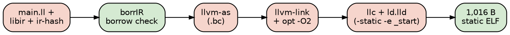

> **tl;dr** [borrIR](https://github.com/fzakaria/borrir) is a borrow checker, a
> zero-libc standard library (`libir`), and a bitcode package manager for raw
> LLVM IR. Try it live in the [browser playground](https://fzakaria.github.io/borrir/), 
> and commit yourself to the _agentic engineering way of life_.

Welcome AI disciples. This post is for you.

We are just past the year mark when [Opus 4.5 was released](https://www.anthropic.com/news/claude-opus-4-5)
on November 24, 2026, when the way in which we craft and generate code changed overnight.
We ushered in the era of _agentic coding_, where AI agents can autonomously generate,
modify, and reason about code with minimal human intervention.

<!--more-->

Despite the loss of joy that comes with knowing the codebase inside and out or bickering
with my friends about esoteric language features, there is no denying how much more prolific
I have become by embracing the _agentic engineering way of life_.

With the blindfolds on, the language du jour seems to be Rust for our dutiful clankers.
Anthropic even made a large splash at how they rewrote their whole messaging system from Python
to Rust [[cite](https://newsletter.pragmaticengineer.com/p/how-anthropic-builds-software-in)]
for those sweet sweet performance gains.

After numerous projects coded 100% by agents, where I have had 0 insight into the code itself:
why are we even bothering with a language at all?

Rust seems like a reasonable choice but it has its fair share of criticisms: complexity,
slow compile times, and everyone seems to enjoy complaining about the generated build artifacts.

[](https://x.com/awesomekling/status/2125492836824912145?a=YsGdAghV1r7-0I1VXoo&s=20)
{: style="--image-width: 30rem"}

Of course the popular opinion now is that the compile-time verification of Rust from the
borrow-checker is what gives it the appeal. Coupling provable-verification with the stochastic reasoning of AI
agents seems to be the current trend.

[](/assets/images/borrir-ackchyually-meme.jpg)
{: style="--image-width: 20rem"}

Hear me out: a borrow checker does not require Rust.

To commit to the _agentic engineering_ way of life, we need the implementation to be
so low-level that you are disuaded from even looking at it.

We need the LLM agents to code directly in assembly, but not any ordinary assembly.
We need a form of assembly that carries enough type information to allow the agents to reason
about memory safety without human intervention.

We need LLVM IR as our assembly language, _with a borrow checker built on top of it_.

<video autoplay loop muted playsinline width="606" height="400" style="display:block;margin-inline:auto;max-width:28rem;width:100%;height:auto;border-radius:6px">
  <source src="/assets/images/borrir-do-it-in-llvm-ir.mp4" type="video/mp4">
  <a href="/assets/images/borrir-do-it-in-llvm-ir.mp4">Looping clip of Bill O'Reilly shouting, with the caption "FUCK IT, WE'LL DO IT IN LLVM IR" appearing word by word as he says it.</a>
</video>

I built [borrIR](https://github.com/fzakaria/borrir). It is a borrow checker for LLVM IR, 
designed to enforce memory safety at the assembly level. Check out [the playground](https://fzakaria.github.io/borrir/#playground) for an interactive demo.

Wtf did I just build?[^agents]

[^agents]: Yes, I am using **I** in the sense of "I, the author, built this tool." even though it's 100% LLM-generated code.

`borrIR` is a static analysis pass that sits in front of `llvm-as` (assembler for LLVM IR).
It parses textual LLVM IR (or disassembles `.bc` bitcode via `llvm-dis`), builds each
function's control-flow graph, tracks pointer provenance, and runs a forward
fixed-point dataflow analysis to enforce affine ownership.
_All the fancy stuff Rust's borrow checker does, but at the LLVM IR level._


Here is the same use-after-move bug in Rust on the left and raw LLVM IR on the
right:

<div class="side-by-side" markdown="1">

```rust
fn bad_move() -> i64 {
    let mut buf = Box::new(42i64);
    consume(buf);
    *buf
}
```

```llvm
declare noalias ptr @libir_alloc(i64)
declare void @consume(ptr "borrir.own")

define i64 @bad_move() {
entry:
  %buf = call noalias ptr @libir_alloc(i64 64)
  store i64 42, ptr %buf
  call void @consume(ptr %buf)
  %x = load i64, ptr %buf
  ret i64 %x
}
```

</div>

We can then run `borrir check` on the LLVM IR file and get a diagnostic
equivalent to what Rust's borrow checker would produce for the same use-after-move bug.

```console
$ borrir check examples/bugs/use-after-move.ll
error[E0001]: use of moved pointer `%buf` (root `%buf`)
  --> examples/bugs/use-after-move.ll:10:3 (in @use_after_move)
   |
 9 |   call void @consume(ptr %buf)
   |   ---------------------------- ownership of `%buf` moved into `@consume` here
   |
10 |   %x = load i64, ptr %buf
   |   ^^^^^^^^^^^^^^^^^^^^^^^ value used here after move
   |
   = help: borrow `%buf` with `readonly` instead of moving it, or finish reads before calling `@consume`
```
{: data-mark="2,6"}

> **Aside**
> For those wanting the juicy compiler details: borrIR gets **Non-Lexical
> Lifetimes (NLL)** almost for free. In early Rust a borrow lasted until the
> closing `}` of its scope, even if you never touched the reference again.
> Fixing that meant inventing MIR so the compiler could track where each
> reference was last used. LLVM IR has no scopes to begin with.
> Simplicity wins.
{: .alert .alert-note }


As of the first release, the checker reports eight error classes (`E0001`–`E0008`) and one warning from use after move to laundering a pointer through `inttoptr`. You can see the full list of error classes and the warning on [the borrIR documentation](https://fzakaria.github.io/borrir/#rules).

In the pursuit of pure blind agentic engineering zeal, I decided to abandon all libraries that might have been generated by higher-level languages and rely solely on our verified LLVM IR modules.

`borrir` includes a set of verified LLVM IR modules for common low-level operations, `libir`, such as memory allocation, I/O, and string manipulation, all of which pass the borrow checker itself. Think of these as the replacement for the standard libraries you would normally get from C or Rust: `libc` and friends.

No `crt0`, no `libc`, no dynamic linker.


{: style="--graphviz-height: 6rem"}

The binaries produced by this pipeline are fully static ELF executables, with no dependencies on `libc` or any other external libraries.
They are incredibly small and self-contained, and the build process itself produces very little overhead or intermediate artifacts.

> **Aside**
> You actually have to ask LLVM to disable passes such as `LoopIdiomRecognize`, otherwise
> LLVM will happily rewrite your hand-written loops into calls to standard library functions,
> which then fail to link if you don't have `libc`.
{: .alert .alert-note }

There is even a package-manager built into `borrir` for handling pre-assembled `.bc` packages,
making it easier to share and reuse verified LLVM IR modules. Details are unimportant
for this post but suffice it to say that we can build a complete ecosystem purely
out of verified LLVM IR modules.

This has been a nagging thought bugging me for the last few months as I have gotten more-and-more
comfortable with having projects purely written by an LLM agent.

I already trust the compiler to turn whatever language I write into correct,
optimized assembly, and I never read that output. Having the agent write LLVM IR
directly is the same trust, moved one layer up.

The borrow checker is what makes that trust reasonable. It is a safety net for
me and a feedback loop for the agent. Ownership is checked one function at a
time, so the agent does not have to hold the whole program in its context to
know who frees what.

Try breaking the borrow checker in the
[live WebAssembly playground](https://fzakaria.github.io/borrir/), or poke around
the [repo](https://github.com/fzakaria/borrir) and run `nix run
github:fzakaria/borrir -- run examples/hash-demo`.

Programming languages are for humans. Nobody asked the clankers if they wanted one.