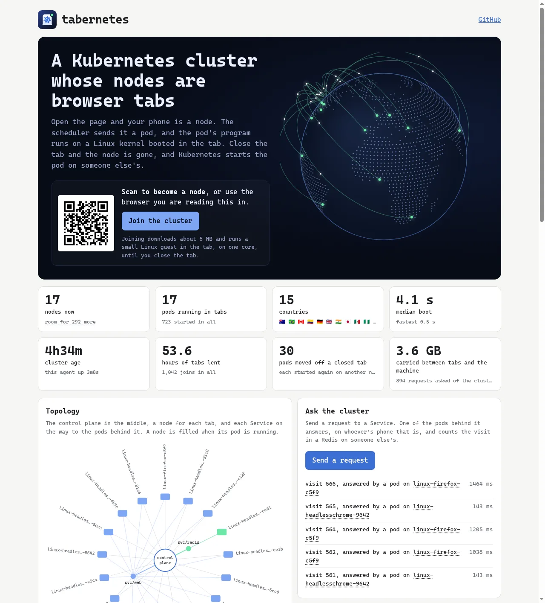
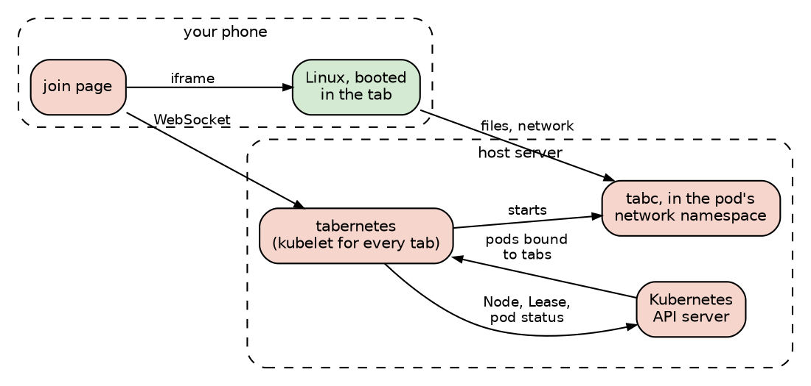

> **tl;dr** [tabernetes](https://github.com/fzakaria/tabernetes) turns browser tabs into real Kubernetes nodes.
> Open [tabernet.es](https://tabernet.es) on your phone to join my live cluster: the scheduler assigns your tab a pod, and it runs on a Linux kernel <u>booted inside the browser</u>.

Ever since I came across [@\_pi0\_](https://x.com/_pi0_)'s work on [unkernel.dev](https://unkernel.dev), it's been a chaotic brain-gasm of ideas about running Linux in unconventional places now that it's economical and practical enough to do even on a phone.[^trynix]

[^trynix]: [trynix.dev](https://trynix.dev) is another project of mine exploring Linux in the browser, which inspired some of my thinking here.

In my [last post]() I introduced [tabc](https://github.com/fzakaria/tabc), a container runtime that runs each container in a browser tab. Feedback to the project and the post were a mix of curiosity and a surprising amount of skepticism about whether this could actually be useful.

What can you do with a container runtime that treats every browser tab as a potential host?
How about create a massive ~~botnet~~ Kubernetes cluster out of people's browsers?

The genesis of the idea came from that `--link` flag in `tabc`. It made me realize that any browser that opens a link could effectively become a host for a container. If you could coordinate multiple browsers, you could orchestrate them like a real cluster.

By default that URL is only bound to localhost, so it's meant for your own browser. Nothing in `tabc` actually cares where the browser lives, though: put a reverse proxy or tunnel in front of it, send the link to a friend, and their laptop runs your container.
{: .aside}

```console
$ tabc run --link alpine uname -m
tabc: open this page to start the container:
  http://127.0.0.1:41873/t/8c1f.../
aarch64
```

If any browser can run a container just by opening a link, then any browser can become a node in "a cluster". The one thing missing is a way to coordinate them all: a scheduler [like Kubernetes](https://kubernetes.io/).

The end result is [tabernet.es](https://tabernet.es), a Kubernetes cluster made out of people's browsers, phones included!

[](/assets/images/tabernetes-dashboard.webp)
{: style="--image-width: 32rem"}

Ready to join? 🧑‍🍳

[](https://tabernet.es/join)
{: style="--image-width: 12rem"}

Go ahead and scan it (or open [tabernet.es/join](https://tabernet.es/join)) and your browser will join my live cluster:

```console
$ kubectl get nodes -o wide
NAME                  STATUS   VERSION        OS-IMAGE                   KERNEL-VERSION           CONTAINER-RUNTIME
pixel-11-pro-3145     Ready    v1.37.2+k3s1   Chrome 158 on Android 17   7.3.4-unkernel (arm64)   tabc://1.0.0
linux-firefox-c5f9    Ready    v1.37.2+k3s1   Firefox 160 on Linux       7.3.4-unkernel (arm64)   tabc://1.0.0
tabernetes            Ready    v1.37.2+k3s1   Ubuntu 24.04.5 LTS         6.12.115 (amd64)         containerd://2.3.7-k3s1
```

That is a real k3s cluster,[^k3s] and `pixel-11-pro-3145` is just the phone in my hand with a browser tab open. 🤯

[^k3s]: I chose to run [k3s](https://k3s.io/) because it is a lightweight Kubernetes distribution and I'm running this on a small [exe.dev](https://exe.dev) instance.


The cluster at the moment is configured with two services: one counting visits and another rendering Mandelbrot tiles.

<video autoplay loop muted playsinline width="800" height="577">
  <source src="/assets/images/tabernetes-picture.mp4" type="video/mp4">
  <a href="/assets/images/tabernetes-picture.mp4">Screencast: the topology of the cluster beside a picture of the Mandelbrot set. A green dot flies from the control plane to a node for each tile, and the picture fills in tile by tile until all 64 are drawn by 5 devices.</a>
</video>

Once you join, your tab displays your pod's live logs and you can even start a shell. Hit "Send a request" or "Render a picture" on the dashboard a few times and watch the tab start churning with activity.[^capacity]

[^capacity]: Please be kind to the server. It is running on a tiny instance with 2 vCPUs and 8 GB of RAM.


[](/assets/images/tabernetes-join.webp)
{: style="--image-width: 18rem"}


## What is a node, anyway?

As far as Kubernetes is concerned, a node is really just two things: a `Node` object in the API server advertising some capacity (_1 CPU, 256 MiB of RAM, Ready_), and a `kubelet` that keeps renewing its lease and starts whatever pods the scheduler binds to it.

There is no rule saying the kubelet has to run on the same physical machine as the workload it manages.[^vk]

[^vk]: [Virtual Kubelet](https://virtual-kubelet.io/) has been doing this for years to make managed cloud container services look like a single giant node.

`tabernetes` is a small Go agent sitting next to the API server that acts as a kubelet for <u>every connected browser tab at once</u>.


{: style="--graphviz-height: 16rem"}

On the Kubernetes side, a pod only needs a single `runtimeClassName: tab` line to land on a browser. Everything else is standard pod YAML:

```yaml
apiVersion: v1
kind: Pod
metadata:
  name: hello
spec:
  runtimeClassName: tab
  containers:
    - name: hello
      image: alpine
      command: ["sh", "-c", "echo hello from $(uname -m); sleep 3600"]
```
{: data-mark="6"}

```console
$ kubectl apply -f hello.yaml
$ kubectl logs hello
hello from aarch64
```

The agent also labels each `Node` with whatever the browser reports about itself: the OS platform, browser name, and device model when available. That means you can target specific devices with a normal `nodeSelector`:

```yaml
spec:
  runtimeClassName: tab
  nodeSelector:
    tabernetes.dev/platform: Android
```
{: data-mark="4"}

That pod will only run on Android phones. 

Swap in `iOS` and you have the world's first Kubernetes workload with a blue-bubble requirement.[^cringe]

[^cringe]: I actually cringed making this joke.


In order to facilitate migrating workloads between the browser and the host, the pod is effectively split in two.

<figure>
<svg viewBox="0 0 640 210" role="img" style="display:block;margin-inline:auto;max-width:40rem;width:100%;height:auto;font-family:var(--mono)"
     aria-label="A pod split in two. The tab holds the pod's CPU and memory: the Linux kernel and the program. The host server holds the pod's files, its pod IP and every network connection it makes. A WebSocket connects them.">
  <g font-size="13" fill="var(--ink)">
    <text x="150" y="20" text-anchor="middle" font-weight="bold" fill="var(--accent)">a browser tab</text>
    <rect x="30" y="34" width="240" height="160" rx="8" fill="none" stroke="var(--accent)" stroke-width="2"/>
    <rect x="50" y="54" width="200" height="34" rx="5" fill="none" stroke="var(--ink)" stroke-width="1.5"/>
    <text x="150" y="76" text-anchor="middle">your program</text>
    <rect x="50" y="96" width="200" height="34" rx="5" fill="none" stroke="var(--ink)" stroke-width="1.5"/>
    <text x="150" y="118" text-anchor="middle">Linux kernel, as wasm</text>
    <text x="150" y="162" text-anchor="middle" fill="var(--ink-muted)">CPU and memory</text>

    <text x="490" y="20" text-anchor="middle" font-weight="bold">the host server</text>
    <rect x="370" y="34" width="240" height="160" rx="8" fill="none" stroke="var(--ink)" stroke-width="1.5"/>
    <rect x="390" y="54" width="200" height="34" rx="5" fill="none" stroke="var(--ink)" stroke-width="1.5"/>
    <text x="490" y="76" text-anchor="middle">image and volumes</text>
    <rect x="390" y="96" width="200" height="34" rx="5" fill="none" stroke="var(--ink)" stroke-width="1.5"/>
    <text x="490" y="118" text-anchor="middle">pod IP 10.244.128.7</text>
    <text x="490" y="162" text-anchor="middle" fill="var(--ink-muted)">files and network</text>

    <line x1="270" y1="114" x2="370" y2="114" stroke="var(--ink-muted)" stroke-width="1.5" stroke-dasharray="5 4"/>
    <text x="320" y="104" text-anchor="middle" font-size="11" fill="var(--ink-muted)">WebSocket</text>
  </g>
</svg>
</figure>

The browser tab supplies the CPU and RAM. Everything else: the container image and volumes, stays on the server.

This is the magic that makes it possible to migrate a stateful service like Redis between different phones without losing its state.[^live-migration]

[^live-migration]: [unkernel.dev](https://unkernel.dev) can actually snapshot a running Linux guest, serialize its memory, and resume it in a completely different browser tab but that requires a graceful shutdown.


## Please don't run prod on my phone

Did this further exploration change any of those eye-rolls from earlier?

Obviously this is not how you should run production but it does make me think of leveraging possibly the world's largest pool of disposable compute: people's phones.[^folding]

[^folding]: This is reminiscent of distributed computing projects like [Folding@home](https://en.wikipedia.org/wiki/Folding@home), where people's personal devices contribute to a larger computational effort.

I continue to be fascinated with exploring what new possibilities arise when running the bedrock component, Linux, in the browser makes possible. It's wild that a single URL is now enough to turn almost any device on earth into a sandboxed Linux compute node in a couple of seconds.

Go join the cluster at [tabernet.es](https://tabernet.es), or check out the [README](https://github.com/fzakaria/tabernetes) if you want to spin up your own.

Sometimes you build the ridiculous version just to see how far the abstraction actually bends.